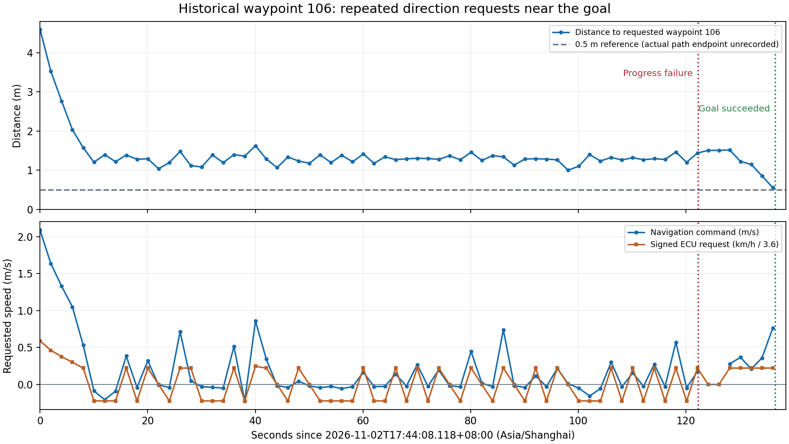

# 11月2日普通航点附近反复前后移动分析

分析日期：2026-11-06。用户确认描述发生于11月2日上次实车测试，地图3b2mus、路线113 → 106 → 107。本文所有时间均为北京时间（Asia/Shanghai）。仅离线读取日志、核对代码并生成本报告；此次未修改车辆控制代码或参数。

后续优化：用户随后授权处理到点振荡，已将GoalCritic启用距离由0.8米改为1.6米，与PathFollow的1.4米形成重叠；42项真实评分器离线检查通过，尚未实车验收。详见 [第一轮优化结果](goal_approach_fix_20261106/RESULT.md)。下文保留修复前配置与历史归因分析，不能将其中0.8米描述当作当前值。

## 结论

日志明确记录了106航点附近约两分钟的前后方向反复切换，定位距原航点大多仍有1米多。最吻合现有证据的解释是：临近目标的路径推进与目标距离评分交接存在空档，允许倒车的控制器持续给出小幅正负修正，而转换层的最低速度补偿将这些小请求抬到0.8 km/h；进度检查又允许往返位移延长任务，因此迟迟不能收敛。

其中，评分交接空档、倒车许可、最低速度补偿和进度检查语义均可由保留配置及本地源码确认；小幅正负命令与0.8 km/h请求有历史数据直接支持。没有保存当时的完整路径末端及逐候选评分，**还不能证明每一帧都命中了评分空档，也不能唯一确定最初触发反向修正的原因**。

普通点位置容差是0.5米，最终朝向基本不限制，也没有停稳等待条件。已有速度单位修复保留了0.8 km/h最低速度补偿，并未处理评分交接问题；尚无修复后实车结果。

## 历史数据

原始目标及导航结果来自 `/home/akun/.ros/log/python3_10311_1793611823820.log`；位置和命令来自本目录 `pose_observer.jsonl`。只使用TF延迟不超过0.3秒的样本；命令统计另外要求cmd、ECU、vehicle各自年龄不超过0.2秒且底盘模式为1。

| 航点 | 首次采样进入原目标2米范围 | 导航成功 | 进入2米后耗时 |
|---|---|---|---:|
| 113 | 17:38:55.769 | 17:39:00.055 | 4.29秒 |
| 106 | 17:44:16.129 | 17:46:24.706 | 128.58秒 |

106重点徘徊段为17:44:18.129—17:46:10.239，持续112.11秒：

- 57个新鲜定位样本，距原目标为约1.000—1.624米。
- 同期导航线速度请求为正23次、为负34次。
- ECU非零前进请求21次、倒退请求29次，零速7次；去掉零速后方向请求切换37次。这是下发请求，不能当成实际换挡反馈次数。
- 57个ECU样本中49个电机速度恰为0.8 km/h。
- 例如17:44:26，导航请求约−0.0404 m/s，ECU请求倒退0.8 km/h，折合约−0.2222 m/s。微小反向修正因而不能按原请求的小速度执行。
- 该112秒段内没有 `Optimizer fail to compute path` 报错。
- 17:46:10.349出现 `Failed to make progress`。之后短暂零速，17:46:16起恢复正向请求，17:46:24.706成功。

上图只有约2秒采样，连线用于观察趋势，不能表示完整控制波形或完整原始里程计。下图ECU正负号由请求档位赋予，不是测得的有符号实车速度。

### 到达范围的证据边界

上面的距离是TF位置到**原始请求航点**的距离。Nav2成功检查实际比较当前全局规划路径的最后一点，MPPI评分还可能比较被裁剪或在换向点截断后的局部路径末端，三者不能直接等同。

历史没有保留这些路径。113和106成功前最后一个2秒采样距原目标分别约0.505和0.553米；采样随后便进入成功结果，不能据此认定车辆始终未进0.5米，也不能精确恢复真实验收点的首次入圈时刻。

## 为什么会来回且持续几分钟

### 1. 向目标推进的两项评分交接不连续

保留配置中：

- `GoalCritic.threshold_to_consider: 0.8`，本地源码仅在距MPPI路径末端小于0.8米时启用目标距离评分。
- `PathFollowCritic.threshold_to_consider: 1.4`，本地源码在距同一末端小于1.4米时退出路径推进评分。

因此距该末端 **[0.8, 1.4)米** 的区间内，两项同时不参与。路径对齐、角度、障碍和约束等其他评分仍可能参与，并非完全没有评分；但直接推动车辆走到终点的约束减弱。106反复停留的原航点距离与此相近，是优先验证的机制。由于局部路径末端没有记录，不能宣布历史逐帧落入该区间。

配置：`nav2/src/nav2/config/nav2_real_params.yaml:278–288,336–341`。源码：`nav2/src/navigation2/nav2_mppi_controller/src/critics/goal_critic.cpp:36–56`、`path_follow_critic.cpp:35–70`；距离判定：`nav2/src/navigation2/nav2_mppi_controller/include/nav2_mppi_controller/tools/utils.hpp:237–257`。

### 2. 允许反向修正，小速度又被最低速度补偿放大

普通控制器允许负线速度，全局规划器采用REEDS_SHEPP，`PreferForwardCritic`关闭。局部修正可以前进，也可以倒退。

当时普通转换器存在m/s与km/h数字直接混用的问题，同时对超过停车阈值、低于低速阈值的请求施加0.8 km/h最低补偿。较大的请求执行偏慢，小请求又可能被抬高，预测和执行很难一致；历史57个样本中49个落在最低请求，说明补偿实际参与了这段控制。

速度单位修复已完成源码及安装更新，详见 [修复结果](speed_units_fix_20261106/RESULT.md)。该修复保留既有0.8 km/h最低速度标定，接近终点的小速度请求仍可能受最低补偿影响。实际硬件能稳定运行的最低速度、停车响应和转向模型需要另行标定，不能直接把最低速度改成零就认定解决。

修复前源码原样备份：`speed_units_fix_20261106/before/real_ws/src/driver/car_control/cmdvel_2_ecu/cmdvel_2_ecu/convert.py`；当前代码：`real_ws/src/driver/car_control/cmdvel_2_ecu/cmdvel_2_ecu/convert.py`。

### 3. 往返移动也会刷新“有进展”的计时

当前 `SimpleProgressChecker` 要求20秒内相对基准位置移动超过0.3米，达到位移就重置基准及计时；它没有要求距离终点持续减小。因此前后移动也能让导航持续。历史没有保存每次基准重置，不能复原具体哪次移动刷新了计时，但代码确认允许这种情况。

普通行为树还允许多次重试和恢复，所以失败后仍可继续一段时间。本次106最终报一次无进展，并于约14.36秒后成功。

源码：`nav2/src/navigation2/nav2_controller/plugins/simple_progress_checker.cpp:56–95`；行为树：`nav2/src/nav2/config/general_nav_to_pose.xml`。

### 4. 普通到点不要求精确对齐车头或等待完全停车

普通行为树明确使用 `general_goal_checker`，其位置容差0.5米、朝向容差6.28弧度。最短角差最多π，因此该朝向设置基本不限制最终车头角度；`SimpleGoalChecker`不检查速度。不能把两分钟徘徊解释成正常的精确对头或停稳等待。

不过规划路径的朝向、换向点和局部角度评分仍可能影响接近过程。没有历史路径，不能由最终朝向容差宽松进一步推断所有朝向相关代价都不起作用。

源码：`nav2/src/navigation2/nav2_controller/plugins/simple_goal_checker.cpp:93–117`；`controller_server.cpp:445–464,601–620`。

## 与之前倒车恢复故障的关系

能明确定位的四次 `backup failed` 均发生在17:52、107航段。用户已补充后方人员可能触发碰撞检查，这四次报警继续保留，暂不作为软件故障证据。

106的这112秒有连续、数值变化的正负局部速度请求，不能把它们全部称为BackUp恢复。Nav2日志为WARN级别，成功的恢复动作未必有日志，因此也不能仅凭没有报错就绝对排除任何短暂BackUp参与。

## 后续处理重点

1. 让路径推进与目标距离评分在接近目标时连续交接，先离线检查目标前后和换向点附近的控制行为。
2. 用已统一的SI单位重新核对最低稳定车速及目标接近策略，使控制器预期的小修正与底盘实际响应一致。不要简单扩大普通到点容差来掩盖徘徊。
3. 复测同时保存原目标、全局和局部路径末端/换向点、完整odom、TF、cmd_vel、ECU、底盘反馈、FollowPath与BackUp状态；据此区分局部前后修正和恢复倒车，并检验修复后的到点耗时。

其他既有问题（里程计速度坐标系、MPPI内部失败重试等）仍按 [MPPI故障分析](MPPI_FAILURE_ANALYSIS.md) 的边界保留；本报告没有将任何一个未验证机制宣布为全部根因。

复算脚本：[analyze_goal_oscillation.py](analyze_goal_oscillation.py)；派生数据及原始文件SHA-256：[goal_oscillation_metrics.json](goal_oscillation_metrics.json)。脚本独立复算结果与另一轮只读日志审阅的主要计数一致。
