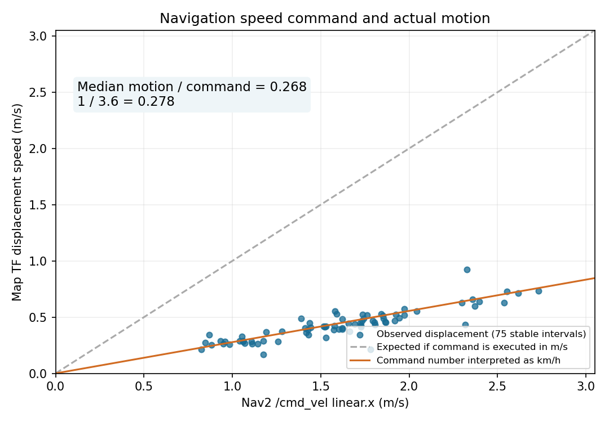

# 直线无障碍路线的 MPPI 失败分析

分析对象：2026-11-02，3b2mus 地图，113 → 106 → 107，任务 `task_1793612181`。分析日期：2026-11-06。本文只分析历史文件和当前源码/安装文件，没有发送车辆命令、启停节点或修改控制参数。

后续处理记录：用户随后授权解决速度单位问题，普通导航换算、物理限速和配套参数已完成源码修复及安装更新，安装版本54项离线测试通过，尚未实车验证。见 [速度单位修复结果](speed_units_fix_20261106/RESULT.md)。下文保留历史问题分析，不代表后续修复后的当前代码；MPPI重试标志和里程计速度坐标系尚未在该修复中改动。

后续重试修复：用户随后授权处理内部重试缺陷，现已清理失败标志与缓存、隔离每周期计数、终止失败批次的控制更新，并保留动态限速；本机编译安装完成，23项专项回归及14项原有单测通过。见 [MPPI重试修复结果](mppi_retry_fix_20261106/RESULT.md)。下文第3节描述修复前代码，不能当作当前状态；里程计速度坐标系问题仍未由此次修复解决。近点GoalCritic评分衔接亦已另行修复，见 [到点优化](goal_approach_fix_20261106/RESULT.md)。

用户补充的现场事实：路线为直线，前方没有障碍物；测试后的运动由人工遥控造成，制动问题排除。后续由现场人工干预，助手不主动发送制动命令。测试后的人工关机也不作为本次导航异常重启证据。

用户于2026-11-06进一步补充：倒车恢复失败可能因为当时人员站在车后。此项按“可能存在真实后方人员障碍，暂不作为软件异常归因证据”记录；保留四次原始报警，但未确认四次均由人员触发。

## 结论及其边界

直接导致导航退出的条件已经查明：MPPI 的碰撞评分器至少在一轮计算中，把整批候选轨迹都判为不可行，内部重试随后失败。最后短距离倒车恢复也未通过碰撞检查，最终 107 航点中止。倒车恢复可能受到车后人员影响，暂不参与软件异常根因判断。

已确认三项软件问题：普通导航速度单位不一致、MPPI 内部失败重试未清除标志、里程计速度坐标系接口不一致。其中速度单位问题得到本次实际导航数据支持。它们分别影响预测与执行的一致性、碰撞失败后的恢复机会和速度初始状态。

但“第一个碰撞判定具体由哪个点/栅格触发”尚未确定。需记录前进优化失败时的完整候选、扫描、TF、轮廓和代价地图；撤回基于四次倒车失败而优先推断车体附近误判的证据链。不能仅凭前方目视空旷，推断软件地图必然为空，也不能把速度单位错误单独宣布为 29 次碰撞失败的全部根因。

## 1. ‘反复优化’与‘优化失败’是两件事

MPPI 本来就要随控制周期反复预测、评分和更新速度，即使道路完全笔直也一样。异常是日志里的 `Optimizer fail to compute path`，全程共 29 次：到 113 的航段 1 次、到 106 的航段 4 次、到 107 的航段 24 次。

当前配置每轮生成 2000 条候选，预测时长为 56 × 0.05 = 2.8 秒。`CostCritic` 和 `ObstaclesCritic` 会在各自判定所有候选碰撞时设置 `fail_flag`。`Optimizer::fallback()` 在失败超过内部重试限额时抛出上述错误。

因此这个报错表示软件认为候选不可通行。判定可能包括致命障碍栅格、轮廓与障碍相交，以及特定配置下的未知/越界条件；现有日志没有区分本次究竟是哪一种。它不能直接证明真实前方有障碍、算法算力耗尽或全局直线路径生成失败。

源码：

- `nav2/src/navigation2/nav2_mppi_controller/src/critics/cost_critic.cpp:143–180,188–220`
- `nav2/src/navigation2/nav2_mppi_controller/src/critics/obstacles_critic.cpp`
- `nav2/src/navigation2/nav2_mppi_controller/src/optimizer.cpp:180–195`

原始日志：`nav2_2026-11-02_17-36-55.log`。

## 2. 已确认：速度命令按错误单位执行

普通导航转换链如下：

1. Nav2 的 `/cmd_vel.linear.x` 单位是 m/s。
2. `convert.py` 普通模式把这个数字经小幅偏置/低速补偿后，直接写入 `Ecu.motor`，未换算为 km/h；对接模式有独立的 3.6 换算。
3. 底盘速度编码以 km/h 数字乘 10 下发。

例如约 1.8 m/s 的指令，会被当成约 1.8 km/h 执行，即约 0.5 m/s。控制器的预测速度和实际执行速度因此不一致。

这不仅来自代码阅读。取正式自动导航期间 75 个相邻约 2 秒的稳定前进区间，排除后续人工遥控，并要求两端命令、ECU、底盘反馈和 TF 新鲜度不超过 0.2 秒、模式为 1、两端指令均大于 0.8、指令变化小于 0.3、两端角速度绝对值小于 0.3：

| 比较量 | 比值中位数 |
|---|---:|
| 地图 TF 位移速度 / Nav2 速度指令 | 0.2682 |
| 理论 km/h 与 m/s 换算系数 | 1 / 3.6 = 0.2778 |
| 地图 TF 位移速度 /（底盘 km/h 反馈 ÷ 3.6） | 1.0015 |

这里实际位移速度来自相邻地图 TF 的平移距离除以时间，**不是**使用存在坐标系疑问的 `/odom.twist` 来自证。2 秒采样和定位修正会引入散布，整体比例与 km/h 执行相符。

数据和筛选条件：`mppi_unit_analysis.json`；原始数据：`pose_observer.jsonl`。

这会造成预测位移与实际位移偏差，并影响修正、恢复及转角执行。但如果内部代价地图完全自由，仅速度单位不一致并不足以解释“所有候选都碰撞”；仍必须查碰撞触发栅格。

普通导航的低速阈值 0.8 实际按约 **0.8 km/h，即 0.222 m/s** 下发，不能称为实车 0.8 m/s 下限。也不能直接只给转换器乘 3.6：那会同时改变现有指令对应的实车速度；后续修复需统一物理目标速度、Nav2 限制、单位换算和运动模型。本次未修改。

源码：

- `real_ws/src/driver/car_control/cmdvel_2_ecu/cmdvel_2_ecu/convert.py:80–129`
- `real_ws/src/driver/car_control/chassis_driver/chassis_driver/src/MsgJD01.cpp:62–80`

## 3. 已确认：失败后的内部重试没有重新评分

调用顺序为：

1. `prepare()` 清除 `fail_flag`。
2. 一轮碰撞评分可能把它置为 true。
3. `fallback(true)` 调用 `reset()`，但 `reset()` 不清除该标志。
4. 下一轮 `CriticManager::evalTrajectoriesScores()` 一开始看到 true，直接跳出，未对新候选评分。
5. 再次进入 fallback 并耗尽重试次数，抛出错误。

这是确定的逻辑缺陷：一次全体候选碰撞后，本次内部重试失去意义。下次新的 `evalControl()` 仍会通过 `prepare()` 清标志，所以不能把全程 29 次错误解释为一个标志始终残留。它放大首次碰撞失败，但没有解释首次碰撞为什么发生。

源码：

- `nav2/src/navigation2/nav2_mppi_controller/src/optimizer.cpp:116–132,146–154,180–213`
- `nav2/src/navigation2/nav2_mppi_controller/src/critic_manager.cpp:67–75`

只读检查当前安装库也支持上述控制流程。历史运行进程加载库的完整校验值未保存，因此不能把当前文件等同于逐字节留存的历史运行镜像。

## 4. 已确认：里程计速度坐标系接口不一致，历史影响尚不能量化

LIO-SAM 把 GTSAM `currentState.velocity()` 直接写入 Odometry 的线速度。该速度是导航坐标系表达；GTSAM 另提供 `bodyVelocity()`。TransformFusion 修改位姿后原样转发 twist。

Nav2 订阅器直接读取 twist 的 x/y，MPPI 把 x 当作车体前向速度。因此这里存在速度坐标系接口错误，可能使预测初始速度不正确。

本轮历史观察器没有保存完整原始 odom 姿态/twist，不能量化当时错误，也不能仅凭 map 航向约 -90° 断言前向速度接近零：map → odom 的旋转也需要计入。后续应明确 child_frame 并进行对应速度变换；涉及雷达/IMU与车体不同原点时，还要处理旋转和角速度造成的速度差，不能只替换变量名。

2026-11-06补查发现本次LIO退出时保存了479个关键帧的位姿，已原样备份到 `odometry_evidence/`；它们没有twist/坐标系消息字段，且ASCII时间已经量化成100秒一档，仍不能代替完整原始里程计。96个已检查录包数据库均无本次测试窗口消息。查找范围、文件字段及限制见 [ODOMETRY_RECORD_SEARCH.md](ODOMETRY_RECORD_SEARCH.md)。

源码：

- `slam/src/LIO-SAM/src/imuPreintegration.cpp:120–125,544–567`
- `/usr/include/gtsam/navigation/NavState.h:39–41,110–111`
- `nav2/src/navigation2/nav2_dwb_controller/nav_2d_utils/include/nav_2d_utils/odom_subscriber.hpp:84–91`
- `nav2/src/navigation2/nav2_mppi_controller/src/optimizer.cpp:268–275`

## 5. 碰撞触发位置待查，倒车恢复暂不参与异常归因

所有候选从同一实测状态开始，第一步使用相同的初始速度和角速度；静止时它们的首个预测位置与当前位置重合。若这一共同位置/附近轮廓被判碰撞，再多候选也可能一起失败。但现有记录没有首个碰撞点索引，不能断言本次就是首点触发。

最后四次倒车恢复也报 `Collision Ahead`。恢复碰撞检查从 t=0 开始，并检查短倒车投影，当前恢复目标距离约 0.3 米。用户补充当时可能有人站在车后，真实人员障碍能够解释倒车被拒绝，因此这四次报警保留为运行事实，暂不视为软件异常证据，也不据此判断当前轮廓被误判碰撞。人员与各次报警是否逐一对应尚未确认。

前进优化失败仍需核查虚假回波、轮廓与实际车体不符、合并扫描的外参/方向/时间配准、局部地图残留栅格及预测越界。具体检查优先级应由前进失败时的首个碰撞点确定。撤回此前利用短倒车失败削弱“MPPI远期预测越界”解释的推断。

另有两个配置不一致项，尚未证明是本次根因：

- 局部代价地图采用 x ±0.27、y ±0.43 米的轮廓，即长 0.54、宽 0.86 米；全局地图采用半径 0.22 米圆形。应按实车尺寸和坐标轴统一。显式 footprint 会取代 robot_radius，二者不是叠加成更大轮廓。
- 局部地图为 15 × 15 米，中心到边界约 7.5 米；MPPI 在最高 3 m/s、2.8 秒预测下可达约 8.4 米。部分高速候选可能越界，但仅凭这两个长度不能确定全部候选失败的原因。倒车恢复单独按可能存在后方人员障碍记录。

局部插件实际只启用了 obstacle_layer 和 inflation_layer；配置文件虽有 static_layer 字段，它未列入局部 plugins。旧静态地图墙体不是直接写入该局部碰撞地图的来源。全局地图对路径的影响仍需单独核查。

源码：

- `nav2/src/nav2/config/nav2_real_params.yaml:232–254,294–313,360–416,443–466`
- `nav2/src/nav2/config/general_nav_to_pose.xml:32`
- `nav2/src/navigation2/nav2_behaviors/include/nav2_behaviors/plugins/drive_on_heading.hpp:192–218`

## 6. 下一步应补的证据与修复顺序

先为失败点记录具体触发信息：哪个碰撞评分器、首个碰撞点索引及坐标、栅格值、是否越界、当时 footprint 和地图边界。同步保存原始前后扫描/合并扫描、TF、原始 odom、局部原始代价地图、路径、候选轨迹、cmd_vel、ECU 和底盘反馈。先通过静止数据或离线回放核对车体周围，无须发出运动或制动命令。

软件修复优先处理已经确定的接口/逻辑错误：统一速度单位及物理限制，修正里程计速度表达，修复 fallback 标志清理。再用实际尺寸统一轮廓和转向模型，并验证候选预测范围与地图大小匹配。不能用降低避障权重替代定位碰撞栅格，因为本次错误来自硬碰撞失败标志，单纯降低权重不能消除该条件。

历史文件没有保存失败瞬间的完整代价地图和每条候选的碰撞索引，故本报告到此保留明确边界：**已找到可复查的软件缺陷，尚不能唯一指定首次碰撞判定的传感器点或栅格。倒车恢复可能受后方人员影响，暂不作为软件异常证据。**
