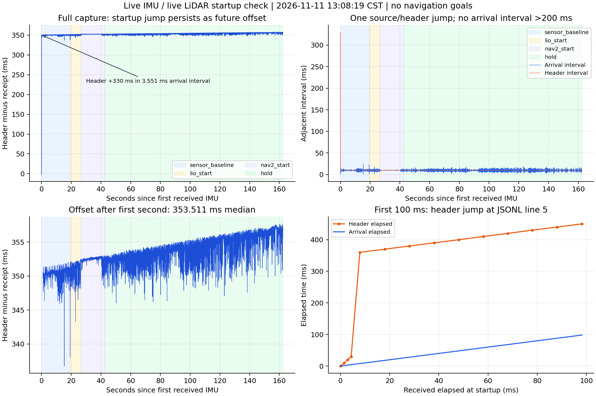

# 真实 IMU 时间与连续性分析（2026-11-11 13:08:19 轮）

范围：离线分析本轮已关闭的 `imu_samples.jsonl`、`imu.log`、四个 LIO 日志及 `result.json`；未更改生产代码、配置或 `result.json`。时间均为北京时间 UTC+8。

本轮收到的 IMU 数据连续，LIO 启动及 Nav2 加载期间没有超过 0.2 秒的接收空洞，也没有 IMU header 回退。仍复现一次启动时 header 跳变，随后 header 持续超前本机接收时间约 0.35 秒；因此“本轮启动通过”不能解释为设备时间同步问题已经解决。

| 指标 | 结果 |
|---|---:|
| IMU 条数 / 实际采样跨度 | 16246 / 162.412 秒 |
| 接收频率 | 100.024 Hz |
| 接收间隔中位 / P99 / 最大 | 10.019 / 13.811 / 24.110 ms |
| header 间隔中位 / 最大 | 10.000 / 330.000 ms |
| 接收间隔 >0.2 秒 / header 间隔 >0.2 秒 / header 非正间隔 | 0 / 1 / 0 |
| header − received 中位 / P99 / 最大 | 353.511 / 357.122 / 357.671 ms |
| 非有限角速度 / 非有限加速度 / 异常四元数范数 | 0 / 0 / 0 |

`header − received` 为正表示消息抵达观察节点时已指向未来。received 使用系统时间，接收间隔用 monotonic；二者相邻间隔差异最大绝对值仅 37.842 μs，没有证据支持这是本机系统时钟的大幅跳变。

| 阶段 | 条数 | 接收 Hz | 接收最大间隔 ms | header 最大间隔 ms | offset 中位 ms | offset 最大 ms |
|---|---:|---:|---:|---:|---:|---:|
| sensor_baseline | 1932 | 100.172 | 24.110 | 330.000 | 350.552 | 352.041 |
| lio_start | 710 | 100.203 | 23.338 | 10.043 | 351.154 | 352.412 |
| nav2_start | 1603 | 100.011 | 13.230 | 10.046 | 352.531 | 353.000 |
| hold | 12001 | 100.003 | 18.179 | 10.045 | 354.330 | 357.671 |

各阶段 header 回退和接收 >0.2 秒空洞均为 0。唯一 header >0.2 秒事件位于传感器基线阶段，先于 LIO-SAM 和 Nav2 启动。

## 唯一 header 跳变的精确样本

| JSONL 行 | received | header | header 间隔 ms | 接收间隔 ms | offset ms | 四元数范数 |
|---|---|---|---:|---:|---:|---:|
| 1 | 13:08:22.125016925+08:00 | 13:08:22.123299510+08:00 | — | — | -1.717415 | 1.000000024 |
| 2 | 13:08:22.126534471+08:00 | 13:08:22.133299510+08:00 | 10.000000 | 1.516706 | 6.765039 | 1.000000058 |
| 3 | 13:08:22.127941460+08:00 | 13:08:22.143299510+08:00 | 10.000000 | 1.406776 | 15.358050 | 1.000000004 |
| 4 | 13:08:22.129385772+08:00 | 13:08:22.153299510+08:00 | 10.000000 | 1.444562 | 23.913738 | 1.000000051 |
| 5 | 13:08:22.132936104+08:00 | 13:08:22.483299510+08:00 | 330.000000 | 3.550643 | 350.363406 | 1.000000110 |
| 6 | 13:08:22.143088957+08:00 | 13:08:22.493299510+08:00 | 10.000000 | 10.152626 | 350.210553 | 0.999999980 |
| 7 | 13:08:22.153150587+08:00 | 13:08:22.503299510+08:00 | 10.000000 | 10.061847 | 350.148923 | 1.000000046 |
| 8 | 13:08:22.163167669+08:00 | 13:08:22.513299510+08:00 | 10.000000 | 10.017003 | 350.131841 | 1.000000050 |

驱动在 `2026-11-11 13:08:22.131081430+08:00` 报一次 `check crc16 failed (imu), total_crc_errors=1`；1.854674 ms 后收到第 5 条消息，header 间隔 330 ms，但实际到达间隔只有 3.550643 ms。这证明本轮该 330 ms 不是观察节点真实停收 330 ms；异常发生在传感器基线，后续形成约 350 ms 的时间戳偏移。

CRC 与跳变发生时间接近属于可重复关联；这些 ROS 消息不包含原始串口帧，不能据此单独证明 CRC 错误造成 header 跳变。本轮没有设备时间戳 reset/non-monotonic 诊断。

## LIO 与关闭日志

- `lio_featureExtraction.log`：2 行；gap/reset/fatal/Indeterminant 相关日志 0，WARN/ERROR/FATAL 0。
- `lio_imageProjection.log`：5 行；gap/reset/fatal/Indeterminant 相关日志 0，WARN/ERROR/FATAL 0。
- `lio_imuPreintegration.log`：2 行；gap/reset/fatal/Indeterminant 相关日志 0，WARN/ERROR/FATAL 0。
- `lio_mapOptimization.log`：2 行；gap/reset/fatal/Indeterminant 相关日志 0，WARN/ERROR/FATAL 0。

预积分 ready 最终为 `True`，曾就绪 `True`，状态变化 1 次，true→false 0 次。本轮没有记录预积分失效或恢复。

IMU 的唯一 short-read 日志出现在 `13:11:47.133140374`，紧随 SIGINT/SIGTERM `13:11:47.127891791`，属于关闭阶段；不应计为采样期间的串口短读。本报告仅分析 `imu_samples.jsonl` 实际覆盖的 2026-11-11 13:08:22.125016925+08:00 至 2026-11-11 13:11:04.536683981+08:00。

与前两轮对照：12:59 轮启动 header 跳 340 ms、offset 中位 359.531 ms；13:05 轮跳 320 ms、offset 中位 353.951 ms，且仅该轮启动前几帧含两个异常四元数。本轮没有异常四元数，但同类 330 ms header 跳变仍出现。

采样第 2–7 秒 offset 中位为 350.320 ms，最后 5 秒为 356.554 ms，增加 6.234 ms。因此未来偏移并非严格常数，另有缓慢漂移；该统计不能单独区分设备振荡器偏差、host 时钟校正和接收延迟变化。
