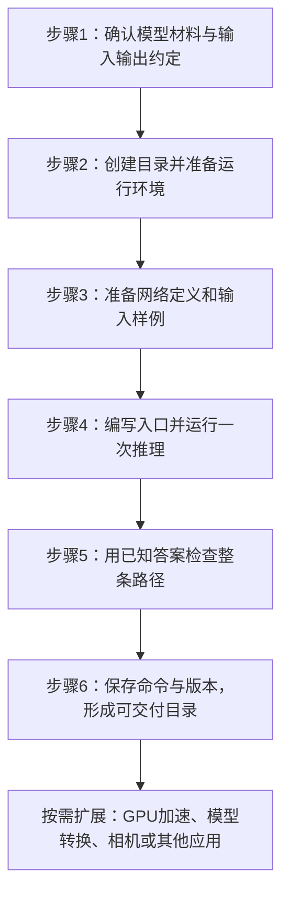

# 深度学习基础与红绿灯识别模块从零部署：零基础详细教程

编写日期：2026-11-05；本次修订日期：2026-11-11。面向读者：会基本使用电脑，但尚不熟悉深度学习、Python 环境和 Jetson 模型部署的开发者。

本教程对应本工作区的 [traffic-light-main 项目](/home/akun/workspace/Car_jetson/traficclight/traffic-light-main)。文中的项目现状由当前代码和 2026-10-29 的构建、部署记录核对；不代表在编写本文时又对远端车辆做了一次部署。

## 如何使用这份教程

正文分为两个部分：

1. **第一部分：深度学习基础与通用部署。** 先弄清数据、神经网络、训练、推理、模型文件和运行环境，再在普通电脑的隔离环境里亲手完成一个小模型的训练、保存、重新加载和 ONNX 推理。
2. **第二部分：本项目红绿灯识别从零部署。** 把第一部分的概念对应到项目，逐步完成代码准备、Jetson 环境检查、独立候选目录、模型准备、离线运行、结果解释和验证。

建议第一次完整阅读，不急着复制全部命令。第二次按自己所在的设备和选定路线执行。文中会用 **学习电脑**、**准备电脑**、**Jetson 维护终端**、**导航主机** 标出命令执行位置。

### 读完并操作后，应当得到什么

- 能用自己的话解释“训练”和“推理”的区别。
- 能看懂图片的尺寸、颜色通道、张量形状和检测框坐标。
- 能理解 PyTorch、CUDA、ONNX、ONNX Runtime、TensorRT 分别做什么。
- 能运行教学小模型，并知道它为什么不能代替交通灯识别模型。
- 能在满足依赖的 Jetson 上，把当前项目作为**独立、有限次数的离线图片识别模块**运行。
- 能区分“程序运行成功”“模型转换一致”“真实红绿灯识别准确”“可以让车辆通行”这四种不同结论。

### 当前项目的边界，先说清楚

目前已有 YOLOv10n 红/绿两类源模型、重建的 TensorRT 候选引擎，以及输出 `RED/GREEN/UNKNOWN` 的独立观察器。新的观察器入口仅接受离线/mock 上下文，输出固定带有 `automatic_release_enabled=false` 和 `control_eligible=false`。

因此，本文中“部署成功”的直接目标是：**给模块一张图片，它能在 Jetson GPU 上完成一次推理，返回可解释的结果，错误情况下也能正确退出或返回未知。** 当前仓库还没有完整的“实时视频接入新观察器 → 导航状态机 → 底盘自动放行”成品；后面的章节会说明这条链路还缺什么。不能通过改两个布尔值把离线观察器变成通行控制器。

### 命令和代码块阅读约定

| 写法 | 含义 |
|---|---|
| `bash` 代码块 | 在 Linux Bash 终端执行。不要复制 Markdown 的三反引号。 |
| `python` 代码块 | Python 源代码；按说明保存为指定文件，或用 `python - <<'PY'` 运行。 |
| `text` / `json` 代码块 | 目录结构、示意输出或配置内容，不一定是终端命令。 |
| `# ...` | Shell/Python 注释，用来解释后面的操作。 |
| `--xxx` | 程序的命令行参数。 |
| `$TL_WORK` 等 | 本教程自定义的 Shell 变量。它只在设置过该变量的终端里有效。 |
| 示例维护账户、示例路径 | 执行前替换；这不是项目预置的登录身份。 |

本文使用 Bash 数组、here-document 和 `set -o pipefail`。用 Bash 执行相应代码块；不要把 Bash 数组命令直接放进 `/bin/sh`。`sudo` 只用于需要系统权限的安装或账户切换；推理本身使用专用账户。

第一次看到 here-document 时，可以这样理解：

```bash
python3 - <<'PY'
print("这段内容由 Python 解释执行")
PY
```

第一行启动 Python；中间是 Python 代码；最后单独一行 `PY` 表示结束。`<<'PY'` 中的引号使 Shell 不会提前展开代码里的 `$` 等字符。

### 阅读导航

- [第一部分：深度学习基础与通用部署](#part-one)
- [第二部分：把本项目的红绿灯识别模块部署到 Jetson](#part-two)
- [附录：复习、常见疑问、验证记录与参考资料](#guide-validation)

### 详细目录

**第一部分**

- [1.1 先把几个容易混淆的词分清楚](#section-1-1)
- [1.2 一个深度学习项目究竟由哪些东西构成](#section-1-2)
- [1.3 数据：模型实际从什么东西里学习](#section-1-3)
- [1.4 图像如何变成神经网络能处理的数字](#section-1-4)
- [1.5 神经网络究竟在“学”什么](#section-1-5)
- [1.6 怎么判断模型“学会了”，以及哪些数字容易误读](#section-1-6)
- [1.7 一个完整入门实验：CPU 上训练一个小神经网络](#section-1-7)
- [1.8 常规深度学习框架如何部署和运行](#section-1-8)
- [1.9 把基础概念对应到本项目 YOLOv10n](#section-1-9)
- [1.10 普通深度学习程序究竟需要哪些运行环境](#section-1-10)
- [1.11 在普通 x86_64 电脑建立 CPU 学习环境](#section-1-11)
- [1.12 一个完整可复现的“PyTorch → ONNX → ONNX Runtime”示例](#section-1-12)
- [1.13 模型文件格式、权重和检查点怎样区分](#section-1-13)
- [1.14 从准备数据到接入应用：每一步交付什么](#section-1-14)
- [1.15 性能与数值精度：为什么模型快了，应用仍可能慢](#section-1-15)
- [1.16 第一部分自检：把概念对应到自己的文件](#section-1-16)

**第二部分**

- [2.1 先认清本次运行的模块和设备分工](#section-2-1)
- [2.2 准备四种材料，并确认模型约定](#section-2-2)
- [2.3 确认目标系统，给尚未装系统的设备安排前置步骤](#section-2-3)
- [2.4 从准备电脑打包资料，并复制到 Jetson](#section-2-4)
- [2.5 准备系统工具、Python 库和匹配的 GPU 框架](#section-2-5)
- [2.6 创建专用运行账户、venv 和 GPU 访问权限](#section-2-6)
- [2.7 建立本轮工作目录，并定义统一运行函数](#section-2-7)
- [2.8 先检查软件逻辑，再确认 GPU 真正可用](#section-2-8)
- [2.9 为模型构建固定依赖、源文件和调用参数](#section-2-9)
- [2.10 第一步模型转换：从源 PT 导出 ONNX](#section-2-10)
- [2.11 构建 TensorRT engine：把 ONNX 变成 Jetson 可执行的候选模型](#section-2-11)
- [2.12 验证三种模型表示，并固定本轮模型身份](#section-2-12)
- [2.13 第一次通过独立观察器入口运行离线识别](#section-2-13)
- [2.14 使用真实图片，并从外到内读懂观察报告](#section-2-14)
- [2.15 理解 ROI、开发阈值和结果可视化](#section-2-15)
- [2.16 从程序运行到真实效果：建立分层验证](#section-2-16)
- [2.17 只有现有模型不够用时，才进入重新训练](#section-2-17)
- [2.18 从离线图片到实时导航，还缺哪些模块](#section-2-18)
- [2.19 按固定顺序排错，并正确记录性能](#section-2-19)
- [2.20 保存本轮成果，并判断下一步从哪里继续](#section-2-20)
- [附录：复习、常见疑问、验证记录与参考资料](#guide-validation)

---

<a id="part-one"></a>

## 第一部分：深度学习基础与通用部署

这一部分先建立概念，再用一个很小的程序走完“准备数据 → 定义模型 → 训练 → 验证 → 保存 → 重新加载 → 推理”的过程。
你不需要先学会高等数学，也不需要先有 NVIDIA 显卡。
示例先在普通电脑的 CPU 上运行，目的是把每一步的作用看清楚；第二部分再把同一套思路对应到 Jetson 上的红绿灯检测。

<a id="section-1-1"></a>

### 1.1 先把几个容易混淆的词分清楚

#### 1.1.1 人工智能、机器学习、深度学习、计算机视觉的关系

| 名称 | 它在解决什么问题 | 容易理解的例子 |
|---|---|---|
| 人工智能，AI | 让计算机完成一些通常需要智能判断的工作，是一个很大的范围 | 路径规划、规则推理、语音识别、图像识别 |
| 机器学习，ML | 从样本里学习输入与输出之间的关系 | 给很多已知房价的数据，让程序学习房屋面积与价格的关系 |
| 深度学习，DL | 主要使用多层神经网络进行机器学习 | 用大量已标注图片训练红绿灯检测网络 |
| 计算机视觉，CV | 从图像、视频中提取信息 | 找到红绿灯、读车牌、判断人在哪里 |

可以把深度学习理解为机器学习中的一类方法。
计算机视觉是一类应用问题，它既可以使用传统图像处理，也可以使用深度学习。
例如，“判断图像里红色像素的数量”可以完全用 OpenCV 和人工规则实现，不一定需要训练神经网络。

#### 1.1.2 传统规则与深度学习的区别

传统规则的红色识别可能这样写：

```text
读取图片
→ 转换到 HSV 颜色空间
→ 选择红色范围
→ 找连通区域
→ 检查区域大小和形状
→ 认为满足条件的区域可能是红灯
```

这些条件由人明确设计。
在光照、曝光、距离、背景变化不大的条件下，它可能很好用；遇到红色广告牌、尾灯、夕阳时，人可能还需要继续补规则。

深度学习的做法是给模型很多示例：哪些区域是红灯，哪些是绿灯，哪些背景不应被当成灯。
训练程序不断调整模型内部的数字参数，让输出逐渐接近标注答案。
模型仍然会犯错，且错误不一定能用一条直观规则解释，因此需要独立数据验证。

两类方法也可以组合：神经网络先产生候选框，后面的程序再按照置信度、位置、大小、来源可靠性进行筛选。
本项目的 `detector.py` 就包含这样的后处理筛选。

#### 1.1.3 分类、目标检测、分割有什么区别

| 任务 | 典型输入 | 典型输出 | 对红绿灯的意义 |
|---|---|---|---|
| 图像分类 | 一张图片或已裁好的灯图 | `red` 或 `green` | 回答这张小图主要是什么，不直接回答灯在哪里 |
| 目标检测 | 一张道路图片 | 多个框，每个框有坐标、类别、分数 | 回答画面中哪里有红灯、绿灯 |
| 语义分割 | 一张道路图片 | 每个像素的类别 | 精细划出交通灯、道路、天空等区域 |
| 实例分割 | 一张道路图片 | 每个物体各自的像素区域 | 区分两个不同的交通灯，并画出各自轮廓 |
| 目标跟踪 | 连续多帧 | 目标 ID 和随时间变化的位置 | 判断多帧中是否是同一盏灯 |

本项目选择的是**目标检测**。
模型候选结果除了灯色，还有目标框和分数。
“检测到绿灯”和“应该让车辆起步”是不同层次的判断：前者描述图像，后者还要结合目标属于哪个方向、图像是否新鲜、车辆处于哪个导航阶段等信息。

<a id="section-1-2"></a>

### 1.2 一个深度学习项目究竟由哪些东西构成

#### 1.2.1 不只有一个“模型文件”

一个可复现、可使用的深度学习应用，通常至少包含以下内容：

1. **任务定义**：到底分几类、检测什么、未知情况如何表达。
2. **数据与标注**：输入样本以及人工确认的答案。
3. **网络结构**：由哪些计算层构成，各层输入输出是什么。
4. **权重参数**：通过训练得到的大量数字。
5. **预处理**：如何裁剪、缩放、调整颜色通道、转换数据类型。
6. **后处理**：如何解释输出、筛选目标、还原坐标。
7. **运行环境**：Python、框架、驱动、GPU 运行库、相关版本。
8. **验证与发布信息**：类别表、输入输出约定、校验值、精度报告。

只有一份 `.pt` 或 `.engine` 文件，通常不足以确保另一台设备上的结果正确。
如果红绿类别顺序错了，程序可能正常运行，却把红灯解释成绿灯。
如果 BGR/RGB 顺序错了，程序也可能不报错，但识别质量下降。

#### 1.2.2 训练与推理：两种不同工作

```text
训练：图片 + 正确答案 → 网络预测 → 计算误差 → 调整权重 → 重复很多次

推理：新图片 + 已训练权重 → 网络预测 → 输出结果
```

训练阶段要保存中间结果并计算梯度，通常比单次推理占更多内存和计算资源。
推理阶段通常不更新模型参数。
因此，可以在一台工作站训练，再把训练好的模型交给 Jetson 做推理。
这不要求 Jetson 一边开车一边重新训练。

本项目当前的部署主线是**使用已有权重进行转换和推理**。
“从零部署”指从准备环境开始把既有模型运行起来，不等于从随机权重开始重新训练一套红绿灯模型。
如果以后需要适应新灯型、新镜头或新场景，才进入数据采集、重新训练或微调的工作。

#### 1.2.3 迁移学习、预训练和微调

从随机参数开始训练一个视觉模型，可能需要较多数据和训练资源。
常见做法是先使用在较大数据集上训练过的网络参数，再用自己的任务数据继续训练，这叫迁移学习或微调。
一般希望复用已经学到的边缘、纹理、形状等表达能力，再学习本任务的类别和特点。

不要把“用了预训练模型”理解成“它天然认识本项目全部交通灯”。
真正适合本项目的类别、标注定义、数据分布和验证结果仍需要检查。
本项目 `2025_7_24.pt` 具体经历过怎样的历史训练，应以可找到的训练记录为准，不能只凭文件名推断。

<a id="section-1-3"></a>

### 1.3 数据：模型实际从什么东西里学习

#### 1.3.1 样本、特征、标签、标注

- **样本**：一个训练或验证实例。视觉任务中通常是一张图片及其答案。
- **特征**：输入里用于判断的信息。二维点示例中是 `x1`、`x2`；图像网络中最初是像素，后面是网络学习出的表示。
- **标签**：答案，例如类别 `red`。
- **标注**：给样本补充答案的过程及结果；检测任务还要标目标框。
- **类别表**：类别编号与文字名称的对应关系，例如 `0=red, 1=green`。
- **负样本**：不含目标但仍有训练价值的图片，例如没有交通灯的道路、尾灯、广告牌。

同一张道路图中有两盏灯时，检测标签可能包含两行，而不是只给整张图片一个 `red`。
标注规则还要明确：框住整个灯壳，还是只框住发光区域；远处很小的灯是否标；遮挡灯如何标。
这些规则会影响模型学到什么，也会影响后处理面积阈值的含义。

#### 1.3.2 训练集、验证集、测试集分别做什么

| 数据集 | 训练时是否据此更新权重 | 用途 |
|---|---|---|
| 训练集，train | 是 | 让模型学习 |
| 验证集，validation/val | 否 | 选择训练轮次、调阈值、比较方案 |
| 测试集，test | 否 | 在方案基本确定后做最终的独立评估 |

假设有 10,000 张图片，可以初步考虑 7,000 张训练、1,500 张验证、1,500 张测试。
这个比例只是入门示例，并非所有项目的固定要求。
真正重要的是数据是否独立、是否覆盖使用环境、各类别和困难情况是否足够。

如果反复查看测试集结果并据此改模型、改阈值，这部分数据实际上也参与了开发决策。
此时最好再准备新的独立测试集，避免对最终效果过于乐观。

#### 1.3.3 视频项目尤其容易发生数据泄漏

假设从同一个路口视频每秒抽取 10 帧，再把这些图片完全随机分到训练集和测试集。
那么相隔 0.1 秒的两帧可能分别出现在两边，背景、目标位置甚至噪声都非常相似。
模型在测试中的高分可能主要反映“见过几乎同样的画面”。

更合理的划分单位往往是完整视频片段、一次采集行程、一个路口或一个日期。
例如：

```text
训练：A 路口白天的视频、B 路口白天的视频
验证：C 路口视频，以及 A 路口另外一天的独立采集
测试：D 路口、夜间、逆光和雨天等预先保留的独立采集
```

是否跨路口划分取决于最终使用目标，但必须明确记录。
增强出来的图片也应与原图留在同一个划分里，不能让原图在训练集、它的翻转副本在测试集。

#### 1.3.4 数据增强与真实覆盖

常见增强包括亮度变化、轻微缩放、裁剪、噪声和模糊，用来让模型适应一定的变化。
增强应保持标签的实际含义；改变颜色过多可能把红灯变成与真实任务不一致的样子。
水平翻转对某些带箭头或左右方向语义的任务也需要特别考虑。

增强不能代替真实夜间、逆光、远距离、多个方向灯同时出现的数据。
如果训练集没有这些情况，仅仅把已有白天图片复制很多次，通常不能证明模型已经适应真实困难场景。

<a id="section-1-4"></a>

### 1.4 图像如何变成神经网络能处理的数字

#### 1.4.1 像素、分辨率、通道

一张宽 1280、高 720 的彩色图像，可以看作一个形状为 `(720, 1280, 3)` 的数字数组。
这里顺序是**高、宽、通道数**，即 `HWC`。
常见的 8 位图像每个通道取值为 0～255，数据类型写作 `uint8`。

三个通道并不是“三张不同照片”，而是同一位置的三个颜色分量。
对于 RGB 顺序，一个纯红像素可以写成 `[255, 0, 0]`。
对于 BGR 顺序，同一个纯红像素写成 `[0, 0, 255]`。

OpenCV 常见的彩色读图接口得到 BGR 排列；本项目当前模型清单要求 RGB。
因此，本项目在预处理时需要进行 BGR → RGB 转换。
“同样是三个通道”并不意味着顺序可以互换。

#### 1.4.2 Tensor、shape、dtype、device

Tensor，中文常译为“张量”，这里可以先理解为可以在 CPU 或 GPU 上计算的多维数组。
查看一个张量时，优先看四件事：

| 属性 | 表示什么 | 本项目输入示例 |
|---|---|---|
| `shape` | 每个维度多大 | `[1, 3, 640, 640]` |
| `dtype` | 每个元素的数据类型 | `float32` |
| `device` | 数据位于哪里 | CPU 内存或 CUDA GPU 内存 |
| 数值范围与含义 | 数字怎么解释 | RGB 像素值除以 255 后通常位于 0～1 |

`[1, 3, 640, 640]` 是 `NCHW`：

- `N=1`：一次送入 1 张图，称为 batch size 为 1。
- `C=3`：红、绿、蓝三个通道。
- `H=640`：图像高度为 640。
- `W=640`：图像宽度为 640。

这份输入共有 `1 × 3 × 640 × 640 = 1,228,800` 个元素。
FP32 每个元素 4 字节，输入数据本身约为 4.92 MB，即约 4.69 MiB。
这只是输入缓冲区大小，不是整个网络的总内存需求；权重、中间特征、执行工作区和输出还要额外占用内存。

#### 1.4.3 归一化不只是“换个数据类型”

把 `uint8` 转为 `float32`，原值 255 仍然是 255.0。
再除以 255.0，才得到 1.0。

例如，一个 BGR 像素是 `[10, 20, 200]`：

```text
BGR uint8       [10, 20, 200]
RGB uint8       [200, 20, 10]
RGB float32     [200.0, 20.0, 10.0]
除以 255.0      [0.784314, 0.078431, 0.039216]
```

有的模型还会减均值、除以标准差；有的要求 -1～1；有的使用 NHWC。
必须遵守对应模型训练与导出的约定。
不能因为网上另一个示例用了某种处理，就直接加到本项目里。

本项目当前清单明确要求 RGB、NCHW、FP32、除以 255，不额外使用 ImageNet 均值和标准差归一化。

#### 1.4.4 resize、拉伸与 letterbox

模型要求 640×640，并不意味着原图必须是正方形。
常见选择有：

1. 直接拉伸成正方形：实现简单，但物体长宽比例改变。
2. 先裁成正方形再缩放：保持比例，但可能裁掉目标。
3. 按比例缩放，再补边：保持完整图像和长宽比，叫 letterbox。

本项目使用第三种。
假设不裁 ROI，原图为 1280×720：

```text
目标尺寸：640×640
缩放比例：min(640/1280, 640/720) = 0.5
缩放后宽高：640×360
左右补边：0
上下各补边：(640-360)/2 = 140
```

当前模型使用的补边像素值是 114。
除以 255 后，补边对应约 0.447059。
补边不是实际道路内容，因此坐标还原时要扣除它，且不能把补边里的候选目标当成真实有效目标。

#### 1.4.5 把模型框坐标还原到原图：一个完整数值例子

继续使用上面的 1280×720 图像。
假设模型在 640×640 输入中的框是：

```text
[x1, y1, x2, y2] = [300, 180, 340, 220]
```

先减补边，再除缩放比例：

```text
原图 x1 = (300 - 0) / 0.5 = 600
原图 y1 = (180 - 140) / 0.5 = 80
原图 x2 = (340 - 0) / 0.5 = 680
原图 y2 = (220 - 140) / 0.5 = 160
```

所以原图上的框是 `[600, 80, 680, 160]`，宽 80、高 80。
原图归一化坐标是 `[600/1280, 80/720, 680/1280, 160/720]`，约为 `[0.46875, 0.111111, 0.53125, 0.222222]`。
这里 `x` 向右增大，`y` 向下增大，原点在图像左上角。

如果先裁剪 ROI，还要再加上 ROI 在原图中的左上角偏移。
例如原图 1280×720、ROI 为 `(0.25, 0.25, 0.75, 0.75)`，裁剪起点是 `(320, 180)`，裁剪区域宽 640、高 360。
该区域 letterbox 到 640×640 的比例为 1，上下各补 140。
模型框 `[100, 190, 140, 230]` 还原后得到原图框 `[420, 230, 460, 270]`。

真实代码还涉及整数像素取整，缩放后实际宽高可能与理想小数值有一点差别。
因此，应该保存实际裁剪边界、实际 resize 尺寸和补边值来还原，不能只凭理想比例猜测。
本项目 `detector.py` 已处理这些变换，调用它时不需要在外面再重复还原一次。

#### 1.4.6 xyxy 与 YOLO 标注的 xywh 不相同

目标框常见两种写法：

```text
xyxy：左上角 x、左上角 y、右下角 x、右下角 y
xywh：中心点 x、中心点 y、宽、高
```

YOLO 文本标注常见的是归一化 `class_id center_x center_y width height`。
对于 1280×720 原图里的框 `[600, 80, 680, 160]`：

```text
中心点：(640, 120)
宽高：(80, 80)
归一化中心点：(0.5, 0.1666667)
归一化宽高：(0.0625, 0.1111111)
若类别是 red 且 red=0，标签行可写为：
0 0.5 0.1666667 0.0625 0.1111111
```

这条训练标签不能直接当成本项目 engine 的输出解析。
本项目输出列是像素 `xyxy + confidence + class_id`，具体应以模型清单为准。

<a id="section-1-5"></a>

### 1.5 神经网络究竟在“学”什么

#### 1.5.1 从一个神经元开始

一个最简单的神经元会计算：

```text
z = w1 × x1 + w2 × x2 + b
output = activation(z)
```

其中 `x1`、`x2` 是输入，`w1`、`w2` 是权重，`b` 是偏置。
权重和偏置都是参数，通过训练调整。
激活函数提供非线性，例如 ReLU 的规则为 `max(0, z)`。

例如 `w1=0.8, w2=-0.3, b=0.1`，输入 `x1=0.5, x2=0.2`：

```text
z = 0.8×0.5 - 0.3×0.2 + 0.1 = 0.44
ReLU(z) = 0.44
```

这本身并不会理解红绿灯。
大量计算单元按一定结构组合，再经过数据训练，才可能形成有用的映射。

#### 1.5.2 层、网络结构、参数和超参数

| 名称 | 含义 | 例子 |
|---|---|---|
| 层，layer | 一组计算操作 | 卷积层、全连接层、激活层 |
| 网络结构，architecture | 各层如何连接 | 一个 2→16→16→2 的小网络；YOLOv10n |
| 参数，parameters | 训练直接更新的数字 | 卷积核、全连接权重、偏置 |
| 超参数，hyperparameters | 开发者设置的训练或模型选项 | 学习率、batch size、训练轮数、隐藏层宽度 |

学习率不是模型自己在普通训练里自动学出来的一个像素特征，它控制每次参数更新的幅度。
参数数量多，通常意味着更大的存储和计算需求，但不能单凭参数数量判断实际速度或精度。
硬件、输入尺寸、算子实现、内存访问和计算精度都会影响运行速度。

#### 1.5.3 卷积为什么适合处理图像

卷积可以先理解为一个小窗口在图片上滑动，每到一个位置就对局部数值做加权求和。
同一组权重在不同位置重复使用，帮助识别不同位置出现的局部图案。

一个纯数值示例：

```text
局部图像：        卷积核：
1 2 3            1  0 -1
4 5 6            1  0 -1
7 8 9            1  0 -1

逐项相乘后相加：
1×1 + 2×0 + 3×(-1)
+4×1 + 5×0 + 6×(-1)
+7×1 + 8×0 + 9×(-1) = -6
```

这个固定小核仅用于展示计算方式。
真正的网络卷积核通常由训练学习，并且有多个输入和输出通道。
不能保证“第一层一定识别边缘、最后一层一定认识灯壳”，这只是帮助理解的常见直观描述。

#### 1.5.4 损失、梯度、反向传播和优化器

网络先输出预测，损失函数把“预测偏离答案的程度”变成一个数。
训练的目标通常是让训练损失下降，同时保持独立数据上的表现。

以最简单的平方误差为例：

```text
模型：y_hat = w × x
样本：x = 2，正确答案 y = 4
当前 w = 1，所以 y_hat = 2
损失 L = (y_hat-y)^2 = 4
对 w 的梯度 dL/dw = 2×(w×x-y)×x = -8
学习率 lr = 0.1
新 w = 旧 w - lr×梯度 = 1 - 0.1×(-8) = 1.8
新的预测为 3.6，新的损失为 0.16
```

真实网络有很多参数，自动求导框架负责按链式法则计算梯度，这个过程通常叫反向传播。
优化器根据梯度更新参数；常见优化器有 SGD 和 Adam。
上面的一个数值例子不能说明所有训练都必然每一步降低损失；复杂任务中损失可能波动。

分类示例常用交叉熵损失。
PyTorch 的 `CrossEntropyLoss` 接收未经 softmax 的分数，即 logits，以及整数类别标签。
因此下面的训练代码不会先对输出手动 softmax，再交给交叉熵。

#### 1.5.5 epoch、batch、step

假设训练集有 1000 个样本，batch size 为 64：

- 一次取最多 64 个样本一起计算，叫一个 batch。
- 完成一次前向、损失、反向和更新，通常叫一个训练 step。
- 把整个训练集遍历一遍，叫一个 epoch。
- 不丢弃最后一个 batch 时，一个 epoch 有 `ceil(1000/64)=16` 个 batch，最后一个包含 40 个样本。
- 训练 60 个 epoch，约进行 960 次参数更新。

batch size 不是摄像头帧率。
epoch 不是推理次数。
推理时也可以 batch=1，而训练使用更大的 batch。

#### 1.5.6 训练模式、评估模式与关闭梯度

在 PyTorch 中，下面三个概念分别处理不同问题：

| 写法 | 作用 |
|---|---|
| `model.train()` | 将 Dropout、BatchNorm 等层切换到训练行为 |
| `model.eval()` | 将这些层切换到评估行为 |
| `with torch.no_grad():` | 在代码块中不记录反向传播需要的梯度计算图 |

`model.eval()` 本身不会关闭梯度。
`torch.no_grad()` 本身不会把层切到评估行为。
正式推理通常两者都用；也可以在合适情况下用 `torch.inference_mode()` 进一步减少推理开销。
本入门网络没有 Dropout 或 BatchNorm，仍然显式写出正确的模式切换，便于以后换成更复杂网络。

官方接口说明：[Module.train/eval](https://docs.pytorch.org/docs/stable/generated/torch.nn.Module.html)、[no_grad](https://docs.pytorch.org/docs/stable/generated/torch.no_grad.html)。

<a id="section-1-6"></a>

### 1.6 怎么判断模型“学会了”，以及哪些数字容易误读

#### 1.6.1 欠拟合、过拟合与分布变化

| 现象 | 可能看到的表现 | 优先检查 |
|---|---|---|
| 欠拟合 | 训练和验证都表现不好 | 数据标签、模型能力、训练是否充分、预处理是否正确 |
| 过拟合 | 训练很好，验证明显差 | 数据太少或不独立、模型过大、训练过久、缺少合理增强 |
| 分布变化 | 旧验证集很好，新路口或新镜头明显变差 | 光照、灯型、距离、视角、清晰度、采集设备和环境差异 |

训练 loss 降低不等于真实部署效果提升。
需要一起观察验证指标、错误样本以及场景覆盖。
最直观的检查常常是把误识别、漏识别图片找出来，看它们有哪些共同特点。

#### 1.6.2 confidence 不是 accuracy

假设某一帧输出“red，confidence=0.92”。
这个 0.92 是模型对这一候选的分数，不是“整个系统有 92% 准确率”。
它也不天然意味着在本路口 100 个此分数的结果里恰好有 92 个正确；这种对应关系需要概率校准和实际验证。

accuracy 是在一批带有正确答案的数据上统计出来的指标。
confidence 是单个输出附带的分数。
把阈值从 0.5 提到 0.8，可能减少一部分错误候选，也可能丢掉真实但低分的灯，需要根据数据比较。
“阈值越高越安全”也不能简单成立，因为漏识别同样会影响系统行为。

#### 1.6.3 TP、FP、FN 与 precision、recall

先用单一“红灯目标”说明：

- TP，真正例：真的有红灯，检测结果在规定位置和类别条件下正确匹配。
- FP，假正例：报告了一个红灯，但它是背景、别的目标、错误类别或无法匹配的多余框。
- FN，假负例：真实红灯没有被正确检出。

如果一组图像有 100 个标注红灯，正确检出 80 个，还额外误报 20 个：

```text
TP=80，FP=20，FN=20
Precision = TP/(TP+FP) = 80/100 = 80%
Recall    = TP/(TP+FN) = 80/100 = 80%
```

若改阈值后正确检出 60 个、误报 5 个：

```text
Precision = 60/(60+5) ≈ 92.31%
Recall    = 60/(60+40) = 60%
```

第二个结果更“少误报”，但也漏掉了更多真灯。
这两个指标需要结合看，不能只挑一个好看的数字。

#### 1.6.4 目标框还需要检查位置：IoU

IoU 是预测框与标注框的交集面积除以并集面积：

```text
IoU = 交集面积 / (预测框面积 + 标注框面积 - 交集面积)
```

两个 100×100 的框，一个为 `[0,0,100,100]`，另一个为 `[50,0,150,100]`：

```text
交集 = 50×100 = 5000
并集 = 10000+10000-5000 = 15000
IoU = 5000/15000 ≈ 0.3333
```

如果该项评价要求 IoU≥0.5，即使类别对了，这两个框也不能算成功匹配。
目标检测里一个标注目标通常只匹配一个预测框，重复报告同一目标的额外框会影响指标。
具体匹配规则、忽略区域、最大检测数量等要以所用评测实现为准。

#### 1.6.5 AP、mAP 是什么

在多个置信度阈值下统计 precision 与 recall，可以形成一条精确率—召回率曲线。
AP 可以理解为按指定规则对这条曲线计算面积。
mAP 是多个类别 AP 的平均；不同协议还可能对多个 IoU 阈值取平均。

`mAP@0.5` 与 `mAP@0.5:0.95` 不应当作同一个指标比较。
前者通常使用 IoU=0.5，后者通常还包括更严格的多个 IoU 条件。
报告 mAP 时，应该同时说明数据集、类别、IoU 协议、样本数量和是否独立测试。
一个模型在通用公开数据上的 mAP，不能直接当成本项目真实路口红绿灯的验收结果。

#### 1.6.6 混淆矩阵：特别关注红绿互相误认

下面是一个**人为构造的两类分类统计例子**，用于说明矩阵怎么看，不是本项目的实测成绩：

| 真实类别 \ 预测类别 | 预测 red | 预测 green | 行合计 |
|---|---:|---:|---:|
| 真实 red | 48 | 2 | 50 |
| 真实 green | 5 | 45 | 50 |
| 列合计 | 53 | 47 | 100 |

正确分类共有 `48+45=93` 次，accuracy 为 93%。
但整体 93% 会掩盖两个不同错误：2 次红灯被说成绿灯，5 次绿灯被说成红灯。
这些错误对导航决策的影响不同，因此需要分别统计。

本项目还会输出 `UNKNOWN`。
验收时应把未知率、无灯误报、多个目标冲突、红误绿等情况单独列出来。
检测任务完整的混淆矩阵还需要考虑框匹配与背景项，不能只照搬上面的整图分类表。

<a id="section-1-7"></a>

### 1.7 一个完整入门实验：CPU 上训练一个小神经网络

#### 1.7.1 这个实验要学什么

我们让网络看一个二维点 `(x1, x2)`，判断它属于哪种区域：

```text
同号区域：左下角 (-1,-1)、右上角 (1,1) → 类别 0，名称 same_sign
异号区域：左上角 (-1,1)、右下角 (1,-1) → 类别 1，名称 opposite_sign
```

每个点会加入少量随机偏移，形成四团数据。
这种类似 XOR 的任务不能仅用一条直线把两个类别完全分开，适合展示隐藏层与非线性的作用。
程序通过样本学习，而不是把“同号/异号的规则”写到 `forward()` 里。

这是**二维点分类教学模型**，不处理照片，不检测红绿灯，保存的权重不能替代本项目 `2025_7_24.pt`。
它的价值在于让你亲手完成一个完整的训练和部署闭环。

#### 1.7.2 在普通 Ubuntu/x86_64 电脑建立独立目录

以下命令用于学习用的 CPU 环境，**不要把这段 CPU PyTorch 安装命令用于替换 Jetson 的项目环境**。
Jetson 的 NVIDIA 定制 PyTorch、CUDA、TensorRT 配套方式在第二部分另讲。

终端命令里的 `$HOME` 表示当前用户的主目录；它不是需要原样创建的文件夹名。
每个代码块里的命令按行执行，出现错误时先处理该步，再继续。

```bash
mkdir -p "$HOME/dl-beginner-lab"
cd "$HOME/dl-beginner-lab"
unset PYTHONPATH PYTHONHOME
python3 --version
python3 -m venv .venv
source .venv/bin/activate
python -m pip --version
```

如果 Ubuntu 提示缺少 `venv` 或 `ensurepip`，可先安装对应 Python 的 venv 包；对于 Ubuntu 默认 Python，常用命令是：

```bash
sudo apt-get update
sudo apt-get install python3-venv
```

然后重新执行创建虚拟环境的命令。
`source .venv/bin/activate` 只影响当前终端；以后新开终端，需要重新进入目录并激活。
使用虚拟环境的目的，是让这个教学实验的依赖与其他项目分开。这里在专门的学习终端清除 PYTHONPATH/PYTHONHOME，避免已经加载的 ROS/Conda 路径注入；不要在正在运行车辆项目的终端里照做。

安装固定版本的 CPU PyTorch：

```bash
python -m pip install torch==2.7.1 --index-url https://download.pytorch.org/whl/cpu
python -c "import torch; print('torch=', torch.__version__); print('cuda_available=', torch.cuda.is_available())"
```

这里固定 2.7.1 是为了提供一个可复现的教学环境，并不是宣称它是最新版本。
本例不需要 `torchvision`、`torchaudio`、OpenCV 或下载图片数据集。
CPU 版本下 `cuda_available=False` 是预期结果。
固定版本与 CPU 安装来源可参考 [PyTorch 官方历史版本安装页](https://pytorch.org/get-started/previous-versions/)。

#### 1.7.3 创建完整程序

在 `dl-beginner-lab` 中新建 `tiny_dl_demo.py`，复制下面全部内容。
程序既支持 `train` 训练，也支持在另一个进程中执行 `predict` 推理。

```python
from pathlib import Path
import argparse

import torch
from torch import nn
from torch.utils.data import DataLoader, TensorDataset


CLASS_NAMES = ["same_sign", "opposite_sign"]
FEATURE_NAMES = ["x1", "x2"]


def make_data(count, seed):
    """生成相互独立的四团数据；返回 X[count,2] 与 y[count]。"""
    generator = torch.Generator().manual_seed(seed)
    centers = torch.tensor([
        [-1.0, -1.0],
        [1.0, 1.0],
        [-1.0, 1.0],
        [1.0, -1.0],
    ], dtype=torch.float32)
    cluster_ids = torch.randint(0, 4, (count,), generator=generator)
    noise = 0.25 * torch.randn(count, 2, generator=generator)
    features = centers[cluster_ids] + noise
    labels = (cluster_ids >= 2).to(torch.long)
    return features, labels


class TinyClassifier(nn.Module):
    def __init__(self, hidden_size=16):
        super().__init__()
        self.network = nn.Sequential(
            nn.Linear(2, hidden_size),
            nn.ReLU(),
            nn.Linear(hidden_size, hidden_size),
            nn.ReLU(),
            nn.Linear(hidden_size, 2),
        )

    def forward(self, features):
        return self.network(features)


def evaluate(model, features, labels, loss_function):
    model.eval()
    with torch.no_grad():
        logits = model(features)
        loss = loss_function(logits, labels).item()
        predictions = logits.argmax(dim=1)
        accuracy = (predictions == labels).float().mean().item()
    return loss, accuracy


def load_checkpoint(path):
    # 只载入本实验自己生成、来源可信的文件。
    checkpoint = torch.load(path, map_location="cpu", weights_only=True)
    if checkpoint["format_version"] != 1:
        raise ValueError("不支持的教学 checkpoint 版本")
    if checkpoint["class_names"] != CLASS_NAMES:
        raise ValueError("类别顺序与程序不一致")
    if checkpoint["feature_names"] != FEATURE_NAMES:
        raise ValueError("输入特征顺序与程序不一致")
    model = TinyClassifier(hidden_size=checkpoint["hidden_size"])
    model.load_state_dict(checkpoint["model_state_dict"])
    model.eval()
    return model, checkpoint


def train(output_path):
    torch.manual_seed(2026)
    torch.set_num_threads(1)
    train_x, train_y = make_data(1000, seed=100)
    val_x, val_y = make_data(240, seed=200)
    test_x, test_y = make_data(240, seed=300)
    loader = DataLoader(
        TensorDataset(train_x, train_y),
        batch_size=64,
        shuffle=True,
        generator=torch.Generator().manual_seed(400),
    )

    model = TinyClassifier(hidden_size=16)
    loss_function = nn.CrossEntropyLoss()
    optimizer = torch.optim.Adam(model.parameters(), lr=0.01)
    best_val_loss = float("inf")
    output_path.parent.mkdir(parents=True, exist_ok=True)

    parameter_count = sum(p.numel() for p in model.parameters())
    print(f"device=cpu, train={len(train_y)}, val={len(val_y)}, test={len(test_y)}")
    print(f"parameters={parameter_count}")

    for epoch in range(1, 61):
        model.train()
        total_loss = 0.0
        correct = 0
        for features, labels in loader:
            optimizer.zero_grad(set_to_none=True)
            logits = model(features)
            loss = loss_function(logits, labels)
            loss.backward()
            optimizer.step()
            total_loss += loss.item() * labels.numel()
            correct += (logits.argmax(dim=1) == labels).sum().item()

        train_loss = total_loss / len(train_y)
        train_accuracy = correct / len(train_y)
        val_loss, val_accuracy = evaluate(model, val_x, val_y, loss_function)

        if val_loss < best_val_loss:
            best_val_loss = val_loss
            torch.save({
                "format_version": 1,
                "model_state_dict": model.state_dict(),
                "hidden_size": 16,
                "class_names": CLASS_NAMES,
                "feature_names": FEATURE_NAMES,
                "best_epoch": epoch,
                "validation_loss": val_loss,
            }, output_path)

        if epoch == 1 or epoch % 10 == 0:
            print(
                f"epoch={epoch:02d} "
                f"train_loss={train_loss:.4f} train_acc={train_accuracy:.3f} "
                f"val_loss={val_loss:.4f} val_acc={val_accuracy:.3f}"
            )

    best_model, checkpoint = load_checkpoint(output_path)
    test_loss, test_accuracy = evaluate(best_model, test_x, test_y, loss_function)
    print(f"best_epoch={checkpoint['best_epoch']}")
    print(f"test_loss={test_loss:.4f}, test_acc={test_accuracy:.3f}")
    print(f"saved={output_path.resolve()}")


def predict(checkpoint_path, x1, x2):
    model, checkpoint = load_checkpoint(checkpoint_path)
    features = torch.tensor([[x1, x2]], dtype=torch.float32)
    with torch.no_grad():
        logits = model(features)
        probabilities = torch.softmax(logits, dim=1)[0]
        class_id = int(probabilities.argmax().item())
    print(f"input_shape={list(features.shape)}, dtype={features.dtype}")
    print(f"class_id={class_id}, class_name={checkpoint['class_names'][class_id]}")
    print(f"scores={probabilities.tolist()}")


def main():
    parser = argparse.ArgumentParser(description="CPU 深度学习入门：二维点分类")
    subparsers = parser.add_subparsers(dest="command", required=True)
    train_parser = subparsers.add_parser("train")
    train_parser.add_argument("--output", type=Path, default=Path("artifacts/tiny_classifier.pt"))
    predict_parser = subparsers.add_parser("predict")
    predict_parser.add_argument("--checkpoint", type=Path, default=Path("artifacts/tiny_classifier.pt"))
    predict_parser.add_argument("--x1", type=float, required=True)
    predict_parser.add_argument("--x2", type=float, required=True)
    args = parser.parse_args()
    if args.command == "train":
        train(args.output)
    else:
        predict(args.checkpoint, args.x1, args.x2)


if __name__ == "__main__":
    main()
```

#### 1.7.4 运行训练

```bash
python tiny_dl_demo.py train
```

输出中首先应该看到：

```text
device=cpu, train=1000, val=240, test=240
parameters=354
```

然后会打印第 1、10、20、30、40、50、60 轮的指标。
一般会看到 loss 明显下降，验证和测试准确率接近 1.0。
因为这个教学数据很简单，接近 100% 也不代表它具备真实视觉任务的难度。
运行耗时取决于 CPU、环境和系统负载，不能拿这里的速度推算 YOLO 在 Jetson 上的速度。

本文在临时隔离 CPU 环境实际运行过这份完整程序：Python 3.10.12、PyTorch 2.7.1+cpu，354 个参数，训练进程含启动约 2.36 秒；独立测试集 240 个样本准确率为 1.000，四个象限的独立进程预测均符合预期。这个成绩只适用于容易分开的合成点数据，不能迁移为交通灯模型指标。不同机器的精确耗时和浮点末位可能不同。


最终应产生：

```text
dl-beginner-lab/
├── .venv/
├── tiny_dl_demo.py
└── artifacts/
    └── tiny_classifier.pt
```

如果只有 loss 数字而没有最终保存提示，先检查程序是否中途报错。
不要从一次运行的末尾截掉错误后，就当作模型已经保存成功。

#### 1.7.5 退出训练进程后重新加载推理

下面每条命令都是新启动的 Python 进程。
它们会创建网络结构、加载刚才保存的参数，再预测一个点：

```bash
python tiny_dl_demo.py predict --x1 -1.0 --x2 -1.0
python tiny_dl_demo.py predict --x1 1.0 --x2 1.0
python tiny_dl_demo.py predict --x1 -1.0 --x2 1.0
python tiny_dl_demo.py predict --x1 1.0 --x2 -1.0
```

期望前两条主要输出 `same_sign`，后两条主要输出 `opposite_sign`。
`input_shape=[1, 2]` 表示 1 个样本、每个样本 2 个特征。
`scores` 的第 0 个数对应 `same_sign`，第 1 个数对应 `opposite_sign`，两者相加接近 1。
这里同样不能把 softmax 分数直接解释成经过真实校准的可信概率。

也可以试试没有训练样本聚集在附近的点：

```bash
python tiny_dl_demo.py predict --x1 0.0 --x2 0.0
python tiny_dl_demo.py predict --x1 100.0 --x2 -100.0
```

模型仍可能给出很高的分数，但这些输入与四团训练数据的关系已经不同。
这说明“程序能输出一个类别”和“输出在该场景里可靠”需要分开验证。
通用分类器不会因为输入超出经验范围，就自动返回 `UNKNOWN`；未知处理通常还需要专门设计。

#### 1.7.6 把代码逐段对应回概念

| 程序部分 | 做了什么 | 对应概念 |
|---|---|---|
| `make_data()` | 生成点和整数标签 | 样本、特征、标签、随机种子 |
| 三次不同 seed 的 `make_data()` | 生成不同数据集合 | 训练、验证、测试隔离 |
| `TensorDataset`、`DataLoader` | 按 batch 取训练数据 | 批处理、打乱顺序 |
| `TinyClassifier` | 定义 2→16→16→2 网络 | 结构、隐藏层、非线性 |
| `CrossEntropyLoss` | 对比分数和真实类别 | 损失函数 |
| `Adam(..., lr=0.01)` | 管理参数更新 | 优化器、学习率 |
| `zero_grad()` | 清理上一次梯度 | 避免默认的梯度累积 |
| `logits = model(features)` | 做一次预测计算 | 前向传播 |
| `loss.backward()` | 计算损失对参数的梯度 | 自动求导、反向传播 |
| `optimizer.step()` | 根据梯度改变参数 | 学习、参数更新 |
| `evaluate()` | 关闭梯度并评估 | 验证，不学习答案 |
| 最低验证 loss 时保存 | 选择某个 epoch 的权重 | 模型选择 |
| 最后只评一次 test | 用独立集合看最终表现 | 独立测试 |
| `state_dict()` | 取出参数和相关状态张量 | 模型权重 |
| `load_state_dict()` | 把权重装进相同结构 | 恢复模型 |

354 个参数可以手工核对：

```text
第一层 Linear(2,16)：2×16 个权重 + 16 个偏置 = 48
第二层 Linear(16,16)：16×16 个权重 + 16 个偏置 = 272
第三层 Linear(16,2)：16×2 个权重 + 2 个偏置 = 34
合计：48+272+34 = 354
```

保存文件还包含类别顺序、输入特征顺序和隐藏层大小。
这些信息相当于一份简化的“模型契约”。
本项目的 `model_manifest.json` 则把同样的思想扩展到模型哈希、图像预处理、输入输出形状和运行环境。

本例只保存推理需要的信息，没有保存 Adam 优化器状态等内容。
如果要从中断处精确继续训练，通常还需要保存优化器、调度器、epoch、随机数状态等训练状态。
保存整个 Python 对象与保存 `state_dict` 的兼容性要求也不同；文件扩展名 `.pt` 本身不能告诉你内部到底存了什么。
参见 [PyTorch 模型保存和加载教程](https://docs.pytorch.org/tutorials/beginner/basics/saveloadrun_tutorial.html)。

#### 1.7.7 做几个有观察目标的小实验

每次修改都保留原程序副本，记录修改项与输出，避免同时改很多东西后不知道是谁产生影响。

1. 把学习率从 `0.01` 改成 `0.00001`，观察 60 轮后是否仍没学充分。
2. 把训练轮数改为 1，观察早期结果。
3. 移除两处 `ReLU()`，看看只有线性层串联的网络对四团 XOR 数据的限制。
4. 把噪声从 `0.25` 提高到 `0.9`，观察类别区域重叠后，损失和准确率的变化。
5. 故意交换 `CLASS_NAMES` 顺序，理解同一编号为何会被解释成另一个名字。
6. 用新文件保存不同实验模型，比较验证数据，不要只比较训练准确率。

第三项的关键原因是多个线性变换的串联仍可合成为一个线性变换。
第四项的数据标签由生成中心决定；噪声大时，两类在坐标上可能明显重叠，单靠坐标也无法完美区分。
因此“模型不可能达到 100%”有时是任务信息本身不足，不一定是代码错误。

#### 1.7.8 常见入门报错

| 报错或现象 | 常见原因 | 处理方法 |
|---|---|---|
| `No module named torch` | 当前 Python 不是安装包的那个环境 | 看 `python -m pip --version`，重新激活 `.venv` |
| `FileNotFoundError` 指向 `.pt` | 还没训练成功、目录不对或路径不对 | 先训练，或用 `--checkpoint` 明确指定模型文件 |
| `size mismatch` | 加载时网络结构与保存时不同 | 核对隐藏层大小、层名与 checkpoint |
| `expected ... Long` | 交叉熵标签类型不对 | 类别索引使用 `torch.long`，不是浮点标签 |
| 验证时仍在反向传播 | 混淆训练与评估过程 | 看清 `evaluate()` 的 `eval()` 与 `no_grad()` |
| loss 变成 `nan` | 非法输入、学习率过大或数值问题 | 先恢复原示例，检查输入是否有限，再逐项改动 |
| softmax 结果是两个数 | 这是两个类别的输出 | 按保存的类别表解释，不能把两个数当两个目标 |

运行完后，用下面命令退出虚拟环境：

```bash
deactivate
```

退出只改变当前终端的 Python 选择，不会删除环境或模型。

<a id="section-1-8"></a>

### 1.8 常规深度学习框架如何部署和运行

上一节已经训练了一个二维点分类器，并把结果保存成 `tiny_classifier.pt`。现在假设训练程序已经退出，你希望另开一个程序，输入 `(-1, -1)`，让它使用学到的参数给出类别。

这就是我们这一节要完成的最小部署任务。**部署**指把预测所需的代码、模型文件、运行环境和数据约定准备好，使模型能在指定设备上被正确调用。它可以发生在同一台学习电脑上，也可以发生在另一台电脑或 Jetson 上。

本节继续沿用 1.7 的同一个小模型，先讲全程和文件结构，再按顺序构建一个独立的预测目录。例子只需普通电脑的CPU（通用处理器），不需要相机或显卡。等这条路径跑通，再说明加速工具和实际应用接入分别加在哪一步。

#### 1.8.1 先明确目标：部署后具体要得到什么

我们希望最终能执行一条命令：

```text
python predict.py --input samples/same_sign.json --output outputs/same_sign.json
```

它的含义是：让 Python 运行 `predict.py`，从 `--input` 指定的文件读取一个二维点，使用保存好的模型计算类别，再把结果写入 `--output` 指定的文件。
这两个 `--...` 是**命令行参数**，是人在启动程序时传给程序的设置；它们不是模型参数，也不是需要学习的权重。
现在先理解目标，文件会在后面的步骤中逐个创建，暂时不要运行这条命令。

以 `(-1, -1)` 为例，部署完成后会发生：

```text
输入文件：{"features": [-1.0, -1.0]}
                ↓
程序创建网络，载入训练好的参数
                ↓
把两个输入数交给网络，做一次前向计算
                ↓
将输出分数解释成类别编号和名称
                ↓
输出文件：class_id 为 0，class_name 为 same_sign
```

这里没有损失函数、反向传播或优化器更新：普通推理使用已有参数，并不重新学习。
模型对新输入也可能判断错，因此还要检查已知样例，并在真实任务上评估准确率。

#### 1.8.2 总流程：先看地图，再逐步执行

先记住主线中的六步。后面的步骤标题会与这里一一对应。



| 步骤 | 要解决的问题 | 完成后得到什么 |
|---|---|---|
| 1. 确认材料与约定 | 用哪个模型？接收什么？输出编号代表什么？ | 结构与权重匹配，输入和类别含义清楚 |
| 2. 准备目录与环境 | 文件放哪里？用哪个 Python？需要安装什么？ | 独立目录和可导入 PyTorch 的环境 |
| 3. 准备结构与样例 | 怎样还原训练时的网络？怎样表示新输入？ | `model.py` 和固定输入样例 |
| 4. 运行推理入口 | 谁负责加载、计算、解释和保存结果？ | `predict.py`，以及一次完整输出 |
| 5. 核对结果 | 是仅仅没报错，还是输入输出真的对应正确？ | 已知样例的核对记录 |
| 6. 整理交付 | 换终端或交给别人后，还能照着运行吗？ | 说明、版本记录、模型和启动命令 |

前六步完成后，就是一条可以复现的基础部署路径。**模型转换与 GPU 加速是可选扩展**，不用在刚开始时同时安装所有相关工具。

接下来先认文件，再做步骤1；这样后面看到某个文件名时，你会知道它为何存在。

#### 1.8.3 预期项目结构：每个文件负责哪件事

本节将建立下面这个教学目录。它与 1.7 的训练目录分开，专门演示“已有权重的预测部署”。
样例和结果使用JSON这种带字段名的纯文本数据格式；稍后会给出它的具体内容与读取方法。
以下是完成后的预期结构，现在还不需要手工建立所有文件：

```text
point-inference-demo/
├── README.md                    # 运行说明：别人怎样安装、启动和核对结果
├── requirements.txt             # 程序直接依赖的 Python 软件包及版本
├── model.py                     # 网络结构定义，与训练时保持相同
├── predict.py                   # 预测入口，负责把整个过程串起来
├── models/
│   └── tiny_classifier.pt       # 从1.7复制来的权重和模型约定
├── samples/
│   ├── same_sign.json           # 同号点输入样例：[-1, -1]
│   └── opposite_sign.json       # 异号点输入样例：[-1, 1]
├── outputs/
│   ├── same_sign.json           # 第一次运行后生成的结果
│   └── opposite_sign.json       # 第二次运行后生成的结果
├── records/
│   ├── environment.txt         # Python、系统和设备记录
│   └── packages.txt            # 运行环境内实际安装的软件包版本
└── .venv/                      # 本项目在运行机器上创建的 Python 虚拟环境
```

这些文件不是互不相关的材料，而是分工合作：

- **`model.py` 说明“怎样计算”。** 它定义输入经过哪些网络层、各层有多大。Python 源代码就是程序员写的可读指令，通常保存为 `.py` 文件。
- **`tiny_classifier.pt` 提供“用哪些学好的数值计算”。** 训练学到的数值叫参数或权重。这份教学文件还保存隐藏层大小、类别顺序等信息。只有网络结构而没有训练权重，通常得到的只是随机初始化的模型。
- **`predict.py` 说明“本次预测怎样开始和结束”。** 它是入口程序：读取输入、调用网络、解释输出并保存结果。模型不会主动打开输入文件或向用户展示答案，需要这段应用代码把流程接起来。
- **`samples/` 是输入，`outputs/` 是结果。** 两边文件名都可以叫 `same_sign.json`，但它们位于不同目录，内容和用途不同。
- **`requirements.txt` 记录依赖。** 依赖是程序需要调用的外部软件包；例如本节要调用 PyTorch 提供的网络层与张量运算。
- **`.venv/` 放运行环境，`records/` 记录它。** 环境是当前机器上实际安装的软件，记录是帮助以后重建环境的文字资料。
- **`README.md` 把使用方法写给人看。** 它解释应该在哪个目录运行哪些命令、应看到什么输出，以及这个模型不能做什么。

大项目往往还会拆出 `preprocess.py`、`configs/` 和 `tests/`。它们分别保存输入处理代码、可调整设置、自动检查代码。
本节输入只有两个数，约定已随权重保存，所以先放在 `predict.py` 和权重中，避免为了目录复杂而拆文件。第二部分的真实图像项目会有更细分的角色。

`train.py` 与整套训练数据不出现在这里，是因为本例部署已经训练好的模型。若要继续训练，才需要补齐相应的训练程序、数据和训练状态。

#### 1.8.4 步骤1：确认手里的材料与输入输出约定

先确认已完成 1.7，且学习电脑上有：

```text
$HOME/dl-beginner-lab/tiny_dl_demo.py
$HOME/dl-beginner-lab/artifacts/tiny_classifier.pt
```

`$HOME` 是当前用户的主目录，不是名叫“$HOME”的文件夹。本节所有 `$HOME/...` 都跟随当前用户。
如果你此前使用了别的训练目录，应在复制模型那一步改成实际路径。没有训练文件时，应先回到 1.7 完成实验；不要随便找一个同样叫 `.pt` 的文件替代。

**网络结构与权重必须配套。** 1.7 的结构是 `2 → 16 → 16 → 2`，并在隐藏层使用 ReLU。前后数字表示每层接收或输出多少个数；本节会复用相同结构和层名，才能逐项放回已保存的参数。
`.pt` 只是常见的 PyTorch 文件后缀，里面可能是参数字典、检查点或完整对象；本例已知它是由 1.7 保存的字典，不能据此假设项目里所有 `.pt` 都能用同一种方式读取。

接着写清**输入输出约定**，也就是程序和模型之间共同遵守的数据规则：

| 项目 | 本例约定 | 为什么需要明确 |
|---|---|---|
| 原始输入 | 两个数字，按 `x1`、`x2` 的顺序排列 | 顺序是模型输入含义的一部分 |
| 模型输入形状 | `[1, 2]` | 1条样本，每条2个特征 |
| 模型输入类型 | `float32` | 网络按32位浮点数计算 |
| 计算设备 | CPU | 输入和网络都放在CPU上 |
| 原始输出 | `[1, 2]` 的两个类别分数 | 不是两个物体，也不是两个输入值的结果 |
| 类别顺序 | `0=same_sign`，`1=opposite_sign` | 分数本身不携带中文含义 |
| 人可读输出 | 类别编号、类别名称、两个分数 | 由预测程序解释和保存 |

**张量（tensor）**可以先理解为带有形状和数值类型的多维数字数组。`shape` 是形状，例如 `[1, 2]`；`dtype` 是数字类型，例如 `float32`；`device` 是数据所在的计算设备，例如 CPU。
这几个词不代表额外的软件，而是描述一份输入数据的属性。

对于图像，输入约定会再增加图片尺寸、RGB/BGR颜色顺序、像素范围和缩放方法。RGB/BGR分别表示红绿蓝通道的排列顺序，顺序错了就会改变网络看到的颜色。
这些处理通常称为**预处理**，作用是把原始图片整理成模型能按约定理解的张量。相关数字示例见1.4；本节只需把两个数整理成 `[1, 2]`。

这一步完成的标志是：你能明确说出“我用哪份权重、搭配哪个结构、准备怎样的输入，以及如何解释输出”。

#### 1.8.5 步骤2：创建目录，再准备对应的运行环境

先在**普通 Linux/x86_64 学习电脑**的专用终端执行。下面用于 CPU 教学，不能用来覆盖 Jetson 已有的 GPU 环境。
沿用1.7的Python 3.10或3.11教学环境，先用 `python3 --version` 确认；如果版本不同，先按1.11确认匹配的Python与安装包，不要升级车辆项目来迁就这个例子。
本节假设 `point-inference-demo` 是新建的教学目录；如果已有自己的同名文件，先选另一个新目录，并相应替换后文路径。

```bash
mkdir -p "$HOME/point-inference-demo"
cd "$HOME/point-inference-demo"
mkdir -p models samples outputs records
cp "$HOME/dl-beginner-lab/artifacts/tiny_classifier.pt" models/tiny_classifier.pt
```

这里 `mkdir -p` 创建目录，已有时保留其内容；`cd` 切换当前目录；`cp` 将训练产物复制到预测目录。复制后，预测程序就不必再依赖训练目录的位置。

接下来解释为什么还要准备环境。**Python 解释器**是实际读取和执行 `.py` 程序的软件；**PyTorch**是程序调用的一套神经网络计算工具，通常称为深度学习框架。
它既能用于训练，也能直接执行已训练模型的预测。安装时软件包叫 `torch`，代码里写 `import torch`，讨论框架时通常说“PyTorch”，这些名称指向同一套工具。
TensorFlow是另一套常见框架，Keras提供搭建和使用网络的高层接口。它们也需要“代码、模型、环境、输入输出约定”这套部署材料，但具体加载接口和模型文件不同；不能把 `.pt` 改后缀就当作另一种框架的模型。本节选用PyTorch贯穿示例，框架之间的进一步比较见1.10。

同一台电脑可能有多个 Python，也可能有多个项目需要不同版本的包。**虚拟环境（venv）**为本项目提供独立的软件包目录，避免随意覆盖其他项目的依赖。
它并不模拟一台新电脑，也不会自动改变CPU架构。常见PC的处理器架构叫 `x86_64`，Jetson是 `aarch64`/ARM64，二者需要各自匹配的安装包。

在当前目录新建 `requirements.txt`，内容如下。它是依赖清单，不是 Python 源码，不要在终端里逐行执行文件内容：

```text
torch==2.7.1
numpy==2.2.6
```

`==` 表示固定版本。NumPy是常见的数值数组库，PyTorch可以与它交换数组；虽然本例没有直接调用NumPy函数，这里把这一常用配套版本一起固定，便于复现实验环境。
这两行记录直接使用或配套的包，安装时还会自动带入它们需要的其他依赖。它不是保证任何操作系统都可使用的完整锁文件。

然后依次执行：

```bash
cd "$HOME/point-inference-demo"
unset PYTHONPATH PYTHONHOME
python3 -m venv .venv
source .venv/bin/activate
python -m pip install torch==2.7.1 --index-url https://download.pytorch.org/whl/cpu
python -m pip install -r requirements.txt
python -m pip check
```

每一步的目的如下：

1. `unset ...` 仅在这个专用学习终端清除可能由ROS等注入的Python路径，避免其他项目的软件包混入；不要在正在运行车辆任务的终端这样操作。
2. `python3 -m venv .venv` 创建环境目录，不会训练或加载模型。若系统缺少 `venv` 支持，按1.7或1.11安装对应的 `python3-venv` 后再继续。
3. `source .venv/bin/activate` 让当前终端优先找到这个环境里的Python；它只影响当前终端。
4. `python -m pip install ...` 用当前Python对应的安装工具pip安装包；`--index-url` 指定本次从PyTorch官方CPU包源获取框架。
5. `-r requirements.txt` 让pip读取清单补齐依赖。刚安装的 `2.7.1+cpu` 满足清单的 `2.7.1` 要求，因此不会因为这一步改成GPU版。
6. `pip check` 检查已安装依赖的版本关系，正常时输出 `No broken requirements found.`；它不会替我们测试模型准确率。

这里固定PyTorch 2.7.1用于复现，不表示它是最新版。CPU包的官方历史命令见[PyTorch历史版本页面](https://pytorch.org/get-started/previous-versions/)，虚拟环境的用途见[Python venv文档](https://docs.python.org/3/library/venv.html)。

检查真正运行的是哪个环境：

```bash
python - <<'PY'
import sys
import torch

print("Python:", sys.executable)
print("Inside venv:", sys.prefix != sys.base_prefix)
print("PyTorch:", torch.__version__)
print("Test tensor:", torch.tensor([1.0, 2.0]) * 2)
print("CUDA usable:", torch.cuda.is_available())
PY
```

应看到Python路径位于 `point-inference-demo/.venv/bin/python`，`Inside venv` 为 `True`，测试张量数值为2和4。
CPU教学环境的 `CUDA usable` 为 `False` 是正常结果；CUDA是NVIDIA GPU计算所用的软件体系，本节暂时不使用。
到此只证明环境可以计算，还没有证明权重能加载或输入输出正确。

#### 1.8.6 步骤3：准备网络定义与固定输入样例

前面复制的是学到的参数。现在需要代码说明“这些参数应该放进哪种网络”。
在 `point-inference-demo` 目录新建 `model.py`，复制下面的完整内容：

```python
from torch import nn


class TinyClassifier(nn.Module):
    def __init__(self, hidden_size=16):
        super().__init__()
        self.network = nn.Sequential(
            nn.Linear(2, hidden_size),
            nn.ReLU(),
            nn.Linear(hidden_size, hidden_size),
            nn.ReLU(),
            nn.Linear(hidden_size, 2),
        )

    def forward(self, features):
        return self.network(features)
```

它与1.7中的 `TinyClassifier` 定义保持一致，只是移动到独立文件。`nn` 是PyTorch提供神经网络层的模块；`Linear`是全连接层，`ReLU`提供非线性变换，`Sequential`表示把这些层按顺序连接起来。
`forward()` 定义输入怎样经过网络，后面调用 `model(features)` 时，PyTorch会按这个定义计算。
这里不会训练：新建结构后，下一步还要把保存的权重装进去，替换随机初始化的参数。

接着创建两个输入文件。本节用 **JSON** 保存样例，它是一种常见的纯文本数据格式，使用键名和值表达数据，方便程序读取；它不是深度学习专用格式。

新建 `samples/same_sign.json`：

```json
{"features": [-1.0, -1.0]}
```

新建 `samples/opposite_sign.json`：

```json
{"features": [-1.0, 1.0]}
```

`features` 是我们约定的字段名，表示模型输入特征；值是按 `x1`、`x2` 排列的两个数。
样例没有告诉程序正确类别。推理只接收输入；我们人在核对时知道前者应是 `same_sign`、后者应是 `opposite_sign`。

到此目录中已有结构代码、权重、依赖清单和输入。还缺把这些材料串起来的入口程序。

#### 1.8.7 步骤4：编写入口，完整追踪一次推理

先看入口要做的事，再读代码：

```text
读取 --input、--checkpoint、--output 这几个命令行参数
→ 从JSON读出两个数字，并检查格式
→ 读取模型文件中的权重和约定
→ 创建相同网络，把训练好的参数装进去
→ 设置推理模式，把输入变成 [1, 2] 的 float32 张量
→ 前向计算，得到两个类别的原始分数
→ 将原始分数转换成易于比较的两个分数，再选出最大者
→ 根据编号查类别名，打印并保存JSON结果
```

代码中的 `checkpoint` 指保存下来的模型资料，这里就是1.7生成的字典；`state_dict` 是其中保存网络权重及相关状态的部分。
`torch.load()` 把磁盘资料读回程序，`load_state_dict()` 再把权重放进已创建的网络。这是不同的两件事。
本例只加载自己刚生成的可信教学文件，并且明确使用 `weights_only=True`；不应把它当成加载项目任意历史完整对象检查点的通用脚本。

另外有两项推理设置需要区分：

- `model.eval()` 切换网络中某些层的工作方式。例如Dropout在训练时随机屏蔽部分输出，推理时应关闭这种随机屏蔽；Batch Normalization用于对层内数据做标准化，推理时通常使用训练时保存的统计量。本例没有这两类层，也仍保留规范的推理设置。
- `torch.inference_mode()` 关闭普通推理不需要的梯度跟踪等开销；它不会自动替你调用 `eval()`，也不会更新模型参数。

`logits` 是网络尚未归一化的两个类别分数；后面的 `softmax` 将它们转为非负、总和约为1的两个分数，`argmax` 再选择分数最高者的编号。它们用于解释网络输出，不会重新训练网络。
创建网络、加载权重和设置推理模式的关系可对照[PyTorch保存与加载教程](https://docs.pytorch.org/tutorials/beginner/basics/saveloadrun_tutorial.html)。

在 `point-inference-demo` 新建 `predict.py`，复制下面完整内容：

```python
import argparse
import json
import math
from pathlib import Path

import torch

from model import TinyClassifier


# 用程序文件所在位置定位默认权重，避免默认权重路径随终端目录改变。
PROJECT_DIR = Path(__file__).resolve().parent


def main():
    parser = argparse.ArgumentParser(description="二维点模型的独立CPU推理")
    parser.add_argument("--input", type=Path, required=True)
    parser.add_argument(
        "--checkpoint", type=Path,
        default=PROJECT_DIR / "models" / "tiny_classifier.pt",
    )
    parser.add_argument("--output", type=Path, required=True)
    args = parser.parse_args()

    # 1. 读取原始输入。只接受两个有限数字，避免形状或无效数值混入。
    payload = json.loads(args.input.read_text(encoding="utf-8"))
    values = payload.get("features") if isinstance(payload, dict) else None
    if not isinstance(values, list) or len(values) != 2:
        raise ValueError("输入JSON必须含 features 字段，值为两个数字的列表")
    if any(
        isinstance(v, bool)
        or not isinstance(v, (int, float))
        or not math.isfinite(v)
        for v in values
    ):
        raise ValueError("features中的两个值必须是有限数字")

    # 2. 读取教学检查点，核对约定，再创建网络和加载权重。
    checkpoint = torch.load(
        args.checkpoint, map_location="cpu", weights_only=True,
    )
    if checkpoint["format_version"] != 1:
        raise ValueError("不支持的教学模型格式")
    if checkpoint["feature_names"] != ["x1", "x2"]:
        raise ValueError("输入特征顺序与本程序不一致")
    if checkpoint["class_names"] != ["same_sign", "opposite_sign"]:
        raise ValueError("模型类别顺序与本程序不一致")
    model = TinyClassifier(hidden_size=checkpoint["hidden_size"])
    model.load_state_dict(checkpoint["model_state_dict"])
    model.eval()

    # 3. 做一次前向计算。这里没有训练步骤。
    features = torch.tensor([values], dtype=torch.float32)
    if not torch.isfinite(features).all():
        raise ValueError("输入数字超出float32可用范围")
    with torch.inference_mode():
        logits = model(features)
        if not torch.isfinite(logits).all():
            raise ValueError("模型输出出现非有限值，请检查输入范围与模型")
        scores = torch.softmax(logits, dim=1)[0]
        class_id = int(scores.argmax().item())

    # 4. 把编号翻译成名称，打印并保存结构化结果。
    result = {
        "features": values,
        "input_shape": list(features.shape),
        "device": "cpu",
        "class_id": class_id,
        "class_name": checkpoint["class_names"][class_id],
        "scores": scores.tolist(),
    }
    args.output.parent.mkdir(parents=True, exist_ok=True)
    output_text = json.dumps(result, ensure_ascii=False, indent=2, allow_nan=False)
    args.output.write_text(output_text + "\n", encoding="utf-8")
    print(output_text)


if __name__ == "__main__":
    main()
```

不用一下记住所有Python语法，先把代码对应回流程：

| 代码 | 用途 | 与部署流程的关系 |
|---|---|---|
| `argparse` | 读取命令行参数 | 让启动者指定输入、模型和输出路径 |
| `json.loads()` | 把JSON文本读成Python数据 | 从文件取得原始输入 |
| 输入检查 | 确认是两个有限数字 | 避免把错误数据交给模型 |
| `torch.load(..., map_location="cpu")` | 在CPU上读回保存资料 | 本节明确使用CPU，不依赖训练时是否用了GPU |
| `TinyClassifier(...)` | 建立网络结构 | 还原训练时的计算规则 |
| `load_state_dict(...)` | 装入保存的参数 | 使用训练成果，避免拿随机权重预测 |
| `torch.tensor([values], ...)` | 添加样本维度，得到 `[1, 2]` | 把原始输入转成网络要求的张量 |
| `model(features)` | 执行网络 | 即前向计算，产生预测分数 |
| `softmax` | 把原始类别分数转成非负且总和约为1的分数 | 方便比较两个类别；不代表经过实际概率校准 |
| `argmax` | 找到最大分数的位置 | 取得类别编号0或1 |
| `class_names[class_id]` | 根据编号查表 | 将数字翻译成 `same_sign` 或 `opposite_sign` |
| `write_text()` | 保存JSON | 让结果可检查，也能交给其他程序读取 |

`logits` 是网络尚未归一化的类别分数，可能为正也可能为负；`softmax` 只用于把这些分数转换成便于阅读的形式。取最大类别和查类别名，是这里的**后处理**，即把网络输出转成人或应用能理解的结果。
图像目标检测的后处理还会涉及框坐标和候选过滤，本项目的处理细节在第二部分展开。

现在运行首次预测：

```bash
cd "$HOME/point-inference-demo"
source .venv/bin/activate
python predict.py --input samples/same_sign.json --output outputs/same_sign.json
```

应在终端看到JSON，并在 `outputs/same_sign.json` 得到同样内容。主要字段应符合：

```text
features: [-1.0, -1.0]
input_shape: [1, 2]
device: cpu
class_id: 0
class_name: same_sign
scores: 第0项接近1，第1项接近0；实际数值以本次训练结果为准
```

从上到下检查：输入确实读到了、形状正确、在预期设备执行、编号按类别表解释正确、输出文件真实存在。
“分数很高”仍不等于对任意输入都可靠，1.7的原点和远离训练范围的例子已经展示了这个区别。

路径还需要分清：本程序的默认权重相对于 `predict.py` 所在目录定位；你传入的 `--input`、`--output` 如果是相对路径，就相对于终端当前目录定位。
因此上面的命令先 `cd` 到项目目录。换到其他目录运行时，应给输入和输出使用正确路径。

#### 1.8.8 步骤5：区分“能启动”“能计算”和“判断正确”

先再运行一个异号点：

```bash
python predict.py --input samples/opposite_sign.json --output outputs/opposite_sign.json
```

这次主要输出应是 `class_id=1`、`class_name=opposite_sign`。它与前一次分别属于不同类别，可以帮助检查程序是否总输出同一个类别。
1.7还提供四个象限、原点和远离训练分布的例子，可以用同样的JSON格式继续试验。

出现问题时，按下面的顺序定位：

| 层次 | 怎样检查 | 通过后证明了什么 |
|---|---|---|
| 解释器 | `python --version` 与 `sys.executable` | 当前使用的是哪个Python |
| 依赖 | `import torch`、`pip check` | 当前环境有框架且依赖关系基本成立 |
| 文件 | 输入、权重路径是否存在 | 不是读错目录或漏复制文件 |
| 网络与权重 | `load_state_dict()` 是否成功 | 参数名和形状与结构匹配 |
| 数据约定 | `[1,2]`、`float32`、类别顺序等 | 数据进入与离开模型时的解释一致 |
| 一次推理 | 是否生成有效输出文件 | 从读取到保存的计算路径可以运行 |
| 已知样例 | 与人工确认答案比较 | 这些具体样例的结果符合预期 |
| 独立评估 | 在没有用于训练和调参的数据上统计 | 模型在这份独立数据上的实际识别表现 |

例如，把类别表反过来，模型仍可能完成计算，但名称会被翻译错。本例会核对类别顺序并报错，就是为了尽早发现这类配套错误。
再例如，误复制了另一份同结构权重，加载也可能完全成功；结构一致并不证明模型身份或识别质量正确，因此真实部署还应记录模型校验值和验证结果。

本节的两条输入只用于理解部署闭环，不足以证明真实任务的泛化能力。
**验证集**用于开发时选择模型或设置，**测试集**用于最后独立评估，不能在不断看测试答案改参数后仍把它当作全新测试。真实红绿灯任务还要检查误检、漏检、颜色混淆和不同现场条件，详见1.6与第二部分。

#### 1.8.9 步骤6：保存说明与环境记录，形成可复现交付

部署成功应该让另一个人或下一次打开终端的自己也能按说明运行。
在 `README.md` 至少写明：

1. 任务范围：这个程序是二维点分类，不识别照片或红绿灯。
2. 准备条件：学习电脑的系统、架构、Python版本，以及权重来自1.7。
3. 安装步骤：包括PyTorch CPU包的安装来源，不只写一句“安装依赖”。
4. 启动命令：上面两条 `predict.py` 命令，以及应该在哪个目录执行。
5. 输入格式：`features` 是按 `x1`、`x2` 排列的两个数；输出编号0和1的含义。
6. 核对方法：两个样例分别应得到哪个类别，并说明未覆盖的输入范围。

记录环境：

```bash
cd "$HOME/point-inference-demo"
source .venv/bin/activate
python -m pip freeze > records/packages.txt
python - <<'PY' > records/environment.txt
import platform
import sys
import torch

print("Python:", sys.version)
print("Executable:", sys.executable)
print("System:", platform.platform())
print("Machine:", platform.machine())
print("PyTorch:", torch.__version__)
print("Device for this demo: cpu")
PY
```

`pip freeze` 输出环境中实际安装的包版本，`>` 把文本写入指定文件；它会覆盖同名记录，所以不同实验需要保留时应另用文件名或目录。
包版本记录不是跨硬件的一键安装保证，硬件、系统和专用安装来源同样要记下。

把项目搬到另一台同类学习电脑时，复制代码、模型、样例、说明和记录，在目标机重新建立 `.venv` 并安装匹配依赖；**不要整目录复制虚拟环境**，其中的解释器路径和安装包与原位置、系统及架构有关。
即使同在一台电脑上，换路径也建议重新创建环境。把已训练的模型交给别人使用，不要求把整套训练集一同交付，但模型来源和输入输出规则必须保留。

#### 1.8.10 基础流程完成后，GPU和模型转换加在哪里

上面的路径是“PyTorch直接在CPU上推理”。如果它满足速度和内存需求，可以继续使用；不必为了叫“部署”就先转换格式。
这里的**推理运行时**指实际负责执行模型计算的软件，刚才就是PyTorch。

先说明三个常见扩展方案，再决定是否需要：

| 路线 | 计算由谁执行 | 在基础流程上增加什么 |
|---|---|---|
| CPU + PyTorch | PyTorch调用CPU计算 | 本节已完成 |
| NVIDIA GPU + PyTorch | PyTorch调用GPU计算 | 匹配的GPU环境，并把网络和输入放在GPU上 |
| ONNX + ONNX Runtime | ONNX Runtime执行导出的模型 | 模型导出、对应运行时、转换前后验证 |
| NVIDIA GPU + TensorRT | TensorRT执行为目标环境准备的模型产物 | 导出/构建、目标GPU和版本匹配、精度及性能验证 |

**GPU**是擅长并行计算的处理器，NVIDIA GPU的软件计算体系通常称为**CUDA**。**驱动**是系统访问硬件所需的软件；框架还需要与硬件、系统、驱动和计算库配套，不能把CPU安装包随意换个名字当GPU版。
模型参数和输入张量也要位于兼容的计算设备上。PyTorch中常见 `model.to(device)` 和 `features.to(device)`，其中 `device` 表示CPU或GPU的位置；这只是代码中的数据放置操作，不能代替环境安装。

因此，把本例改成GPU版，需要同时改变环境和程序的设备选择；它不是在当前代码中单独粘贴一行 `.cuda()` 就完成。
普通PC和Jetson的GPU安装途径不同，具体分层见1.10，Jetson见第二部分。

如果需要把模型交给另一种运行时，可以进行**导出**，即把网络计算步骤与参数写成目标工具能读取的表示。
**ONNX**是一种描述网络计算、参数与输入输出的交换格式，帮助不同工具传递模型；**ONNX Runtime**是能够读取并执行ONNX的软件。二者用途不同：一个是模型表示，一个负责实际计算。

```text
PyTorch网络与权重
       ↓ 导出
model.onnx
       ↓ 由ONNX Runtime读取
在所支持的CPU或其他计算后端执行预测
```

**TensorRT**是NVIDIA提供的推理优化与执行软件。在本项目采用的路线里，先导出ONNX，再为目标Jetson构建优化后的执行产物，通常叫 **engine**，文件也可能称为plan。
**构建**是在选定设备环境、版本和精度设置下生成该产物的过程；engine不是重新训练出的权重，也不是通用的Python程序，换硬件或软件组合要重新确认兼容性。

```text
PyTorch网络与权重
       ↓ 导出
ONNX中间文件
       ↓ 在目标环境构建
TensorRT engine
       ↓ 由TensorRT执行
模型输出，再接原来约定好的解释与过滤
```

转换和优化可能改变数值表现。导出成功后，应使用相同输入比较原模型与新运行时的输出，再用标注数据评估识别效果；不能只看到生成文件就认为准确率未变。
1.12会完整演示PyTorch→ONNX→ONNX Runtime。1.13比较文件格式，1.15解释FP32、FP16、INT8等数值精度选项，以及速度应该怎样测量；这些是基础运行正确之后再展开的细节。

#### 1.8.11 最后再接应用：一次预测怎样变成连续工作

本节命令启动一个程序，读一个输入、预测一次、保存结果，然后退出。一次启动到退出的运行实例称为**进程**。
如果想持续接收输入，就要有长期运行的应用代码组织它，而不是每次都重新加载权重。

例如图片任务可以按下面的顺序扩展：

```text
先：读一张固定图片 → 处理输入 → 推理 → 保存可核对的结果
再：重复读一个目录里的图片 → 复用已加载的模型 → 保存多张结果
再：持续读相机帧 → 复用模型 → 处理断流、过期帧和异常
最后：把有效结果提供给其他应用，由上层决定怎样使用
```

读图片或视频常用 **OpenCV**，它是图像处理工具库，负责读取、颜色转换、缩放等工作；它与PyTorch分工不同，不是因为安装OpenCV就有了训练好的红绿灯模型。

两个程序要交换结果，需要**接口**：双方约定数据格式、字段含义、收发方式和错误处理。
例如JSON可以作为结果格式；网络服务可以等待其他程序发来请求；ROS节点是ROS系统中独立运行、通过发布/订阅等方式交换消息的程序。它们把输入输出接入系统，并不替代模型计算，也不会由训练框架自动生成。

在本项目中，Jetson上的识别只是整体导航系统的一部分。车辆何时等待、何时可以继续，还需要上层**状态机**：明确记录当前运行状态，并规定满足哪些条件才能进入下一个状态的控制逻辑。
当前新观察器仍是离线输入路径，不能把一次图片预测为GREEN直接等同于自动放行。

读到这里，你已经知道了通用部署的骨架：模型资料和约定 → 目录和环境 → 加载和前向计算 → 解释输出 → 核对与记录 → 按需优化和接入应用。
下一节把这些角色逐项对应到本项目的真实文件；第二部分再给出Jetson的实际部署命令。


<a id="section-1-9"></a>

### 1.9 把基础概念对应到本项目 YOLOv10n

1.8 已经把同一个二维点分类器拆成了结构、权重、入口、输入和输出。现在先把这张地图换成真实项目的地图，再继续学习环境与模型转换。你暂时不需要运行车辆程序，只需要认清：同一种部署角色，在项目里由哪个文件承担。

#### 1.9.1 先看完整路径：从图片到一次观察

教学模型接收两个数字，回答一个类别；红绿灯模块接收道路图片，先找目标在哪里，再判断候选目标的颜色。后者叫目标检测，除了类别，还要返回目标框的位置。

本项目当前使用的路径分成准备和运行两个阶段：

```text
模型准备，只在构建或重建时进行：
已训练的 .pt + 配套网络代码
    -> 导出 .onnx
    -> 在目标兼容环境构建 .engine
    -> 保存模型说明清单和验证报告

每次识别：
图片文件
    -> 读取图片
    -> 裁剪、缩放、排列颜色与数字
    -> TensorRT 加载的 engine 执行计算
    -> 筛选候选框并恢复坐标
    -> 返回 RED / GREEN / UNKNOWN 及原因
```

这两段不要混淆：识别一张图片时，不需要重新导出模型或构建引擎；正常的推理程序也不会因此重新训练权重。

`RED` 表示红灯观察，`GREEN` 表示绿灯观察，`UNKNOWN` 表示当前观察没有形成可接受的红/绿结论。未知结果可能来自未检测到目标、候选冲突或输入问题，需要一起阅读原因字段。

#### 1.9.2 再认目录：教学角色在实际项目里在哪里

项目根目录是 [traffic-light-main](/home/akun/workspace/Car_jetson/traficclight/traffic-light-main)。下面只列与当前独立模块直接相关的结构，省略旧应用和框架内部的大量文件：

```text
traffic-light-main/
|-- traffic_light_detector/
|   |-- __main__.py       离线命令行入口
|   |-- detector.py       图像整理、候选筛选、一次观察
|   |-- engine.py         TensorRT 与 GPU 执行
|   `-- contract.py       核对模型文件与数据约定
|-- scripts/
|   |-- build_jetson_model.py  导出、构建、比较
|   |-- self_check.py         环境和模型检查
|   `-- environment_manifest.py  记录设备和依赖
|-- models/rebuilt/
|   `-- 2025_7_24-trt10.7-fp16-20261029/
|       |-- 2025_7_24.onnx
|       |-- 2025_7_24_fp16.engine
|       `-- model_manifest.json
|-- deploy/               环境、构建、观察器使用说明
|-- tests/                软件行为的自动检查
`-- ultralytics/          与源模型配套保存的框架代码
```

源权重保存在这个目录之外：[2025_7_24.pt](/home/akun/workspace/Car_jetson/traficclight/traffic-models-master/2025_7_24.pt)。因此只复制 `traffic-light-main` 源码，可能没有把重建所需的源模型也准备齐全。第二部分会专门检查需要交付的文件。

把 1.8 的分工一一对应起来：

| 1.8 的角色 | 本项目的文件 | 为什么需要它 |
|---|---|---|
| `model.py`，描述网络结构 | [本地 ultralytics](/home/akun/workspace/Car_jetson/traficclight/traffic-light-main/ultralytics) | 加载、导出历史源权重时需要匹配的网络实现 |
| `tiny_classifier.pt`，训练成果 | [2025_7_24.pt](/home/akun/workspace/Car_jetson/traficclight/traffic-models-master/2025_7_24.pt) | 提供已经学到的红/绿检测参数 |
| `predict.py`，组织一次预测 | [__main__.py](/home/akun/workspace/Car_jetson/traficclight/traffic-light-main/traffic_light_detector/__main__.py) | 读取参数和图片、调用模块、打印报告 |
| 原来放在入口里的输入处理 | [detector.py](/home/akun/workspace/Car_jetson/traficclight/traffic-light-main/traffic_light_detector/detector.py) | 图像处理比两个数字复杂，因此单独组织 |
| 原来的 `model(features)` | [engine.py](/home/akun/workspace/Car_jetson/traficclight/traffic-light-main/traffic_light_detector/engine.py) | 把输入交给 TensorRT 在 GPU 上计算 |
| 类别和形状等约定 | [model_manifest.json](/home/akun/workspace/Car_jetson/traficclight/traffic-light-main/models/rebuilt/2025_7_24-trt10.7-fp16-20261029/model_manifest.json) | 记录应该怎样送入数字、怎样解释结果 |
| 加载时的约定检查 | [contract.py](/home/akun/workspace/Car_jetson/traficclight/traffic-light-main/traffic_light_detector/contract.py) | 防止错误引擎或不同类别定义被当作同一模型 |

`manifest` 在这里是说明清单的意思。代码把这些必须共同遵守的要求称为 **contract，契约**，可以理解为“模型文件与调用程序之间的数据约定”。它不是另一个识别网络。

#### 1.9.3 看懂名字：YOLOv10n 到底指什么

YOLO 是一类目标检测模型的名称；`v10` 表示这一系列中的版本，`n` 表示较小的 nano 型号。名称有助于理解模型家族，但不能替代输入输出清单。同名模型经过不同导出处理后，也可能有不同接口。

本项目随源码保存了 Ultralytics 相关实现。Ultralytics 在这里承担模型框架的角色，不是系统驱动，也不是前向摄像头。加载历史 `.pt` 时，盲目换成网上最新安装的同名包，可能遇到类定义或行为变化。

当前推理引擎已经包含从检测输出中选取候选目标的步骤。清单里的 **TopK** 表示保留至多 K 个候选位置，本项目输出有 300 个槽位；槽位并不意味着图片中真的有 300 盏灯。

你还会看到 **NMS**，中文常称非极大值抑制，作用是从互相重叠的检测框中筛选候选。YOLOv10 使用了不同于许多历史检测器的设计；本项目这份导出产物明确约定“不再额外做一次 NMS”。这里应按实际产物的约定操作，不能套用“所有 YOLO 后面都要加 NMS”的经验。背景可读 [YOLOv10 原论文](https://arxiv.org/abs/2405.14458)。

#### 1.9.4 用一行数字理解实际输入和输出

当前清单约定输入名为 `images`，形状 `[1, 3, 640, 640]`，类型为 `float32`。依次表示：1 张图、3 个颜色通道、高 640、宽 640。通道按 RGB 排列，像素值由 `0..255` 转为 `0..1`。

**letterbox** 是保持原图比例缩放、再在剩余区域填边的做法。本项目把选中图像区域居中填入 `640 x 640`，填边像素值为 114。模型看到的框坐标属于这张处理后的输入图，恢复到原图时还要撤销填边、缩放和裁剪。

当前输出名为 `output0`，形状 `[1, 300, 6]`，类型仍为 `float32`。一行候选按下面的次序排列：

```text
[左上角x, 左上角y, 右下角x, 右下角y, 置信分数, 类别编号]
```

例如：

```text
[300, 180, 340, 220, 0.92, 0]
```

它表示处理后的输入图中，从 `(300,180)` 到 `(340,220)` 的候选框，分数为 `0.92`，类别 `0=red`。类别 `1` 则是 `green`。这个分数不是在某个测试集上测出的 92% 准确率，坐标也不是图片序号或归一化中心点。

随后 `detector.py` 还会检查候选分数、框的位置和面积，并将坐标恢复到原图。**ROI** 是 region of interest，即本次关注的图像区域；ROI 外的内容不能在坐标恢复后被误当成有效目标。

当前默认 `0.5` 是开发探测分数阈值，阈值就是“接受还是过滤”的分界数值。它尚未用真实标注灯图完成标定。有效候选出现颜色冲突、或同时存在多个无法归属的目标时，模块会返回未知，不能简单挑最高分灯色作为车辆通行命令。

#### 1.9.5 这一节认清角色，第二部分再实际部署

目前的新入口接受离线图片或合成测试图，报告中固定包含 `control_eligible=false` 和 `automatic_release_enabled=false`。前者表示该观察不具备控制资格，后者表示自动放行关闭。

模型清单中的 `real_traffic_light_accuracy_validated=false` 表示真实交通灯识别效果仍未验收。因此现在可以学习和验证“图片进、观察结果出”的模块，导航接入和现场识别验收还需要各自完成。

接下来先回到学习电脑：1.10 解释环境有哪些层，1.11 在 1.8 的同一个目录补齐导出工具，1.12 用同一分类模型实际体验模型转换。理解这一小段后，再阅读 Jetson 的部署命令就不会把不同软件混为一件事。

<a id="section-1-10"></a>

### 1.10 普通深度学习程序究竟需要哪些运行环境

刚才已经知道项目里谁负责计算，现在要回答：这些代码为什么在一台机器上能运行，换一台却可能连导入都失败？原因往往在计算过程下面的运行环境。

这一节先看环境的层次和检查顺序，不安装任何 GPU 软件。下一节再把需要的 CPU 学习环境落实为命令。

#### 1.10.1 先分清三种环境，避免把命令放错位置

| 环境 | 放在哪里 | 当前用途 | 需要注意什么 |
|---|---|---|---|
| 1.7 的训练实验 | `$HOME/dl-beginner-lab` | 生成二维点数据并训练参数 | 保留原模型供后续复制和比较 |
| 1.8 的预测实验 | `$HOME/point-inference-demo` | 使用同一参数独立推理；后续加 ONNX 实验 | 1.11 继续使用它，不另换目录 |
| 车辆识别环境 | 目标 Jetson | 运行真实红绿灯检测引擎 | 按第二部分的 JetPack 与项目要求准备 |

前两项都是普通 x86_64 电脑上的 CPU 教学。`x86_64` 是处理器指令体系的名称；Jetson 使用的 `aarch64`/ARM64 是另一种体系。编译好的软件包包含面向处理器的机器指令，不能只因都是 Linux 就互换。

本教程不会要求把学习环境整套复制到车辆。应该交付代码和模型资料，然后在目标机器重新建立匹配的环境。

#### 1.10.2 从一次调用往下看：环境不是只有一个 pip 包

以“调用一次模型”为线索，下面每一层都支撑上面一层：

```text
预测入口 + 输入输出约定
    -> 模型代码、参数或推理引擎
    -> PyTorch / ONNX Runtime / TensorRT 等执行工具
    -> Python 包与解释器；GPU路线还需要对应计算库
    -> 操作系统；GPU路线还需要匹配驱动
    -> CPU / GPU / 内存等硬件
```

**操作系统**负责管理进程、文件和硬件；Linux 和 Windows 属于这一层。**Python 解释器**负责执行 Python 代码；`sys.executable` 给出当前真正被调用的解释器路径。

**框架或推理工具**把模型里的运算变成设备能够执行的工作。一个 **算子，operator**，就是其中一项运算，例如矩阵乘法、卷积或取最大值；目标工具需要支持模型用到的算子及其参数。

在 CPU 路线上，先让解释器和软件包匹配即可开始小实验。使用 NVIDIA GPU 时，还需要下面几层：

| 名称 | 用途 | 它不是哪些东西 |
|---|---|---|
| NVIDIA 驱动 | 让系统和应用访问 NVIDIA GPU | 不是模型参数，也不由一个普通虚拟环境代替 |
| CUDA 运行库 | 为程序提供 NVIDIA GPU 计算接口 | 不是一个交通灯模型 |
| CUDA Toolkit | 面向开发的工具集合，通常包括 `nvcc` 编译器 | 不等于“当前 Python 已能使用 GPU” |
| cuDNN 等计算库 | 为卷积等神经网络运算提供优化实现 | 不负责接收导航命令或选择目标灯 |
| GPU 版框架构建 | 包含或配套相关 GPU 计算支持的 PyTorch 等二进制软件 | 不等于只给 CPU 包换个名字 |

这里的 **二进制包**是已经为特定系统、处理器和 Python 版本编译好的安装包；常见 Python 包文件扩展名为 `.whl`，叫 wheel。安装时需要同时匹配这些条件。

#### 1.10.3 虚拟环境能隔离什么，不能隔离什么

1.8 使用 `venv` 为项目提供独立的 Python 软件包目录。默认情况下，项目 A 升级包，不会自动修改项目 B 的包。

但虚拟环境不隔离系统内核、GPU 驱动或摄像头权限。两个虚拟环境仍共享同一台机器。因此“重建了 venv”不能自动解决所有驱动故障。

`--system-site-packages` 是创建虚拟环境的一项选项，表示允许访问系统 Python 的软件包。本项目 Jetson 方案用它继承系统里匹配的深度学习组件；普通 CPU 教学先使用默认隔离方式。参考 [Python venv 官方说明](https://docs.python.org/3/library/venv.html)。

终端里的 **环境变量**是程序启动时继承的文字设置，例如 `PATH` 决定去哪里查找命令，`PYTHONPATH` 可以额外加入 Python 包搜索目录。激活虚拟环境主要调整命令搜索顺序，其他来源的 `PYTHONPATH` 仍可能使 ROS 包混入学习环境。

所以本教程在专门的学习终端清除 `PYTHONPATH/PYTHONHOME`，再选择实验解释器；车辆项目终端继续按它自身的要求设置，不能在正在运行车辆任务的终端照搬清理操作。

你以后可能见到 Docker 等 **容器**工具，它们把应用及一部分用户空间依赖组织到可复用环境中。容器比普通 venv 覆盖的内容更多，但也不能凭空提供宿主机缺少的兼容 GPU 驱动。初学阶段先把当前 venv 路线跑清楚。

#### 1.10.4 为什么几个 CUDA 版本可以不一样

只在普通 NVIDIA GPU 电脑排查时，你可能遇到下面四项：

| 检查 | 它回答的问题 |
|---|---|
| `nvidia-smi` | 驱动与 GPU 是否可见，驱动报告支持怎样的 CUDA 能力 |
| `nvcc --version` | 当前搜索路径找到的 CUDA 编译工具是哪一版 |
| `torch.version.cuda` | 这个 PyTorch 包构建时对应哪一版 CUDA |
| `torch.cuda.is_available()` | 这个 Python 进程此刻能否使用 CUDA |

它们不是同一个版本号的四种写法。例如，CPU 版 PyTorch 的 `torch.version.cuda` 为 `None`，即使系统里另装了 CUDA Toolkit，也不会自动变成 GPU 构建。

普通桌面机器的预编译框架包通常通过包本身及配套依赖提供所需 CUDA 运行组件；要从源码编译或开发自定义 CUDA 扩展时，才另有开发工具要求。具体仍需按官方匹配关系判断，而不是要求这四项字符串完全相等。参考 [NVIDIA CUDA 兼容说明](https://docs.nvidia.com/deploy/cuda-compatibility/latest/)。

Jetson 上还要考虑 **JetPack**，即 NVIDIA 为 Jetson 提供的系统与计算软件组合。项目历史环境和新刷机默认组合不一定完全相同，不能仅凭“都叫 JetPack 6”判断引擎兼容。第二部分会列出实际版本和重建分支。

#### 1.10.5 PyTorch 以外的工具放在什么位置

本教程选择 PyTorch 完整走一遍，是为了把一个例子学通。其他框架也有相似的“定义计算、加载参数、执行输入”角色，但安装和文件接口不同。

| 工具 | 主要角色 | 初学者怎样定位 |
|---|---|---|
| TensorFlow | 另一套张量计算、自动求导和模型训练框架 | 功能层次接近 PyTorch，不要直接拿 `.pt` 改后缀交给它 |
| Keras | 较高层的模型构建与训练接口 | Keras 3 需要选择 TensorFlow、JAX 或 PyTorch 等后端 |
| ONNX | 计算图与参数的交换表示 | 它描述模型，不负责主动读取图片和启动计算 |
| ONNX Runtime，简称 ORT | 读取 ONNX 并执行推理 | 后续 CPU 实验用它验证转换结果 |
| TensorRT | NVIDIA 平台的推理优化与执行工具 | 项目第二部分用它构建和执行 Jetson 引擎 |

**后端，backend**指接口下面实际承担计算的实现。Keras 3 可以选后端，ORT 也可以选择执行设备的实现，但两种选择的具体 API 不相同。ORT 把对应实现称为 **执行提供器，Execution Provider**；后续明确使用 `CPUExecutionProvider`，意思是让 ORT 在 CPU 上执行。

不用为了“把深度学习环境装齐”把表里所有框架装进同一个环境。当前教学只安装下一节列出的工具。若以后另学其他框架，应另建环境并按 [TensorFlow 安装文档](https://www.tensorflow.org/install/pip) 或 [Keras 入门文档](https://keras.io/getting_started/) 选择版本。

至此检查顺序已经清楚：先确认机器和 Python，再确认包与运行时，最后加载模型。1.11 就按这个顺序操作。

<a id="section-1-11"></a>

### 1.11 在普通 x86_64 电脑建立 CPU 学习环境

本节继续使用 1.8 的 `$HOME/point-inference-demo`，为下一节补齐 ONNX 导出和运行工具。不会改用另一个分类模型，也不需要安装 CUDA、TensorRT 或相机工具。

如果尚未完成 1.8，请先建立其中的 `model.py`、`predict.py`，并复制 1.7 生成的 `models/tiny_classifier.pt`。这里不会用下载的陌生权重替代教学模型。

#### 1.11.1 先看本节流程和最终文件

```text
确认 x86_64 与 Python 3.10/3.11
    -> 进入 1.8 项目并选择同一个 .venv
    -> 确认 CPU PyTorch 可用
    -> 写 ONNX 依赖清单并安装
    -> 检查解释器、版本和 CPU 提供器
    -> 保存环境记录
```

后续目录会增加这些内容，其余文件继续保留：

```text
point-inference-demo/
|-- model.py
|-- predict.py
|-- models/tiny_classifier.pt
|-- requirements.txt
|-- requirements.onnx.txt       本节新增：转换实验的依赖
|-- records/
|   |-- environment-onnx.txt    本节生成：版本与设备
|   `-- packages-onnx.txt       本节生成：完整 Python 包列表
`-- .venv/                     继续使用已有 CPU 环境
```

#### 1.11.2 步骤1：确认设备与解释器

在普通学习电脑的专用终端执行：

```bash
uname -m
python3 --version
python3 -c 'import sys; print(sys.executable)'
```

本教程固定组合使用 `x86_64` Linux 和 Python 3.10/3.11，其中历史实测解释器为 Python 3.10.12。若当前 Python 不是这个教学范围，不要继续假设固定包一定有匹配安装文件；先选择对应解释器，再创建环境。

`python3` 通常指向机器默认 Python，默认版本随系统不同；项目的 `.venv` 则绑定创建它时使用的 Python。激活已有 venv 后，仍应检查 `sys.executable`，不能凭终端前缀猜测。

在当前学习终端进入项目：

```bash
cd "$HOME/point-inference-demo"
unset PYTHONPATH PYTHONHOME
source .venv/bin/activate
python --version
python -c 'import sys; print(sys.executable)'
```

若 `.venv/bin/activate` 不存在，但已经备好 1.8 的代码和模型，可以使用选定的 Python 3.10/3.11 创建：

```bash
python3 -m venv .venv
source .venv/bin/activate
```

只有当 `python3 --version` 已确认是选定版本时，才直接使用上面的 `python3`。如果你明确使用其他解释器，例如 `/usr/bin/python3.11`，创建命令也应使用它的实际路径。

Ubuntu 提示 `ensurepip is not available` 时，通常缺少对应解释器的 venv 支持。使用系统默认 Python 时可按 1.7 安装 `python3-venv`；自选版本则需要对应版本的包。不要用重新安装车辆系统环境解决学习电脑的 venv 问题。

#### 1.11.3 步骤2：保留 CPU PyTorch，并加入导出依赖

在激活的学习环境先确认已有框架：

```bash
python -c 'import torch; print(torch.__version__); print(torch.version.cuda)'
```

应看到教学版本 `2.7.1+cpu`，CUDA 构建为 `None`。若这是刚创建的新环境、尚未安装 torch，使用 1.8 相同的官方 CPU 来源：

```bash
python -m pip install torch==2.7.1 --index-url https://download.pytorch.org/whl/cpu
```

固定版本是为了复现教学，不代表最新版。真实新项目可在 [PyTorch 官方选择器](https://pytorch.org/get-started/locally/) 选择合适组合；本节固定安装命令可在 [官方历史版本页](https://pytorch.org/get-started/previous-versions/) 核对。

在项目根目录新建 `requirements.onnx.txt`，写入：

```text
numpy==2.2.6
onnx==1.18.0
onnxscript==0.3.2
onnx_ir==0.1.7
protobuf==5.29.5
onnxruntime==1.22.1
```

这份清单在 1.8 的基础框架之上增加转换工具，不取代已有 `requirements.txt`。

| 软件包 | 在本次流程中做什么 |
|---|---|
| `numpy` | 使用 CPU 数组接收 ORT 输出、计算差值 |
| `onnx` | 读取和检查 ONNX 图结构 |
| `onnxscript` | 参与现代 PyTorch ONNX 导出转换 |
| `onnx_ir` | 为 ONNX Script 提供中间表示；IR 即 intermediate representation |
| `protobuf` | 把模型结构与数值资料编码为可保存的数据，属于序列化依赖 |
| `onnxruntime` | 加载导出的 ONNX，在 CPU 上计算 |

**序列化**就是把程序里的资料转换为可以写入文件或传输的表示；随后读回的过程通常叫反序列化。这与模型重新训练不同。

`onnx_ir` 和 `protobuf` 属于转换工具间接使用的依赖，也明确固定版本，是为了避免未来依赖更新改变接口，破坏这套教学组合。一次安装成功并不意味着所有未来版本都能任意组合。

安装并检查：

```bash
python -m pip install -r requirements.onnx.txt
python -m pip check
```

这里用 `python -m pip` 保证安装工具属于当前解释器。`pip check` 正常时输出 `No broken requirements found.`，只说明包版本关系没有检查出的冲突，还没有执行模型。

本节只安装 `onnxruntime`。不要再在同一环境叠装 `onnxruntime-gpu`，两者提供同一 Python 导入名，可能互相覆盖。GPU 路线另建环境并核对依赖，参考 [ORT 官方安装文档](https://onnxruntime.ai/docs/install/)。

#### 1.11.4 步骤3：用一份输出确认整套环境

运行下面检查。它同时写入报告并显示在终端；`tee` 是把一份文本既显示又保存的命令：

```bash
mkdir -p records
python - <<'PY' | tee records/environment-onnx.txt
import platform
import sys

import numpy as np
import onnx
import onnx_ir
import onnxruntime as ort
import onnxscript
import torch
import google.protobuf

print("Python executable:", sys.executable)
print("Python version:", sys.version)
print("Machine:", platform.machine())
print("Inside venv:", sys.prefix != sys.base_prefix)
print("PyTorch:", torch.__version__)
print("PyTorch path:", torch.__file__)
print("PyTorch CUDA build:", torch.version.cuda)
print("CUDA usable:", torch.cuda.is_available())
print("NumPy:", np.__version__)
print("ONNX:", onnx.__version__)
print("ONNX Script:", onnxscript.__version__)
print("ONNX IR:", onnx_ir.__version__)
print("Protobuf:", google.protobuf.__version__)
print("ORT:", ort.__version__)
print("ORT providers:", ort.get_available_providers())
print("Tensor:", torch.tensor([1.0, 2.0]) * 2)
PY
```

逐项核对：

1. `Python executable` 位于 `point-inference-demo/.venv/bin/python`。
2. `Inside venv` 为 `True`，版本与清单一致。
3. CPU 版 `PyTorch CUDA build` 为 `None`，`CUDA usable` 为 `False`，是预期结果。
4. `ORT providers` 包含 `CPUExecutionProvider`；即使还有其他名称，下一节仍明确选择 CPU。
5. 最后一行张量数值为 `2.0` 和 `4.0`，证明基本运算可以执行。

如果使用 `tee`，还要阅读前面的错误信息；它不会把上游 Python 的报错变成模型验证成功。本教程后续关键实验会明确打印 `PASS` 并检查生成的报告。

随后保存包版本：

```bash
python -m pip freeze > records/packages-onnx.txt
```

**IDE** 是编写和运行代码的集成开发工具，**Jupyter** 是按单元格执行代码的交互环境。它们可以选择与终端不同的解释器。终端导入成功而 IDE 报缺包时，先选择同一个 `.venv/bin/python`，不要立刻在系统 Python 里重复安装。

#### 1.11.5 下次打开终端怎样继续，GPU 学习怎样另起环境

下次仍进入同一目录：

```bash
cd "$HOME/point-inference-demo"
unset PYTHONPATH PYTHONHOME
source .venv/bin/activate
python -c 'import sys; print(sys.executable)'
```

也可以用完整解释器路径运行命令，不必依赖激活。例如在这个项目目录执行 `"$HOME/point-inference-demo/.venv/bin/python" -m pip list`。激活只是方便选择路径，不是运行模型的特殊授权步骤。

如果以后学习普通 NVIDIA 桌面 GPU，先查 `nvidia-smi`，再到 PyTorch 官方安装选择器按系统、Python、GPU 与驱动选择构建，并建立另一套 GPU venv。不要在本例 CPU 环境里反复切换包，也不要把桌面 CUDA wheel 安装命令用于 Jetson。

到这里准备工作完成。下一节不再安装新组件，而是使用它们转换和执行同一个教学模型。

<a id="section-1-12"></a>

### 1.12 一个完整可复现的“PyTorch -> ONNX -> ONNX Runtime”示例

1.8 已经使用 PyTorch 读取 `tiny_classifier.pt` 并完成预测。现在保持结构、参数、类别与输入规则不变，只把网络转换为 ONNX，再交给另一套软件执行。这样你能看清“换运行工具”与“重新训练”之间的区别。

本节继续使用 `$HOME/point-inference-demo`。这是 CPU 教学实验，不会构建 TensorRT engine，也不会转换项目红绿灯权重。

#### 1.12.1 先看总流程与新增文件

```text
读取1.7生成、1.8复制的教学 checkpoint
    -> 用 model.py 还原同一网络
    -> PyTorch 对固定点给出原始分数
    -> 导出 ONNX 文件
    -> 检查文件结构与输入输出
    -> ORT 对完全相同的点计算
    -> 比较分数、类别和已知答案
    -> 保存本轮验证报告
```

目录增加三个文件：

```text
point-inference-demo/
|-- model.py                    继续使用1.8的定义
|-- models/tiny_classifier.pt   继续使用同一训练成果
|-- export_and_compare.py       本节新建：组织转换与比较
|-- artifacts/
|   `-- point_classifier.onnx   程序导出的模型
`-- outputs/
    `-- onnx_validation.json    本次比较的结果报告
```

这里 **artifact，产物**指一次操作生成的可保存文件。把导出文件放在 `artifacts/`，原始权重仍放在 `models/`，便于区分源材料与转换结果。

#### 1.12.2 导出前先写清输入输出，而不是猜文件内容

本节为导出模型选择下面的接口名称：

| 项目 | 本例约定 | 怎样理解 |
|---|---|---|
| 输入名称 | `features` | 运行时按这个名字接收数据 |
| 输入形状 | `[1, 2]` | 一次接收1个二维点 |
| 输入类型 | `float32` | 与 PyTorch 模型计算类型一致 |
| 输出名称 | `class_logits` | 返回网络未经 softmax 的原始类别分数 |
| 输出形状 | `[1, 2]` | 一次返回该点的2个类别分数 |
| 类别次序 | `same_sign`、`opposite_sign` | 分数下标0、1的含义 |

输入名称和输出名称是导出时约定的字符串；不能因为交通灯模型输入叫 `images`，就把这个点分类器也按 `images` 调用。

本例保留 `softmax` 与类别查表作为外部后处理，不把它们偷偷加进导出网络。这样比较原始输出时，两边都在比较同一层计算。

**固定形状**表示导出后要求一次输入 `[1,2]`。我们要检查四个点时，就调用四次，而不是直接传入 `[4,2]`。**动态形状**允许某些维度在约定范围内变化，但需要另行声明及验证；本次先不增加这个变量。

导出参数中还会出现 **opset**，即 ONNX 算子集版本。它定义模型运算采用哪版语义，不是 Python、CUDA 或显卡的版本。本例选择 `18`；项目历史红绿灯导出使用 `13`，两者是各自经过选择的不同转换链。

#### 1.12.3 创建完整程序

在项目根目录新建 `export_and_compare.py`，写入：

```python
import hashlib
import json
from pathlib import Path

import numpy as np
import onnx
import onnxruntime as ort
import torch

from model import TinyClassifier


PROJECT_DIR = Path(__file__).resolve().parent
CLASS_NAMES = ["same_sign", "opposite_sign"]


def main():
    weights_path = PROJECT_DIR / "models" / "tiny_classifier.pt"
    onnx_path = PROJECT_DIR / "artifacts" / "point_classifier.onnx"
    report_path = PROJECT_DIR / "outputs" / "onnx_validation.json"
    onnx_path.parent.mkdir(parents=True, exist_ok=True)
    report_path.parent.mkdir(parents=True, exist_ok=True)

    # 1. 读取与1.8相同的教学文件，检查网络接口的约定。
    checkpoint = torch.load(
        weights_path, map_location="cpu", weights_only=True,
    )
    if checkpoint["format_version"] != 1:
        raise ValueError("Unsupported teaching checkpoint version")
    if checkpoint["feature_names"] != ["x1", "x2"]:
        raise ValueError("Unexpected input feature order")
    if checkpoint["class_names"] != CLASS_NAMES:
        raise ValueError("Unexpected class order")

    model = TinyClassifier(hidden_size=checkpoint["hidden_size"])
    model.load_state_dict(checkpoint["model_state_dict"])
    model.eval()
    torch.set_num_threads(1)

    # 2. 示例输入只用来描述固定的[1,2]接口，不会训练网络。
    example = torch.tensor([[-1.0, -1.0]], dtype=torch.float32)
    torch.onnx.export(
        model,
        (example,),
        str(onnx_path),
        input_names=["features"],
        output_names=["class_logits"],
        opset_version=18,
        dynamo=True,
        external_data=False,
    )

    # 3. 检查ONNX文件的图结构，再建立CPU推理会话。
    graph = onnx.load(str(onnx_path))
    onnx.checker.check_model(graph)
    session = ort.InferenceSession(
        str(onnx_path), providers=["CPUExecutionProvider"],
    )
    inputs = session.get_inputs()
    outputs = session.get_outputs()
    if len(inputs) != 1 or len(outputs) != 1:
        raise ValueError("Expected exactly one input and one output")
    if (inputs[0].name, inputs[0].shape, inputs[0].type) != (
        "features", [1, 2], "tensor(float)",
    ):
        raise ValueError("Exported input contract differs")
    if (outputs[0].name, outputs[0].shape, outputs[0].type) != (
        "class_logits", [1, 2], "tensor(float)",
    ):
        raise ValueError("Exported output contract differs")
    print("Input:", inputs[0].name, inputs[0].shape, inputs[0].type)
    print("Output:", outputs[0].name, outputs[0].shape, outputs[0].type)

    # 4. 四个象限分别调用，每一次仍输入一个点。
    cases = [
        ([-1.0, -1.0], 0),
        ([1.0, 1.0], 0),
        ([-1.0, 1.0], 1),
        ([1.0, -1.0], 1),
    ]
    records = []
    for values, expected_id in cases:
        features = torch.tensor([values], dtype=torch.float32)
        with torch.inference_mode():
            reference = model(features).numpy()
        actual = session.run(
            ["class_logits"], {"features": features.numpy()},
        )[0]
        if not np.isfinite(reference).all() or not np.isfinite(actual).all():
            raise ValueError("Non-finite model output")

        # 检查完整数值，而不仅检查最终类别是否相同。
        np.testing.assert_allclose(
            actual, reference, rtol=1e-4, atol=1e-5,
        )
        pytorch_id = int(reference.argmax(axis=1)[0])
        ort_id = int(actual.argmax(axis=1)[0])
        if pytorch_id != ort_id or pytorch_id != expected_id:
            raise ValueError("Class comparison or known-example check failed")

        record = {
            "features": values,
            "pytorch_logits": reference.tolist(),
            "ort_logits": actual.tolist(),
            "max_absolute_difference": float(np.max(np.abs(actual - reference))),
            "class_id": ort_id,
            "class_name": CLASS_NAMES[ort_id],
            "expected_class_id": expected_id,
        }
        records.append(record)
        print(values, "->", record["class_name"],
              "max_difference=", record["max_absolute_difference"])

    # 5. 只在全部检查通过之后保存PASS报告。
    report = {
        "status": "PASS",
        "scope": "four teaching points; conversion and known-example checks",
        "source_sha256": hashlib.sha256(weights_path.read_bytes()).hexdigest(),
        "onnx_sha256": hashlib.sha256(onnx_path.read_bytes()).hexdigest(),
        "versions": {
            "torch": torch.__version__, "onnx": onnx.__version__,
            "onnxruntime": ort.__version__,
        },
        "providers": session.get_providers(),
        "comparison_tolerance": {"rtol": 1e-4, "atol": 1e-5},
        "cases": records,
    }
    report_path.write_text(
        json.dumps(report, ensure_ascii=False, indent=2, allow_nan=False) + "\n",
        encoding="utf-8",
    )
    print("PASS: ONNX structure, four output comparisons and known classes.")
    print("Report:", report_path)


if __name__ == "__main__":
    main()
```

这份代码直接导入 1.8 的 `model.py`，没有复制另一个稍有差别的网络，也没有重新初始化后忘记加载参数。

`InferenceSession` 可以理解为 ORT 加载模型后建立的执行对象，里面准备好后续计算需要的资料。创建一次后可以多次 `run()`，不必每个输入都重新加载文件。参考 [ORT Python API](https://onnxruntime.ai/docs/api/python/api_summary.html)。

`dynamo=True` 明确选择基于 PyTorch 新导出机制的路径，需要本节安装的 ONNX Script 等依赖。显式填写是为了避免不同版本默认值不同；PyTorch 2.9 起默认值改为 `True`，本教程固定的 2.7.1 不依赖那个默认值。

项目历史构建使用较旧 PyTorch 和另一套已验证导出调用，不能因为这个教学例使用 `dynamo=True`，就不经验证直接改项目构建代码。参考 [PyTorch 2.7 ONNX 文档](https://docs.pytorch.org/docs/2.7/onnx.html) 与 [2.9 导出器变更说明](https://docs.pytorch.org/docs/2.9/onnx_export.html)。

`external_data=False` 表示这个小模型把参数保存在同一个 ONNX 文件里。大型模型可能使用额外参数文件，复制时必须一并保存，不能仅带走 `.onnx` 文件名。

#### 1.12.4 运行并逐项核对结果

在同一学习终端运行：

```bash
cd "$HOME/point-inference-demo"
source .venv/bin/activate
python export_and_compare.py
```

导出器可能先打印获取网络计算图、分解运算和转换等日志。这个教学网络不使用 torchvision 算子，若看到 `Skipping torchvision::nms`，本例不需要因此安装整套视觉训练工具。

关键输出应包括：

```text
Input: features [1, 2] tensor(float)
Output: class_logits [1, 2] tensor(float)
[-1.0, -1.0] -> same_sign max_difference= ...
[1.0, 1.0] -> same_sign max_difference= ...
[-1.0, 1.0] -> opposite_sign max_difference= ...
[1.0, -1.0] -> opposite_sign max_difference= ...
PASS: ONNX structure, four output comparisons and known classes.
```

`...` 表示以本次计算的实际差值为准，不是要求程序真的打印省略号。不同 CPU 或执行实现可能有浮点末位差异，因此脚本检查允许的小误差，而不是要求所有字节相同。

程序保存的报告包含两类检查：

- **转换一致性**：PyTorch 与 ORT 在同一个点上的原始分数是否足够接近。
- **已知样例正确性**：这四个点的类别是否符合人事先确认的答案。

两类结论要分开：两个运行工具可能一致地给出错误类别；仅比较最终类别也可能漏掉很大的分数变化。脚本因此同时比较完整原始输出和已知答案。

`rtol` 是相对误差容许量，`atol` 是绝对误差容许量。本例判断形式大致为 `差值 <= atol + rtol * 参考值的绝对值`。真实项目容差需要结合精度设置与任务选择，不能把本例数字机械复制给所有模型。

报告中 **SHA256** 是文件内容算出的校验值，作用是确认本次究竟用了哪一份源模型、生成了哪一份 ONNX。它可以发现文件变化，不代表识别质量好坏。

重新运行会覆盖本节生成的 ONNX 和成功报告。如果本次中途报错，不要把上次留下的报告当作本次通过：应看到本轮终端正常结束并打印最终 `PASS`，再查看对应结果。

#### 1.12.5 顺着流程排查，不要同时换掉所有版本

| 发生在哪里 | 常见现象 | 优先看什么 |
|---|---|---|
| 导入阶段 | `No module named ...` | `sys.executable` 与 1.11 的依赖清单 |
| 加载教学参数 | 缺字段或参数键名不一致 | 是否复制了 1.7 的文件，`model.py` 是否仍是同一定义 |
| 导出阶段 | 转换工具接口错误 | 是否保留固定的 `onnxscript/onnx_ir/protobuf` 组合 |
| ORT 加载 | 不支持的算子、opset 或 IR | 导出与执行工具版本，不只看 `.onnx` 后缀 |
| ORT 输入 | 输入名、类型、维度错误 | 必须是 `features`、`float32`、`[1,2]` |
| 数值比较 | `assert_allclose` 失败 | 是否是相同权重、相同输入、相同模型状态与后处理 |
| 已知类别检查 | 两个后端一致但答案不符 | 训练产物和类别表；不要只放宽比较容差 |

本节通过后证明的是这份小模型的转换与四点检查，不是所有输入的准确率，更不是红绿灯效果。现在已经亲眼见过参数文件和交换格式的区别，下一节再系统解释几种文件为什么不能混用。

<a id="section-1-13"></a>

### 1.13 模型文件格式、权重和检查点怎样区分

你现在有原始 `tiny_classifier.pt` 和导出的 `point_classifier.onnx`。它们都与同一模型有关，但内容组织和加载方式不同。接下来按“文件里是什么、加载时还缺什么、适合什么阶段”理解格式，而不是只背文件后缀。

#### 1.13.1 从已经用过的两种文件开始

1.7 保存的教学文件是一个 Python 字典，包含 `model_state_dict`、隐藏层大小、特征名、类别名和验证信息。`state_dict` 指模型的具名参数与相关状态，例如某一层的权重和偏置。

程序仍需先用 `TinyClassifier` 创建网络，再把 `state_dict` 按名字装进去。如果改了层名或层大小，参数表就可能对不上；这正是 1.8 要保持 `self.network` 及各层定义一致的原因。

1.12 导出的 ONNX 通常同时描述计算关系和参数。ORT 读取 ONNX 时不需要再导入 `TinyClassifier` 类，但仍需要支持模型算子，并需要外部程序按约定喂入数字、解释类别。

```text
教学 .pt:
相同Python网络代码 + 文件中的参数与说明 -> 还原模型

本次 .onnx:
ONNX里的计算关系与参数 + 支持它的运行时 -> 执行模型
```

把 `.pt` 重命名成 `.onnx` 不会进行转换，正如把文本文件改成图片后缀不会真的得到图片。

#### 1.13.2 checkpoint 为什么不都能用来完整恢复训练

**checkpoint，检查点**是某个时刻保存的模型或训练资料，具体字段由项目决定。它不是一个保证所有文件内部都相同的标准格式。

仅继续推理时，需要模型结构、参数和必要约定。若要从中断位置尽量接着训练，往往还需要优化器状态、学习率调度状态、当前轮次、随机状态等。

例如，Adam 优化器会维护用于更新参数的历史统计。只保存网络权重、不保存这些统计，重新训练仍可能运行，但不是完整恢复同一个训练过程。学习率调度器则负责按训练进度调整学习率，也有自己的进度状态。

1.7 为教学推理保存了网络参数和部分说明，**没有保存优化器等完整状态**，所以不要把它叫作能够无缝恢复训练的完整检查点。

下面仅展示一种更完整检查点的内容关系，属于示意，不是直接运行的完整程序：

```text
training_checkpoint.pt
|-- model_state_dict       当前网络参数与状态
|-- optimizer_state_dict   优化器历史状态
|-- scheduler_state_dict   学习率调整进度
|-- epoch                  当前训练轮次
|-- random_state           需要恢复的随机状态
`-- dataset_and_config     数据版本与训练设置
```

即使资料齐全，跨设备、库版本和非确定性算子也可能使重新训练不逐位相同。“可恢复进度”与“完全相同的每一位数值”是不同目标。

#### 1.13.3 再看其他常见保存方式

| 文件内容或形式 | 常见扩展名 | 加载还需要什么 | 常见用途 |
|---|---|---|---|
| 单独 `state_dict` | `.pt`、`.pth` | 匹配的网络代码 | 简洁保存参数 |
| 字典型 checkpoint | `.pt`、`.pth` | 项目约定的字段和网络代码 | 推理交付或恢复训练，取决于实际字段 |
| Python 完整模型对象 | `.pt`、`.pth` | 原类定义、模块路径及兼容的环境 | 一些历史框架保存方式 |
| TorchScript | 后缀也可能是 `.pt` | 支持该格式的运行环境 | 维护既有 PyTorch 部署链 |
| ONNX | `.onnx` | 支持所需算子/版本的运行时 | 模型交换与多种后端推理 |
| TensorRT 引擎 | `.engine`、`.plan` | 匹配的 TensorRT、平台、GPU及相关依赖 | NVIDIA 环境优化推理 |

**TorchScript** 是 PyTorch 历史上用于表示和运行模型的一套机制，不是任意 `.pt` 的统称。官方新的部署方向已转向 `torch.export` 等工具；学习新路线时查当前文档，维护旧项目时则保留经过验证的加载和执行组合。

1.12 中的 `dynamo=True` 使用现代导出路径，不代表我们生成了 TorchScript 文件。工具名、调用 API 与最终保存格式需要分别看。

#### 1.13.4 为什么教学能用 `weights_only=True`，旧模型可能不能

`torch.load()` 可以涉及 Python 对象的恢复。`weights_only=True` 限制恢复方式，适用于本教程自行保存、包含张量及基本资料的字典。它不是“只保留文件名叫 weights 的字段”，教学文件里的类别列表等基本资料仍可读回。

某些历史 YOLO 权重保存了完整模型对象，需要旧代码里的类定义和对应加载方式。遇到不能加载时，应先核对来源、保存结构和官方迁移说明；不要把任意网上模型都统一设成 `weights_only=False`，也不要为了试错升级整台 Jetson 的框架。

这也是部署资料必须附带保存方式和环境记录的原因。参考 [PyTorch 保存与加载教程](https://docs.pytorch.org/tutorials/beginner/saving_loading_models.html) 与 [序列化说明](https://docs.pytorch.org/docs/stable/notes/serialization.html)。

#### 1.13.5 engine 为什么通常要按目标环境构建

TensorRT 会选择适合目标硬件和设置的执行实现，并把构建结果序列化成引擎。因此它接近“为目标环境准备的执行产物”，比交换格式更依赖环境。

默认情况下，换操作系统、CPU 架构、GPU 或 TensorRT 版本，都可能影响加载。**反序列化**在这里是把磁盘引擎读回 TensorRT 执行对象的过程；失败不一定表示原始神经网络训练坏了。

TensorRT 的版本兼容或硬件兼容选项有具体支持条件，不代表任意 engine 能跨设备运行，Jetson 还存在平台限制。稳妥的交付应同时保留源模型、ONNX、构建命令、依赖版本和测试记录，以便按目标环境重建。参考 [TensorRT 引擎兼容文档](https://docs.nvidia.com/deeplearning/tensorrt/latest/inference-library/engine-compatibility.html)。

本项目历史候选引擎还有一层 Ultralytics 长度前缀 JSON 容器，即文件前面先保存部分说明，再放引擎二进制。项目 `engine.py` 负责按这个格式读入。不要仅因后缀相同，就拿不理解容器格式的通用加载代码直接替换。

下一节把这些文件放回从数据到车辆应用的完整工作过程，说明每个阶段为什么要交付不同资料。

<a id="section-1-14"></a>
### 1.14 从准备数据到接入应用：每一步交付什么

现在已经能训练、运行和导出教学模型，可以把视野放大到实际项目。一个部署任务通常按下面的顺序推进；发现问题时，回到产生问题的阶段修改，再向后验证。

```text
明确任务与输入输出
  -> 收集和标注数据
  -> 划分数据并训练
  -> 用独立数据评估
  -> 导出并比较数值
  -> 在目标设备构建和运行
  -> 用真实场景验证
  -> 接入应用并持续记录
```

“独立数据”指没有被拿去调整模型或选阈值的测试样本。“真实场景”除了图像本身，还包括摄像头、光照、距离、安装角度及运行时的时间关系。前面的实验主要走通训练、推理和导出，不能替代后面两项。

#### 1.14.1 先定义任务，才能知道收集什么数据

教学任务是“输入两个数，输出是否同号”。本项目任务要复杂一些：在约定的图像区域中，找出红灯或绿灯目标，并形成一条可信的观察结果。

在拍摄和训练前，应写清楚以下问题：

- 哪一路摄像头、什么分辨率、什么安装角度产生输入？
- 哪些灯是本车需要判断的目标，哪些灯属于背景或其他方向？
- 只识别红/绿，还是也需要黄灯、熄灭、遮挡等状态？
- 没看清、看到多个目标、颜色冲突时输出什么？
- 输出交给哪个程序，以及该程序能接受多旧的结果？

其中“没看清”的处理很关键。本项目检测包可以返回 `UNKNOWN`，表示当前证据不足；它不是模型新训练出来的第三种灯色类别，而是应用层对检测结果作出的状态判断。

#### 1.14.2 数据、训练和测试分别留下记录

**标注**是人工给样本补充正确答案。分类样本通常记录一个类别；目标检测样本还需要给出框的位置。本项目模型只输出两个类别，具体数据集标注必须与 `red`、`green` 的类别编号一致。

收集红绿灯数据时，除了清晰的近景，也应包含远处小灯、逆光、反光、夜间、遮挡、无目标和其他发光物体。具体范围要由计划使用的场景决定，不能用随意收集的少量图片代表所有道路条件。

训练集用于更新参数，验证集用于选训练轮次、阈值等设置，测试集用于最后评估。**数据泄漏**指测试资料提前影响了这些选择，导致最终分数看起来更好。相邻视频帧高度相似，直接随机逐帧划分容易发生这个问题；通常需要按视频片段、采集批次或场景分组划分。

每次训练至少留下数据版本、类别说明、划分方式、配置、随机种子、权重和评估结果。本教程的随机种子用于固定随机过程，便于比较实验；它不能消除所有硬件或算法造成的不确定性。

#### 1.14.3 导出和构建完成后，还要验证具体行为

1.12 的 ONNX 实验回答了“四个教学输入在转换前后是否一致”。真实检测模型需要用覆盖实际情况的样本重复比较，检查框、分数、类别以及预处理是否一致。

接着在目标设备上测速度、显存或内存占用、长时间运行情况，并验证具体场景。项目引擎的形状检查和低分样本测试，不能替代有标注红绿灯的准确率测试。

便于交接的资料可以整理成下面的形式。这是说明资料种类的示意，不要求现在创建新工程：

```text
model-release/
  README.md             # 用途、限制、启动方法
  manifest.json         # 模型身份、输入输出、版本、校验值
  source/               # 原始权重和模型配置
  exported/             # ONNX 等导出产物
  runtime/              # 目标设备的 engine 等运行产物
  environment/          # Python、依赖、系统与构建记录
  evaluation/           # 数据说明、准确率和转换对比结果
  performance/          # 设备、计时方法和延迟记录
```

**发布版本**在这里指一组可追溯、可以一起复查的文件；单独把 `engine` 发给另一台机器，不足以说明它怎样产生、适用什么输入以及是否经过验证。

#### 1.14.4 推理程序接入车辆程序，要另定义接口

识别程序输出检测结果，车辆程序根据自身状态决定下一步动作。两者之间需要明确结果字段、时间戳、错误状态和超时处理。

**时间戳**是样本或结果对应的时刻。处理很快但一直读取旧帧，也会产生过期判断，因此需要区分拍摄时间、接收时间和完成推理时间。

ROS 是机器人软件常用的通信与组织系统；其中 **topic** 是程序发布和订阅消息的通道，**node** 是参与运行的程序单元。TCP socket 则是程序通过网络连接收发字节的一种方式。它们解决“结果如何传递”，并不会自动解决“哪盏灯属于本车”或“结果是否足够可靠”。

本项目当前检测包的离线入口只做文件或合成帧验证，输出也明确禁止自动放行。第二部分会区分检测模块、现有通信代码和车辆控制入口，避免把离线验证误当成已经完成整车接入。

下一节说明设备测试时应该怎样读速度、内存和数值精度，之后再用一组命令检查第一部分的教学成果。

<a id="section-1-15"></a>
### 1.15 性能与数值精度：为什么模型快了，应用仍可能慢

先沿着一张图的路径看时间花在哪里：

```text
采集/读文件 -> 解码 -> 裁剪缩放和归一化 -> 数据传到计算设备
           -> 神经网络执行 -> 解释输出和恢复坐标 -> 发布或保存结果
```

**延迟**是一次工作从起点到终点耗费的时间。只测“神经网络执行”得到的是推理阶段延迟；从采集到结果可用得到的是端到端延迟。报告速度时，必须先说明测的是哪一段。

#### 1.15.1 FPS 和延迟回答不同的问题

FPS 是每秒处理帧数，反映处理能力。若程序完全串行、连续处理同样大小的输入，一帧总耗时 100 毫秒时，大约每秒完成 10 帧。

实际程序还可能有排队和并行。摄像头每秒送来 30 帧，程序每秒只能处理 10 帧，如果一直积累队列，结果会越来越旧。即使设备显示“每秒处理 10 帧”，它也可能正在处理几秒前的图像。

**吞吐量**是单位时间完成的工作量，FPS 是图像任务的一种吞吐量指标。批量处理多张图可能提升吞吐量，但等待凑齐一批也可能增加单张图的等待时间。车辆应用要结合结果年龄看指标。

平均延迟容易掩盖偶发的慢帧，因此也可记录分位数。P50 是约一半样本延迟不超过的值，P95 是约 95% 样本延迟不超过的值；它们需要用足够数量的真实测量样本计算。

#### 1.15.2 测速前，先固定测量条件

**预热**是正式计时前先运行若干次，让库完成初始化、分配内存或选择执行实现。否则首帧可能明显慢于稳定运行阶段。本项目离线入口包含预热流程，但预热次数不是所有设备都适用的性能保证。

GPU 计算通常是**异步**提交的：CPU 发出任务后可以继续运行，任务尚未全部完成。只用时钟包住提交调用，可能漏掉 GPU 的真实计算时间。PyTorch 测 GPU 时间时需要采用同步或 CUDA Event 等适当方法；CPU 教学实验没有这层 GPU 同步问题。

计时应使用适合测时间间隔的单调时钟，例如 Python 的 `time.perf_counter()`。不要把磁盘读取、打印日志和真正需要测的运算不加区分地混成一个“模型耗时”。端到端测试则应有意识地包括应用真实会经历的阶段。

至少记录下面的信息，测出的数字才便于比较：

| 记录项 | 原因 |
|---|---|
| 设备、功耗模式、温度条件 | Jetson 的功耗和散热会影响持续性能 |
| 系统、框架和引擎版本 | 执行实现可能不同 |
| 输入尺寸和 batch 大小 | 计算量和内存占用会变化 |
| FP32/FP16/INT8 设置 | 执行数值方式可能不同 |
| 预热次数、测量次数、计时范围 | 决定数字究竟代表什么 |
| 平均值、P50、P95及失败次数 | 同时了解常态、波动和异常 |

#### 1.15.3 FP32、FP16 和 INT8 是数值表示方式

神经网络执行大量数值运算。FP32 是 32 位浮点数，FP16 是 16 位浮点数，INT8 是 8 位整数。“位”表示保存一个数使用的二进制位数；更少的位通常能减少存储和搬运需求，但能表示的数值范围或细度也会受限。

FP16 在支持相应运算的硬件上可能加速，具体效果取决于算子、数据尺寸和执行实现。INT8 通常涉及**量化**：按约定的缩放关系，把浮点数映射为较少位数的整数参与计算，再按需要解释输出。

量化不等于简单把输入图片改为 `int8`。网络里的权重、激活值和算子要采用相互匹配的量化方式，并重新评估准确率。**激活值**是网络执行到中间层时产生的数据。

某些 INT8 流程需要**校准**，即用有代表性的数据估计数值范围；另一些流程使用训练中引入量化误差的方式，或导入已经包含量化信息的模型。不同 TensorRT 版本支持的流程不同，必须按实际版本选择。

这里的量化校准与“选择置信度阈值”不同。前者解决数值如何编码，后者决定多高的检测分数才被业务接受。检测分数本身也不能直接当作经过校准的真实正确率。

本项目候选引擎启用了 FP16，但输入和输出接口仍是 FP32，部分计算也可能采用 FP32。因此按清单把输入准备成 `float32` 是正确的，不能看到文件名有 `fp16` 就把输入张量一并改成 FP16。

#### 1.15.4 模型文件大小不等于运行时内存

运行时除了保存权重，还需要输入、输出、中间激活值，以及执行实现使用的临时空间。TensorRT 中的 **workspace** 指构建或执行算法可能需要的临时工作空间；相关设置的准确含义应查对应版本 API。

训练还要保存梯度和优化器状态，通常比仅推理占用更多内存。提高输入分辨率或 batch 大小也可能明显增加占用，不能只按 `.pt` 文件大小估算设备容量。

Jetson 的 CPU 与 GPU 使用共享物理内存体系，监控和容量规划不能照搬独立显卡的思路。程序运行时间增长还可能受到温度、功耗和其他进程影响，所以最终要在计划使用的设备与工作条件下测量。

优化的顺序应该是：先确认输出正确，再定位主要耗时或内存来源，再修改一个设置并重复准确率和性能评估。转换成功、文件变小或单次执行变快，都不能单独说明整个模块已经满足应用需要。

<a id="section-1-16"></a>
### 1.16 第一部分自检：把概念对应到自己的文件

第一部分已经沿同一个教学模型走过训练、独立预测和 ONNX 导出。开始 Jetson 部署前，先用自己的话回答下面几个问题，再核对实际文件。

1. `model.py` 保存网络结构，`tiny_classifier.pt` 保存哪些参数和说明资料？
2. 输入 `[-1, 1]` 为什么整理成形状 `[1, 2]` 的 FP32 张量？
3. 为什么预测时既调用 `eval()`，又使用 `inference_mode()`？
4. `class_logits` 与类别编号、显示概率分别是什么关系？
5. ONNX Runtime 为什么要明确输入名和执行提供程序？
6. PyTorch 与 ONNX 输出接近，是否已经证明真实红绿灯识别准确？
7. 为什么教学用 CPU 环境不能直接复制成 Jetson 的运行环境？

若某项还说不清，回到产生这个文件或步骤的小节重跑即可。学习目标是知道每一步在做什么，并能根据错误定位阶段。

#### 1.16.1 检查当前解释器和安装状态

在前面使用的同一台普通 x86 Linux 电脑上执行：

```bash
unset PYTHONPATH
cd "$HOME/point-inference-demo"
source .venv/bin/activate
python -m pip check
python -c "import sys, torch, onnx, onnxruntime as ort; print('Python:', sys.executable); print('PyTorch:', torch.__version__); print('ONNX:', onnx.__version__); print('ORT:', ort.__version__); print('Providers:', ort.get_available_providers())"
```

解释器路径应位于 `point-inference-demo/.venv` 内。CPU 教学环境应能提供 `CPUExecutionProvider`。若这里导入失败，先处理环境，不要把问题归因于模型训练。

#### 1.16.2 检查教学产物以及本次导出的校验值

下面的命令不重新训练或导出，只读取 1.12 生成的文件与报告：

```bash
python - <<'PY'
import hashlib
import json
from pathlib import Path

root = Path.cwd()
paths = [
    root / "model.py",
    root / "predict.py",
    root / "models/tiny_classifier.pt",
    root / "artifacts/point_classifier.onnx",
    root / "outputs/onnx_validation.json",
]
for path in paths:
    if not path.is_file():
        raise SystemExit(f"Missing file: {path}")
    print(f"Found: {path.relative_to(root)} ({path.stat().st_size} bytes)")

report = json.loads(paths[-1].read_text(encoding="utf-8"))
print("Validation status:", report["status"])
print("Validated cases:", len(report["cases"]))
if report["status"] != "PASS" or len(report["cases"]) != 4:
    raise SystemExit("The expected four-case validation is missing.")
checks = [
    (paths[2], "source_sha256"),
    (paths[3], "onnx_sha256"),
]
for path, key in checks:
    actual = hashlib.sha256(path.read_bytes()).hexdigest()
    print(path.name, "SHA256:", actual)
    if actual != report[key]:
        raise SystemExit(f"Report does not match current file: {path.name}")
print("PASS: files exist and the report identifies these model files.")
PY
```

这里重新计算校验值，并与报告里的记录比较。报告必须对应当前这次使用的文件；保留一份旧的 `PASS` 文本，不能证明替换后的模型也已通过比较。这个自检也不替代重新运行 1.12 的数值对比脚本。

#### 1.16.3 带着四条线索进入第二部分

接下来换成真实红绿灯模块时，始终沿四条线索查资料：输入怎样产生和预处理、模型文件怎样加载、输出怎样解释、结果怎样传给应用。

教学模型对应的是两个数和两个类别；真实模块对应的是摄像头图像、目标框、红/绿类别以及无法判断时的状态。PyTorch、ONNX 和 TensorRT 仍分别承担前面解释过的职责，只是模型、设备和运行接口更复杂。

第二部分会从项目目录和运行边界开始，依次准备 Jetson 环境、核对模型文件、运行离线检测并解释结果，再说明摄像头与车辆程序接入前还需要完成的工作。首次练习应从离线输入开始，逐项确认，而不是一次同时启动所有组件。

<a id="part-two"></a>

## 第二部分：把本项目的红绿灯识别模块部署到 Jetson

前面已经完成了一个普通深度学习程序的部署：准备模型结构与权重，选择解释器，提供符合要求的输入，再把输出解释成可读结果。现在换成项目里的交通灯模型，基本过程仍然相同，只是输入变成道路图片，计算设备换成 Jetson，模型执行还增加了 ONNX 导出和 TensorRT 构建。

这一部分从“你有一台能够登录、已经安装 JetPack 的 Jetson”开始。如果手里是尚未安装系统的空设备，先按 2.3 的说明完成系统准备，再回到主线。这里所说的“从零部署”包括准备资料、检查环境、建立运行账户、构建模型和读取图片，不要求你重新训练红绿灯网络。

做完主线后，你应得到下面这一条可以实际运行的链路：

```text
一张已经存在的道路图片
    → 读取成像素数组
    → 裁剪、缩放和转换数据格式
    → Jetson GPU 执行交通灯模型
    → 检查候选目标框
    → 输出 RED、GREEN 或 UNKNOWN，以及框、分数和原因
```

这里的“离线图片”指已经保存在磁盘上的图片。它不要求你拔掉网线，也不要求图片是人工绘制的；真实拍摄的 JPG 同样可以用于离线测试。

本次要运行的程序称为“逐帧观察器”。“帧”是一张图像；“观察器”表示它只报告这一帧看到了什么。当前程序不会因为输出 GREEN 就向车辆发送通行指令，也没有接好认证相机输入和导航放行流程。这一点会在读结果时再次对应到具体字段。

本部分按下列顺序完成，不必同时阅读项目所有文件：

```text
认清代码、权重和模型约定
    → 确认 Jetson 系统可用
    → 把完整资料送到 Jetson
    → 准备依赖
    → 建立运行账户和独立目录
    → 测试软件与 GPU 环境
    → .pt 导出 ONNX
    → ONNX 构建 TensorRT engine
    → 比较三种模型并生成清单
    → 离线图片推理
    → 核对真实样本并保存记录
```

| 章节 | 这一章解决的问题 | 完成后交给下一章的东西 |
|---|---|---|
| 2.1 | 本次到底运行哪一个模块 | 明确的离线部署目标 |
| 2.2 | 需要哪些文件，模型输入输出是什么 | 资料清单、类别和模型约定 |
| 2.3 | 目标 Jetson 是否具备系统条件 | 可登录的设备和系统版本记录 |
| 2.4 | 怎样把当前完整代码与权重送过去 | Jetson 上的一份独立源码副本 |
| 2.5 | 需要哪些系统库和 Python 库 | 基础依赖与匹配的 GPU 框架 |
| 2.6 | 程序用什么账户和 Python 运行 | `trafficlight` 账户与专用 venv |
| 2.7 | 源码、模型、日志分别放哪里 | `TL_WORK` 工作目录和 `tlrun` 函数 |
| 2.8 | 先怎样确认软件与 GPU 正常 | 单元测试、自检与环境记录 |
| 2.9 | 构建前需要固定哪些参数 | 源模型哈希、构建参数和命令记录 |
| 2.10 | 如何从源权重生成 ONNX | ONNX 文件与导出报告 |
| 2.11 | 如何生成目标设备适用的引擎 | TensorRT engine 与构建报告 |
| 2.12 | 如何比较结果并固定模型身份 | 验证报告、模型清单和引擎哈希 |
| 2.13 及以后 | 如何运行图片、读懂结果、保存成果 | 离线观察结果与可复查资料 |

主线选择在目标 Jetson 上重新构建模型，这样既能学习过程，也能避免把其他环境生成的引擎当成通用文件。对于原项目环境已经匹配的设备，2.9 另有复用历史引擎的捷径；符合条件时可以跳过三阶段构建。

每个操作块都会说明执行位置。准备电脑上的终端与 Jetson 上的终端是两个环境，变量也分别保存。不要把两台机器的命令交替粘贴到同一个终端。

<a id="section-2-1"></a>

### 2.1 先认清本次运行的模块和设备分工

#### 2.1.1 本次只需要两种角色

“准备电脑”保存项目代码，负责整理资料；“部署设备”执行模型。两者可以是同一台机器，但多数情况下，准备电脑是普通电脑，部署设备是 Jetson。

| 角色 | 这里需要完成的操作 | 是否需要运行红绿灯 GPU 模型 |
|---|---|---|
| 准备电脑 | 检查文件、打包、复制资料 | 不需要 |
| 目标 Jetson | 检查系统、构建引擎、读取图片推理 | 需要 |

Jetson 是 NVIDIA 面向嵌入式和边缘计算的设备平台，设备里有能够运行 CUDA 计算的 NVIDIA GPU。本项目历史设备使用 Orin 系列，记录中的名称为 Orin Nano Super。

“边缘计算”在这里可以简单理解为：图像在车辆附近的设备上处理，而不是每次发到远程云端识别。模型已经训练好，Jetson 主要执行推理；推理不会自动改变模型权重。

项目资料还会出现两台车载主机：

```text
192.168.1.140：历史方案中的导航主机，连接前向相机
192.168.1.150：历史方案中的 Jetson，负责 GPU 识别
```

后文把它们简称为 `.140` 和 `.150`。它们只是原网络中的地址，不是设备必须使用的固定编号。换网络后可以使用其他地址，前提是你知道目标 Jetson 的实际地址并能登录。

当前这份教程不要求打开 `.140` 的相机。你可以先把几张现成图片复制到 Jetson，独立学会模型部署和结果解释。

#### 2.1.2 当前程序入口在哪里

项目中有两套容易混淆的程序。

旧版入口包括根目录的 `app.py`、`app_multiprocessing.py`，以及 `utils/model/` 下的模型包装代码。它们包含旧相机、通信和颜色保持逻辑；旧启动脚本还使用以前设备的固定路径。

本次使用的新入口是一个 Python 包：

```text
traffic_light_detector/
├── __init__.py
├── __main__.py
├── contract.py
├── engine.py
└── detector.py
```

“Python 包”是可以通过包名导入或运行的一组 Python 文件。本项目用下面的形式运行它：

```text
python -m traffic_light_detector
```

`-m` 表示让 Python 按包名查找并运行入口；在这个包里，入口文件是 `__main__.py`。完整运行还需要引擎、清单和图片等参数，后面准备好材料后再执行。

不要把上面这行当成已经完整的启动命令，也不要直接运行 `python detector.py`。后者会失去这个包需要的相对导入关系。

#### 2.1.3 五个文件怎样合作

| 文件 | 在一次图片识别中负责什么 |
|---|---|
| `__main__.py` | 读取命令行参数和图片，调用识别流程，打印结果 |
| `contract.py` | 检查引擎文件、类别、输入输出格式是否与清单相符 |
| `engine.py` | 加载 TensorRT 引擎，在 GPU 上执行并取回输出 |
| `detector.py` | 把原图变成模型输入，再把模型输出解释成观察结果 |
| `__init__.py` | 导出供其他 Python 程序调用的主要接口 |

这里的“契约”不是额外的模型。它是一组必须一致的约定，例如“输入是 RGB、类别 0 代表红灯、输出每行有六个数字”。如果模型和程序对这些数字的理解不同，即使程序没有崩溃，也可能解释错结果。

一次调用可以这样连起来看：

```text
__main__.py 读取图片
    → contract.py 和 engine.py 确认模型并准备 GPU
    → detector.py 预处理图片
    → engine.py 执行计算
    → detector.py 还原框并筛选目标
    → __main__.py 输出 JSON
```

JSON 是一种用文字保存结构化数据的格式，后面会用完整例子解释它的对象、数组和字段。现在只需要知道：程序会输出机器和人都能读取的结果，而不是自动弹出一个相机窗口。

本节完成标志是：你能说清“本次运行新包、输入已有图片、输出当前帧观察结果”。接下来确认这个包需要配哪一份模型。

<a id="section-2-2"></a>

### 2.2 准备四种材料，并确认模型约定

#### 2.2.1 代码、权重、引擎和清单分别是什么

第一部分已经区分了结构和参数。把这个概念放到本项目，可以按下面四类材料整理。

| 材料 | 本项目中的例子 | 它的作用 |
|---|---|---|
| 程序与网络代码 | `traffic_light_detector/`、`scripts/`、`ultralytics/` | 定义如何加载、计算和处理结果 |
| 训练后的源模型 | `2025_7_24.pt` | 保存已有网络对象与训练后的参数 |
| 目标设备执行产物 | `2025_7_24_fp16.engine` | 供目标环境中的 TensorRT 执行 |
| 模型说明清单 | `model_manifest.json` | 记录类别、输入输出、文件校验值和环境信息 |

“产物”指某一步操作生成的文件。例如导出产生 ONNX，构建产生 engine。后文的 `artifacts/` 目录就是存放本轮产物的地方。

当前源模型不是只有参数数字的简单 `state_dict`。它还保存了 Python 网络对象，需要加载代码中存在相应网络类。项目保存的旧版 `ultralytics/` 中含有这些类，所以不能只复制 `.pt`，然后随便安装任意新版框架就认定能加载。

这也不要求你先学习全部 YOLO 源码。后面的构建脚本会按已经实现的方式加载对应网络。

#### 2.2.2 当前源权重的真实位置

准备电脑上的项目位置是：

```text
/home/akun/workspace/Car_jetson/traficclight/traffic-light-main
```

源权重在相邻目录：

```text
/home/akun/workspace/Car_jetson/traficclight/traffic-models-master/2025_7_24.pt
```

注意 `traffic-models-master` 与 `traffic-light-main` 是同级目录。源权重原本不在 `traffic-light-main/models/` 内；后面会把选定权重复制到本轮独立工作目录。

当前使用的模型是 YOLOv10n。YOLOv10 是目标检测网络系列，末尾的 `n` 表示其中较小的模型规模，并不表示类别编号或训练次数。

本教程沿用已经训练好的这份模型。重新构建 TensorRT 引擎是在转换和优化模型执行方式，不是重新训练。

#### 2.2.3 当前类别只有红、绿两类

类别表必须固定为：

```text
模型类别 0 → red   → 红灯
模型类别 1 → green → 绿灯
```

观察器对外返回的状态有三种：

```text
RED     当前帧存在唯一合格红灯框
GREEN   当前帧存在唯一合格绿灯框
UNKNOWN 当前帧不能形成唯一合格颜色观察
```

UNKNOWN 不是神经网络训练出来的第三个类别。例如没有目标、分数不够、出现多个方向的灯、图像异常，都可能由后处理返回 UNKNOWN。

当前候选没有黄灯类别。往 JSON 文件里添加一个 `yellow` 名称，不会给已有神经网络增加识别能力。

旧 `class_config.json` 写的是 `0=green、1=red、2=yellow`，与当前模型不一致。本次新入口使用模型清单和代码契约，不使用这个旧类别文件。

#### 2.2.4 模型输入输出再对应一次

原始道路图片可以是 1920×1080 或其他尺寸。程序读取后，先把它处理成模型要求的固定张量：

```text
名称：images
形状：[1, 3, 640, 640]
类型：float32，也称 FP32
颜色：RGB
布局：NCHW
数值：原 uint8 像素值除以 255
```

这四个维度依次表示：一次一张图片、三个颜色通道、高 640、宽 640。OpenCV 读出的原始图像是 BGR 顺序，预处理会转成 RGB，因此不用你先手工交换通道。

程序还会保持图片比例缩放，再用数值 114 补边到 640×640。这个操作叫 letterbox，前面已用坐标例子说明；这里继续沿用同一种约定，不把整张道路图拉伸成正方形。

输出约定是：

```text
名称：output0
形状：[1, 300, 6]
类型：float32
每一行：[x1, y1, x2, y2, confidence, class_id]
```

`300` 表示最多输出 300 行候选，不表示一定看到了 300 盏灯。每行前四个数字表示框的左上角和右下角；第五个是分数；最后一个是类别编号。

例如：

```text
[300, 180, 340, 220, 0.92, 0]
```

按当前约定，它表示模型输入空间内一个红灯候选框，分数为 0.92。还要经过坐标还原、面积和目标歧义等检查，才能成为最终选中框。

这一份导出模型已经在图内执行了 YOLOv10 的 one-to-one TopK 输出选择。“TopK”可理解为从候选中保留规定数量的较高分结果；这里的规定数量为 300。不要再套用其他 YOLO 模型的输出解码方式。

NMS 是一种合并或过滤重叠检测框的常见后处理方法。这份模型的清单明确说明无需再做额外 NMS；并不意味着所有 YOLO 模型都采用相同格式。

#### 2.2.5 用文件校验值确认拿到的是同一份模型

文件名相同不等于文件内容相同。传输损坏、下载错版本，甚至把另一个模型改成同名，都可能造成后续问题。

SHA-256 是一种根据文件内容计算校验值的算法。常见输出是 64 个十六进制字符。把当前文件算出的值与预先保存的可信记录比较，可以确认文件内容是否一致。

当前源 `.pt` 的固定校验值是：

```text
9fae5374557eb3ce6f83bd43e8a34d8023f96ef46b91713855ce4d8788abdc36
```

已有历史候选 engine 的固定校验值是：

```text
0239cafccf2264fd43efc014fbf3a4aaec15930df46312d50aed6377ce78c05c
```

这两个值各自对应一个文件。构建脚本的 `--expected-sha256` 校验源 `.pt`；观察器的同名参数校验最终 `.engine`。它们不能互换。

重新构建 TensorRT 引擎后，文件内容可能变化，新的 engine 哈希也可能不同。后面会记录本轮实际产物，而不是强行套用历史值。

本节完成标志是：源权重位置、两类编号、输入输出和两个哈希的用途都已明确。下一步先确认目标设备具备系统条件。

<a id="section-2-3"></a>

### 2.3 确认目标系统，给尚未装系统的设备安排前置步骤

#### 2.3.1 主线从什么状态开始

后面的远程部署需要目标 Jetson 已经能开机、有可用网络，并有你能够登录的维护账户。维护账户是你平时登录系统、安装软件和整理文件的普通账户，不是稍后创建的 `trafficlight`。

如果这些条件已经满足，可以先在 Jetson 本机终端执行检查，也可以在已经建立的远程终端中执行。不要仅凭设备外壳或 IP 地址判断目标是什么系统。

**执行位置：目标 Jetson 的维护终端。**

```bash
uname -m
cat /etc/os-release
cat /etc/nv_tegra_release
/usr/bin/python3 --version
df -h /opt
date -u
```

逐条理解这些信息：

| 命令 | 主要检查什么 | 本教程主线的预期 |
|---|---|---|
| `uname -m` | 处理器架构 | `aarch64` |
| `cat /etc/os-release` | Linux 发行版信息 | 当前方案围绕 Ubuntu 22.04 环境 |
| `cat /etc/nv_tegra_release` | Jetson Linux/L4T 版本 | 文件存在，并记录实际版本 |
| `/usr/bin/python3 --version` | 系统 Python 版本 | 安装脚本要求 Python 3.10 |
| `df -h /opt` | 文件系统剩余空间 | 给本轮资料与构建预留至少约 10 GiB |
| `date -u` | 当前 UTC 时间 | 与真实时间相符，便于核对日志 |

`aarch64` 也常被称为 ARM64。普通电脑常见的 `x86_64` 是另一种架构。两者可以运行类似的 Python 源代码，但预编译的安装包、GPU 库和虚拟环境不能据此任意交换。

L4T 是 NVIDIA Jetson Linux 的历史名称。JetPack 则把 Jetson 系统和 CUDA、TensorRT 等计算组件组织成面向设备的软件组合。它们有关系，但不是同一个版本号。

#### 2.3.2 如果设备还没有系统

对于真正的空设备，应先完成系统安装。这个步骤需要根据具体板卡、启动介质和固件状态选择方案，不能直接套用一条适用于所有 Jetson 的刷机命令。

“刷机”指把系统写入设备的启动介质；选择错误的介质或流程可能覆盖其中内容。已有车辆上的可用系统不需要为了学习本教程重新刷机。

先完成下面几项确认：

1. 设备是 Orin Nano 开发套件、Orin NX 模组，还是其他型号。
2. 系统准备写入 microSD、NVMe 或其他介质。
3. 当前固件与所选系统是否匹配。
4. 目标系统是否使用本项目脚本要求的 Python 3.10 和 TensorRT 10 系列环境。

然后按 [NVIDIA JetPack 6.2 官方资料](https://developer.nvidia.com/embedded/jetpack-sdk-62) 中对应板卡的安装方式完成系统准备。部分开发套件可走 SD 卡镜像路线，其他场景需要 SDK Manager 或对应板卡的 BSP 流程；BSP 是面向具体板卡的系统支持资料和软件。

系统安装结束后，再创建维护账户、接入网络，并回到 2.3.1 检查。后文的 Python 安装器不会替代这一步，也不会把一块没有系统的设备变成可 SSH 登录的 Jetson。

#### 2.3.3 怎样理解项目原来的已验证环境

下面是 2026-10-29 原项目设备的记录，用来帮助识别已有候选的来源：

| 项目 | 历史实测 |
|---|---|
| 设备 | Jetson Orin，项目记录为 Orin Nano Super |
| 系统 | Ubuntu 22.04，L4T R36.4.3 |
| Python | 3.10.12 |
| PyTorch | `2.5.0a0+872d972e41.nv24.08` |
| torchvision | `0.20.0a0+afc54f7` |
| CUDA | 12.6 |
| TensorRT | 10.7.0 |
| NumPy / OpenCV | 1.23.5 / 4.10.0 |
| ONNX / ONNX Runtime | 1.17.0 / 1.20.0 |
| 仓库保存的旧 NN 实现 | Ultralytics 8.1.34 |

NN 是 neural network 的缩写，即神经网络。这里的“旧 NN 实现”指加载这份历史检查点需要的网络类和层实现，不要求把整套训练 SDK 安装到系统。

这张表不是新设备的通用安装清单。标准 JetPack 6.2 发布说明包含 TensorRT 10.3，而原设备实际安装的是 10.7.0；不能把“安装 JetPack 6.2”写成“自然得到相同 TensorRT 10.7 环境”。参考 [JetPack 6.2 发布说明](https://docs.nvidia.com/jetson/archives/jetpack-archived/jetpack-62/release-notes/index.html)。

本项目 runner 还要求 TensorRT 运行库版本与模型清单中的版本字符串完全一致。若目标环境不同，后面的主线会在目标设备上重建；即使同为 TensorRT 10，新的组合也要实际验证。

已有 `.150` 设备应先检查现状，保留已经可用的 NVIDIA 库。历史资料只能说明当时完成过哪些验证，不能代替本轮检查，也不意味着现在需要重装所有软件。

本节完成标志是：你知道目标设备能登录，架构和 Python 符合要求，并保存了实际系统版本。接下来整理并传输源码。

<a id="section-2-4"></a>

### 2.4 从准备电脑打包资料，并复制到 Jetson

#### 2.4.1 先分清本地终端与远程终端

终端是输入命令的窗口；Bash 是解释这些命令的程序。`cd` 改变当前工作目录，相对路径会以这个目录为起点。

SSH 用于远程登录和执行命令，SCP 用于在机器间复制文件。SSH 登录成功后，终端里的命令是在 Jetson 上执行，而不是继续在准备电脑执行。

下面先在准备电脑操作。当前资料尚未全部作为 Git 已跟踪文件保存：新增观察器、构建脚本、测试和候选模型目录可能不会随旧远程仓库的普通克隆出现。因此，本次从实际完整工作区打包，而不是假定重新 `git clone` 就一定拿齐。

#### 2.4.2 在准备电脑确认源码和模型

**执行位置：准备电脑的 Bash 终端。**

```bash
TL_PARENT=/home/akun/workspace/Car_jetson/traficclight
TL_PROJECT="$TL_PARENT/traffic-light-main"
TL_SOURCE_MODEL="$TL_PARENT/traffic-models-master/2025_7_24.pt"
TL_MISSING=0

for TL_REQUIRED in \
  "$TL_PROJECT/traffic_light_detector/__main__.py" \
  "$TL_PROJECT/scripts/build_jetson_model.py" \
  "$TL_PROJECT/deploy/OBSERVER.md" \
  "$TL_SOURCE_MODEL"; do
  if [ -f "$TL_REQUIRED" ]; then
    printf '找到：%s\n' "$TL_REQUIRED"
  else
    printf '缺少：%s\n' "$TL_REQUIRED" >&2
    TL_MISSING=1
  fi
done

if [ "$TL_MISSING" -ne 0 ]; then
  printf '资料不完整；停止打包并先补齐上面的文件。\n' >&2
  false
fi
```

`TL_PARENT=...` 是给当前 Shell 变量赋值，等号两边没有空格。后面写 `$TL_PARENT` 就表示取这个值。`TL_` 是本教程选用的前缀，不是系统规定。

双引号使包含空格的路径仍作为一个参数传递。`-f` 检查是不是现有文件。上面的循环会列出每一项；只要存在缺项，最后的 `false` 就返回非0状态，提醒你停止打包并回到完整工作区补齐。

随后按预先确认的哈希检查源模型：

```bash
printf '%s  %s\n' \
  9fae5374557eb3ce6f83bd43e8a34d8023f96ef46b91713855ce4d8788abdc36 \
  "$TL_SOURCE_MODEL" | sha256sum -c -
```

这里 `printf` 生成“预期哈希、文件路径”这一行，管道符 `|` 把这一行交给 `sha256sum`。`-c` 表示校验，末尾 `-` 表示从刚才传入的文字读取校验记录。

预期末尾显示 `OK`。若显示 `FAILED`，不要继续加载这个检查点；先确认文件来源和传输是否正确。

#### 2.4.3 制作不覆盖旧资料的压缩包

`tar` 可以把多个文件整理成一个包，`-z` 表示使用 gzip 压缩。下面包内保留原来的目录关系：

```bash
TL_BUNDLE="$HOME/traffic-light-source-20261111.tar.gz"

if [ -e "$TL_BUNDLE" ]; then
  printf '文件已存在，请选择新的 TL_BUNDLE 文件名：%s\n' "$TL_BUNDLE" >&2
else
  if tar --exclude='*/__pycache__' --exclude='*.pyc' \
    -czf "$TL_BUNDLE" -C "$TL_PARENT" \
    traffic-light-main \
    traffic-models-master/2025_7_24.pt; then
    sha256sum "$TL_BUNDLE"
    tar -tzf "$TL_BUNDLE" | sed -n '1,25p'
  else
    printf '打包失败，请先检查错误信息，不要继续传输。\n' >&2
  fi
fi
```

`$HOME` 是当前维护用户的主目录；这里只读取它，没有重新定义系统变量。压缩包名称里的日期用于区分本次资料，没有参与模型计算。

`-C "$TL_PARENT"` 表示从该目录选取文件，所以包内不会带上整段 `/home/akun/...` 绝对路径。排除的 `__pycache__` 和 `.pyc` 是自动缓存，目标设备可以自行生成，不需要跨设备复制。

程序先检查文件是否存在，存在就不进入打包分支。若需要重做，改用新的包名，不覆盖仍需保留的资料。

记下压缩包的完整 SHA-256；下一步在 Jetson 上算同一包的哈希，两个值必须相同。包名变化时，远端 `TL_ARCHIVE` 的名字也要相应修改。

#### 2.4.4 复制到目标 Jetson

把示例维护用户名替换成你实际能 SSH 登录的用户名，地址换成实际目标地址：

```bash
TL_REMOTE=YOUR_MAINTENANCE_USER@192.168.1.150
ssh "$TL_REMOTE" 'uname -m; python3 --version'
```

这里远端引号中的两条命令会在 Jetson 上运行。输出应符合前面检查过的架构与 Python 条件。`YOUR_MAINTENANCE_USER` 是待替换占位符，不是项目已经创建的账户。

连接正确后复制压缩包：

```bash
scp "$TL_BUNDLE" "$TL_REMOTE:~/"
```

冒号前面是远端机器，后面的 `~/` 表示远端维护账户主目录。根据你的登录配置，SSH/SCP 可能使用密码或密钥；本教程不在命令里保存密码。

然后进入远端终端：

```bash
ssh "$TL_REMOTE"
```

从下一步起，命令都在 Jetson 维护终端执行。前面准备电脑里的变量不会自动传过去。

#### 2.4.5 在 Jetson 校验并解压

**执行位置：Jetson 维护终端。**

```bash
TL_ARCHIVE="$HOME/traffic-light-source-20261111.tar.gz"
sha256sum "$TL_ARCHIVE"
```

把输出与准备电脑记录的压缩包哈希逐字比较。完全一致后，再建立新解压目录：

```bash
TL_UNPACK=$(mktemp -d "$HOME/traffic-light-unpack-XXXXXXXX")
tar -xzf "$TL_ARCHIVE" -C "$TL_UNPACK"

TL_PROJECT="$TL_UNPACK/traffic-light-main"
TL_SOURCE_MODEL="$TL_UNPACK/traffic-models-master/2025_7_24.pt"

printf '源码目录：%s\n' "$TL_PROJECT"
printf '源模型：%s\n' "$TL_SOURCE_MODEL"
ls -l "$TL_PROJECT/traffic_light_detector/__main__.py" "$TL_SOURCE_MODEL"
```

`mktemp -d` 建立新的随机目录，末尾的 `X` 会替换成实际字符。`$(...)` 表示取命令输出作为变量值；这里把创建出的目录保存进 `TL_UNPACK`。

解压后应能列出新入口与源权重。保存打印出的目录路径，后续继续使用这一份资料。

如果准备电脑本身就是目标 Jetson，可跳过传输和解压，直接把 `TL_PROJECT`、`TL_SOURCE_MODEL` 设置为已有真实路径。它仍需满足后续 GPU 条件。

本节完成标志是：Jetson 上有完整源码和正确权重，压缩包校验一致。现在可以准备程序依赖。

<a id="section-2-5"></a>

### 2.5 准备系统工具、Python 库和匹配的 GPU 框架

#### 2.5.1 “依赖”分成三层理解

程序需要的其他软件称为依赖。本项目依赖既有 Python 包，也有系统工具和 NVIDIA 底层库，不能只运行一次 `pip install` 就认为全部解决。

| 层次 | 例子 | 通常怎样提供 |
|---|---|---|
| 系统工具 | `setfacl`、`rsync`、GStreamer 工具 | 操作系统软件包 |
| GPU 计算栈 | 驱动、CUDA、TensorRT 底层库 | 匹配的 JetPack/NVIDIA 安装方案 |
| Python 库 | `numpy`、`cv2`、`torch`、`onnx` | 系统包、厂商 wheel 或对应 Python 环境 |

`apt` 是 Ubuntu 等系统的软件包管理工具；`pip` 为选定的 Python 安装包。`python -m pip` 明确使用这个 Python 对应的 pip，避免装到另一个解释器。

本项目 `requirements.lock` 当前只有注释，没有列出需要新装的包。它表示原 P2 环境继承已有库，不表示全新设备不需要依赖。对空文件运行 `pip install -r` 不会得到 GPU PyTorch 或 TensorRT。

#### 2.5.2 全新实验设备先准备基础工具

**以下安装命令仅用于全新、专门准备本实验的 Ubuntu/Jetson 系统。** 已有项目设备先查看包和路径，缺什么补什么，不用这段覆盖已经配好的环境。

**执行位置：Jetson 维护终端。**

```bash
sudo apt-get update
sudo apt-get install -y \
  python3-pip python3-venv acl rsync libopenblas-dev \
  python3-numpy python3-opencv python3-scipy \
  python3-matplotlib python3-yaml python3-pil python3-requests \
  python3-tqdm python3-importlib-metadata \
  gstreamer1.0-tools gstreamer1.0-plugins-base gstreamer1.0-plugins-good
```

`sudo` 让该安装命令获得管理权限；`apt-get update` 更新可用软件包索引，不是把整台机器升级到新版本。第二条命令安装列出的具体软件。

它们各自的用途如下：

| 软件 | 后面在哪里使用 |
|---|---|
| `python3-venv` | 创建专用 Python 虚拟环境 |
| `acl` | 提供 `setfacl/getfacl`，配置和查看 GPU 设备访问权限 |
| `rsync` | 把源码复制到本轮运行目录 |
| NumPy / OpenCV / SciPy | 数组处理、图像解码、测试和输出比较 |
| Matplotlib / YAML / Pillow / requests / tqdm | 仓库旧 NN 代码需要的辅助库 |
| GStreamer 工具和插件 | 项目环境自检及后续视频管线 |
| `libopenblas-dev` | 部分数值计算框架安装方案使用的基础库 |

OpenCV 的 Python 导入名是 `cv2`；Pillow 的导入名是 `PIL`；软件包名字与导入名不一定相同。后面用实际导入检查，而不是只看 apt 命令退出了没有。

发行版软件版本可能与原项目的自编库不同。新组合需要记录并测试，不能把安装上述包称为逐字节复现历史环境。

#### 2.5.3 GPU PyTorch 要按 Jetson 的版本关系选择

JetPack 与 PyTorch 不是同一个包。安装 JetPack 不保证存在 PyTorch，也不保证系统里任意一个 `torch` 都能访问 Jetson GPU。

PyTorch 安装包还受到下面几项约束：

```text
处理器架构：ARM64/aarch64
Python 接口版本：本项目系统解释器为 Python 3.10
JetPack / CUDA：必须符合所选 NVIDIA 构建的要求
torchvision：必须与该 PyTorch 构建配套
```

wheel 是扩展名为 `.whl` 的 Python 安装包，其中可能包含预编译代码。文件名里的 `cp310` 等标签表示它面向的 Python 接口版本，`aarch64` 等标签表示处理器架构。

这里常见的 ABI 指二进制接口约定。你可以先把它理解为“编译好的包与 Python、系统库之间是否使用同一套接口”。接口不匹配时，不能靠把文件改名解决。

准备新设备时，按这个顺序选择：

1. 记下实际 JetPack/L4T、Python、CUDA 和架构。
2. 查 [NVIDIA Jetson PyTorch 安装说明](https://docs.nvidia.com/deeplearning/frameworks/install-pytorch-jetson-platform/index.html)。
3. 在 [NVIDIA Jetson PyTorch 支持版本表](https://docs.nvidia.com/deeplearning/frameworks/install-pytorch-jetson-platform-release-notes/pytorch-jetson-rel.html) 中核对所选构建支持的 JetPack。
4. 按那个构建自己的说明准备先决依赖，取得匹配的 wheel 或明确支持的运行环境。
5. 配套准备 torchvision，再做实际 CUDA 运算检查。

torchvision 是 PyTorch 的图像相关扩展。虽然新观察器本身不调用它，当前旧 NN 导入和环境清单脚本仍需要它；仅安装 torch 尚未完成这套构建环境。

部分 NVIDIA PyTorch 版本还要求 cuSPARSELt。它是底层稀疏计算库；是否需要、如何安装，由所选构建的说明决定，不要跨版本照抄一条历史安装命令。

普通电脑的 x86 CPU wheel 不能代替这里的 Jetson GPU 构建。也不要运行 `pip install -U torch torchvision` 来猜测解决，这可能换成不匹配的包。

#### 2.5.4 安装位置也必须正确

后面的专用 venv 会继承系统解释器可见的库，因此厂商安装方案需要放在该方案规定、且运行账户可以读取的位置。

假设你已经取得并确认匹配的厂商 wheel，安装形式可以是：

```bash
TL_TORCH_WHEEL=/absolute/path/to/verified-jetson-torch.whl
ls -l "$TL_TORCH_WHEEL"

# 仅用于前面说明的全新实验系统，并已完成该 wheel 的官方先决依赖。
sudo /usr/bin/python3 -m pip install "$TL_TORCH_WHEEL"
```

`/absolute/path/to/...` 是占位路径，必须换成实际下载的文件。先确认 `ls` 找到的是正确文件，再执行安装。

这里显式给出系统解释器并按系统安装形式示范，是为了让随后继承系统包的运行账户能看到它。如果普通维护用户安装到了自己的 `~/.local`，后面的 `trafficlight` 账户不会自动继承这些包。

这不是一个指定下载地址，也不表示任意厂商包都应该用 sudo 安装。若官方方案使用独立 venv 或容器，要按它的位置准备环境，并相应调整解释器、目录与设备映射；不能一边安装到容器里，一边期待宿主机 venv 自动看见。

当前资料没有附齐能够精确复制历史自定义 NVIDIA 栈的安装包和锁定清单，所以本文不编造一个“所有新设备照抄就能成功”的 wheel 链接。这里的完成条件是选定匹配组合并实际检查，而不是把占位符留在命令里继续往下执行。

#### 2.5.5 TensorRT 与 ONNX 依赖怎样安排

TensorRT 的 Python 包和底层库应由所选 JetPack/NVIDIA 方案提供，当前代码要求 TensorRT 10.x。不要为了运行旧引擎，随便用通用 pip 命令替换设备原有 TensorRT。

模型构建还需要 ONNX、ONNX Runtime 和旧 NN 的辅助依赖。这些可以在运行账户和专用 venv 建好后，再按 2.9 的构建预检集中准备。

这里先达到最基本的“系统图像库与 GPU 框架可导入”，然后建立运行身份。原项目已装好的设备通常不需要重新安装这些库。

#### 2.5.6 用实际解释器检查基础库

**执行位置：Jetson 维护终端。**

```bash
/usr/bin/python3 - <<'PY'
import sys
import numpy as np
import cv2
import torch
import tensorrt as trt

print("解释器:", sys.executable)
print("Python:", sys.version)
print("NumPy:", np.__version__, np.__file__)
print("OpenCV:", cv2.__version__, cv2.__file__)
print("PyTorch:", torch.__version__, torch.__file__)
print("torch CUDA build:", torch.version.cuda)
print("CUDA available:", torch.cuda.is_available())
print("TensorRT:", trt.__version__, trt.__file__)
if torch.cuda.is_available():
    print("GPU:", torch.cuda.get_device_name(0))
PY
```

`python -` 表示从输入读取 Python 源码；`<<'PY'` 到独占一行的 `PY` 是传入源码的范围。引号让 Bash 不把其中的 `$` 等内容提前展开。

逐项确认：

- 导入没有报 `No module named ...`。
- 解释器是 `/usr/bin/python3`，不是无意激活的另一个 Conda 环境。
- `CUDA available` 为 `True`，设备名称对应 Orin。
- TensorRT 版本以 `10.` 开头。
- 各库打印的文件路径与预期安装位置相符。

仅能导入 torch 不足以证明 GPU 能计算；下一步还会以真正的运行账户测试张量运算。如果此处失败，先定位解释器和安装组合，不要继续构建模型。

本节完成标志是：基础库可导入、目标计算栈已确认。现在为程序建立独立身份和 Python 环境。

<a id="section-2-6"></a>

### 2.6 创建专用运行账户、venv 和 GPU 访问权限

#### 2.6.1 为什么不用维护账户一直运行

维护账户负责登录、安装和整理资料；运行账户用于实际执行识别程序。把两者分开，可以明确模型、日志和设备访问属于谁，减少不同人的个人 Python 包相互影响。

本项目运行账户叫 `trafficlight`。它的 home 是 `/opt/traffic-light`，登录 shell 是 `/usr/sbin/nologin`。`nologin` 表示不把这个账户用作普通交互登录账户，不影响管理者通过 `sudo -u trafficlight` 运行指定程序。

比较下面两种用法：

```text
sudo bash 安装脚本
    → 以管理权限创建账户、目录和设备规则

sudo -u trafficlight 命令
    → 以程序运行账户执行这一条命令
```

模型推理进程使用后一种身份，不需要长期以 root 身份运行。

#### 2.6.2 venv 与设备权限是两件事

venv 是 Python 虚拟环境，决定这份解释器可以使用哪些 Python 包。本项目创建它时启用 `--system-site-packages`，以继承已经准备好的系统 GPU 库。

venv 不会自动授予硬件访问权限。Linux 通过设备节点暴露 GPU 接口，例如 `/dev/nvmap`；运行账户必须有相应读写权限。

ACL 是访问控制列表，可以给指定账户授予指定设备的权限。udev 是 Linux 管理设备出现和变化的机制；本项目用 udev 规则，使相应设备节点重新创建时能恢复访问权限。

你不必手工修改所有 GPU 节点。仓库安装脚本会按它覆盖的设备规则配置，并在后面的专用账户测试中验证。

#### 2.6.3 运行安装脚本

**前置：仍在 Jetson 维护终端，`TL_PROJECT` 指向 2.4 解压后的源码。**

```bash
cd -- "$TL_PROJECT"
sudo bash scripts/install_jetson_runtime.sh
```

脚本读取同一项目里的 `deploy/99-trafficlight-gpu.rules`，因此 `scripts/` 和 `deploy/` 的相对位置必须保留。

它依次完成：

1. 检查目标是 aarch64 Jetson，且存在 `/etc/nv_tegra_release`。
2. 检查系统 Python 3.10、venv/ensurepip 和 `setfacl`。
3. 创建或核对 `trafficlight` 系统账户。
4. 创建 `/opt/traffic-light`、release 和共享目录。
5. 创建继承系统库的 `/opt/traffic-light/venv`。
6. 安装 GPU udev 规则，并对当前已存在的对应设备节点应用 ACL。

ensurepip 是 Python 创建环境时准备 pip 所用的组件；如果脚本在这里报错，应补齐系统 venv 条件，而不是随意换 Python 主版本。

这个脚本不执行 apt/pip 安装，不复制识别源码或模型，不创建本轮工作目录，也不启用业务服务。因此，它运行成功意味着“运行身份和基础目录准备好”，还不是模型已经部署完毕。

重复执行时，脚本会检查已有账户、路径和规则。发现部分内容与要求不一致会退出，不应为了让它通过就删除未知目录、改变其他用户或递归开放整个 `/opt`。

#### 2.6.4 检查创建结果

```bash
getent passwd trafficlight
sudo ls -ld /opt/traffic-light /opt/traffic-light/venv

sudo -u trafficlight -- env PYTHONNOUSERSITE=1 \
  /opt/traffic-light/venv/bin/python -c \
  'import sys; print(sys.executable); print(sys.version); print(sys.prefix)'
```

`getent passwd` 查询账户资料，末尾应包含 `/opt/traffic-light` 和 `/usr/sbin/nologin`。后面三行输出确认实际解释器、版本和 venv 路径。

`PYTHONNOUSERSITE=1` 禁止从用户个人的 site-packages 目录导入包，避免个人安装覆盖本次已确认环境。`env` 用于给随后启动的进程传入这项环境设置。

此时不要尝试通过 `su - trafficlight` 登录并把失败当作部署问题。这个账户原本就禁止交互登录，继续用指定身份运行命令即可。

本节完成标志是：运行账户、venv 和设备权限规则已经建立，专用解释器能够启动。接下来把代码和产物放入它能访问的独立目录。

<a id="section-2-7"></a>

### 2.7 建立本轮工作目录，并定义统一运行函数

#### 2.7.1 先看将要建立的布局

本轮把源码、产物、日志和样本放在一个新的工作目录内，避免与其他候选混在一起：

```text
/opt/traffic-light/builds/tutorial-随机字符/
├── source/       本轮源码副本，以及固定的源 .pt
├── artifacts/    本轮导出的 ONNX、engine 和模型报告
├── logs/         测试、自检和运行输出
├── test_data/    明确选入本轮测试的图片
├── config/       旧框架的本轮配置缓存
└── mpl/          Matplotlib 绘图配置缓存
```

本项目还有 `/opt/traffic-light/current` 这样的活动版本入口。它通常通过符号链接指向某个 release；符号链接可以理解为指向另一路径的特殊文件。

本次新建独立候选目录，不切换 `current`，也不让新候选自动成为车辆正在使用的版本。我们先把可以复查的离线结果做出来。

#### 2.7.2 创建目录并复制代码

**执行位置：Jetson 维护终端，继续保留 `TL_PROJECT`、`TL_SOURCE_MODEL`。**

```bash
sudo install -d -o trafficlight -g trafficlight -m 0750 \
  /opt/traffic-light/builds

TL_WORK=$(sudo -u trafficlight -- \
  mktemp -d /opt/traffic-light/builds/tutorial-XXXXXXXX)
printf '本轮工作目录：%s\n' "$TL_WORK"

sudo install -d -o trafficlight -g trafficlight -m 0750 \
  "$TL_WORK/source" "$TL_WORK/artifacts" "$TL_WORK/logs" \
  "$TL_WORK/test_data" "$TL_WORK/config" "$TL_WORK/mpl"

sudo rsync -a --exclude='__pycache__' --exclude='*.pyc' \
  "$TL_PROJECT/" "$TL_WORK/source/"

sudo install -o trafficlight -g trafficlight -m 0640 \
  "$TL_SOURCE_MODEL" "$TL_WORK/source/models/2025_7_24.pt"

sudo chown -R trafficlight:trafficlight "$TL_WORK"
```

这里的 `install` 是系统文件工具，不是在下载软件。`-d` 创建目录，`-o/-g` 指定所属用户和组，`-m` 指定权限。

`0750` 对目录的常用含义是：拥有者可以读写和进入，同组可以读和进入，其他账户不开放访问。单个模型文件用 `0640`，拥有者可读写、同组可读，其他账户不可读。

`rsync -a` 复制目录内容并保留文件属性；源路径末尾 `/` 很关键，它表示复制源码目录里的内容，而不是再套一层 `traffic-light-main`。

最后的 `chown -R` 只对刚建立的 `TL_WORK` 递归调整拥有者，保证运行账户可以读源码、写产物。不要把这个范围改成整个 `/opt` 或整个工作区。

保存 `TL_WORK` 打印出的完整路径。末尾随机字符不同是正常的，每次新建目录都会不同。

#### 2.7.3 先检查服务账户能访问本轮文件

```bash
sudo -u trafficlight -- ls -l \
  "$TL_WORK/source/traffic_light_detector/__main__.py" \
  "$TL_WORK/source/models/2025_7_24.pt"

sudo -u trafficlight -- test -w "$TL_WORK/artifacts"
printf '上一条检查的退出码：%s\n' "$?"
```

退出码是命令完成后交回 Shell 的整数，通常 0 表示成功，非 0 表示失败。`$?` 表示紧接着上一条命令的退出码；中间再运行别的命令会覆盖它。

`test -w` 检查目录是否可写。这里应得到 0；否则应检查刚才创建目录与所属用户，不要等构建到一半才发现不能写文件。

#### 2.7.4 定义 `tlrun`，以后统一使用同一身份和解释器

后面反复需要指定运行账户、解释器、源码位置和缓存位置。可以用一个 Bash 函数把它们集中起来：

```bash
tlrun() {
  sudo -u trafficlight -- env \
    PYTHONNOUSERSITE=1 \
    PYTHONDONTWRITEBYTECODE=1 \
    PYTHONPATH="$TL_WORK/source" \
    YOLO_AUTOINSTALL=false \
    YOLO_CONFIG_DIR="$TL_WORK/config" \
    MPLCONFIGDIR="$TL_WORK/mpl" \
    MPLBACKEND=Agg \
    OMP_NUM_THREADS=4 \
    OPENBLAS_NUM_THREADS=4 \
    bash -c 'cd -- "$1" || exit; shift; exec /opt/traffic-light/venv/bin/python "$@"' \
    trafficlight-run "$TL_WORK/source" "$@"
}

set -o pipefail
```

函数只是给重复命令起了一个简短名字，并不是仓库里原本就安装了名为 `tlrun` 的工具。它只在当前 Bash 终端有效。

调用时，你只写 Python 后面的参数：

```bash
tlrun -c 'import sys; print(sys.executable)'
```

它实际会以 `trafficlight` 身份运行指定 venv 的 Python。输出应指向：

```text
/opt/traffic-light/venv/bin/python
```

几个设置分别解决不同问题：

| 设置 | 为什么需要 |
|---|---|
| `PYTHONPATH` | 把本轮源码加入 Python 包查找范围 |
| `PYTHONNOUSERSITE=1` | 不读取个人用户目录里的包 |
| `PYTHONDONTWRITEBYTECODE=1` | 这轮检查不写 `.pyc` 缓存 |
| `YOLO_AUTOINSTALL=false` | 不让旧框架自行安装依赖 |
| `YOLO_CONFIG_DIR` / `MPLCONFIGDIR` | 把配置缓存写到本轮目录 |
| `MPLBACKEND=Agg` | 绘图使用无显示器后端 |
| 线程数设置 | 限定部分 CPU 数值库使用的线程数量 |

函数内部先进入本轮 `source`，再启动 Python，避免继续停留在维护账户的私有解压目录。`"$@"` 表示把调用者提供的参数逐个原样传递，带空格的文件路径仍保持为一个参数。

`bash -c` 执行其中的一小段 Bash 命令；`shift` 去掉已用过的源码目录参数；`exec` 用 Python 进程接替这一层 Bash。现在知道它们共同保证“正确身份、正确目录、正确参数”即可，后面的命令直接使用已定义函数。

#### 2.7.5 为什么保存日志时还要指定 `tee` 的身份

`tee` 可以同时把程序输出显示到屏幕并保存到文件：

```text
程序输出 → tee → 屏幕
              → 日志文件
```

本轮目录由运行账户拥有，普通维护用户不一定能直接写它。因此后面的日志写法是：

```text
tlrun ... | sudo -u trafficlight -- tee "$TL_WORK/logs/文件名"
```

管道左右是两个进程，左边以运行账户执行 Python，不会自动让右边的普通 `tee` 也获得同一权限。右边也显式指定身份，才由它打开目标日志文件。

`> 文件` 则由当前 Shell 先打开文件；在 `sudo 命令 > 文件` 里，重定向不自动变成 sudo 身份。这也是本教程统一使用上述 `tee` 形式的原因。

`2>&1` 会把错误输出合并到普通输出，适合保存构建日志。需要解析成 JSON 的结果文件要保持纯 JSON，后面不会把任意错误文字都混进去。

`set -o pipefail` 使管道中 Python 的失败能够反映到整条管道退出码。它不会自动阻止你粘贴下一段；每一步仍要看结果，失败先定位再继续。

#### 2.7.6 重新打开终端时怎么办

先重新指定已经存在的路径，不要重新 `mktemp` 后期待新目录有旧产物：

```bash
# 把此占位路径替换成前面打印并保存的真实目录。
TL_WORK=/opt/traffic-light/builds/tutorial-REPLACE_WITH_REAL_DIRECTORY
sudo -u trafficlight -- ls "$TL_WORK/source/traffic_light_detector"
```

确认列出的确实是本轮源码，再重新执行本节完整的 `tlrun` 函数定义。`TL_SOURCE_SHA`、构建参数数组等后面用到的变量，也按相应章节恢复。

本节完成标志是：本轮目录可读写，`tlrun` 能运行正确解释器。现在先测试软件逻辑和 GPU 条件。

<a id="section-2-8"></a>

### 2.8 先检查软件逻辑，再确认 GPU 真正可用

#### 2.8.1 CPU 单元测试检查什么

单元测试是给程序某个功能准备已知输入，再检查结果是否符合预期。例如，给后处理一个人工构造的绿灯框，看它是否返回 GREEN；给两个互相冲突的框，看它是否返回 UNKNOWN。

这类人工替代模型输出的测试称为 mock 测试。它适合验证筛选、异常和坐标逻辑，不需要先加载真正的 TensorRT 模型，也不证明模型能在真实道路上正确发现灯。

**执行位置：Jetson 维护终端，已定义 `tlrun`。**

```bash
tlrun -m unittest discover -s "$TL_WORK/source/tests" -v \
  2>&1 | sudo -u trafficlight -- tee "$TL_WORK/logs/unit_tests.log"
printf '测试管道退出码：%s\n' "$?"
```

`unittest` 是 Python 自带的测试工具，`discover` 查找测试，`-s` 指定测试目录，`-v` 逐项显示名称与结果。

当前测试集有 41 项，本次本地主机检查全部通过。正常末尾包含：

```text
Ran 41 tests ...
OK
```

将来新增测试后数量可能增加，以对应源码为准。重点是没有失败，并保存了日志。

少数自检测试会在 `127.0.0.1` 上使用系统分配的临时端口。这个地址只指本机；它们不访问车辆业务网络，也不启动项目的 5000/12345 服务。

如果报 `No module named cv2/scipy`，说明对应解释器还看不到测试依赖，回到依赖准备步骤。不要把这种错误解释成模型权重坏了。

#### 2.8.2 在运行账户下实际算一次 CUDA 张量

维护账户可以用 GPU，不代表运行账户一定有权限。下面用真正执行识别的账户创建一个 16×16 的全 1 张量并求和：

```bash
tlrun - <<'PY'
import torch
import tensorrt as trt

print("torch:", torch.__version__)
print("TensorRT:", trt.__version__)
print("CUDA available:", torch.cuda.is_available())
assert torch.cuda.is_available(), "运行账户不能使用 CUDA"
assert trt.__version__.startswith("10."), "当前代码需要 TensorRT 10.x"

values = torch.ones((16, 16), device="cuda")
answer = values.sum().item()
print("GPU:", torch.cuda.get_device_name(0))
print("求和结果:", answer)
assert answer == 256.0
PY
```

`device="cuda"` 明确要求张量位于 GPU。16×16 一共有 256 个 1，所以正确结果是 `256.0`。`.item()` 把单个张量数值取回 Python，供打印和比较。

`assert` 是条件检查，不成立就报错停止这次程序。这里的成功只证明当前解释器、库、设备和权限可以一起完成一次 GPU 运算，还没有使用红绿灯模型。

若维护账户成功而 `trafficlight` 失败，先检查安装脚本与 GPU ACL；不要直接把所有识别程序改为 root 运行来掩盖身份配置。

#### 2.8.3 保存本轮环境清单

环境清单把实际版本、路径、账户和 GPU 信息保存下来，方便以后判断“这次能运行时到底用了什么组合”。

```bash
tlrun "$TL_WORK/source/scripts/environment_manifest.py" \
  | sudo -u trafficlight -- tee "$TL_WORK/logs/environment_manifest.json"
printf '环境清单命令退出码：%s\n' "$?"
```

这个脚本会检查 torchvision 在 GPU 上执行 NMS 运算，并记录 NumPy、OpenCV、torch、torchvision、TensorRT 等信息。

前面说当前交通灯模型不用额外 NMS，这里却检查 NMS，并不冲突：这里验证的是配套图像扩展的 GPU 功能，不是给模型输出再增加一道 NMS 后处理。

如果 `operator torchvision::nms does not exist`，优先检查 torch 与 torchvision 的安装组合；单独 `import torch` 成功不足以证明图像扩展已经配套。

只有命令成功结束、文件包含完整 JSON 时，才能把它当作本轮环境记录。不要把失败后留下的空文件当成功报告。

#### 2.8.4 运行不带模型的系统自检

现在还没有生成本轮 engine，可以先检查运行环境：

```bash
tlrun "$TL_WORK/source/scripts/self_check.py" \
  --json \
  --image "$TL_WORK/source/ultralytics/assets/bus.jpg" \
  --bind-host 127.0.0.1 --port 0 \
  --disk-path "$TL_WORK" \
  | sudo -u trafficlight -- tee "$TL_WORK/logs/environment_self_check.json"
printf '环境自检退出码：%s\n' "$?"
```

这里的 `bus.jpg` 是仓库附带的通用图片，用来确认图像解码；它不是交通灯准确率验证样本。

`--bind-host 127.0.0.1 --port 0` 的含义是：只在本机尝试一个由操作系统选择的临时端口，然后关闭。这样避开脚本默认的 `.150` 地址和 5000/12345 业务端口。

“端口”可以理解为网络程序使用的数字入口；当前检查只验证本机临时绑定能力，不会启动一个持续监听的业务服务，也不能证明视频网络链路已经完成。

自检还会检查 GStreamer。GStreamer 是组织视频读取、解码和传输等处理步骤的工具；虽然这次观察器只读图片，项目整体 P2 自检仍检查为后续视频链路准备的插件。

报告中常见状态：

| 状态 | 在这份自检中的含义 |
|---|---|
| `PASS` | 该项按自检条件通过 |
| `WARN` | 可选项缺失或未完成，需要注意但不直接导致整体失败 |
| `FAIL` | 必需项未通过，应先处理 |

目前没有提供模型清单时，manifest 检查会给 WARN，这是预期情况。即使环境 `overall=PASS`，也不表示模型已加载，更不表示真实交通灯准确率通过。

`self_check.py` 对清单只做有限字段检查；后面的观察器还会进行文件哈希、类别、预处理和真实引擎输入输出的完整契约校验。

本节完成标志是：测试与基本 CUDA 运算成功，环境清单保存，自检没有必需项失败。接下来才开始处理本轮模型。

<a id="section-2-9"></a>

### 2.9 为模型构建固定依赖、源文件和调用参数

#### 2.9.1 三个阶段解决三个问题

主线接下来按固定顺序执行：

```text
2025_7_24.pt
    │ export：导出计算图和参数
    ▼
2025_7_24.onnx
    │ build：为目标 GPU 构建执行引擎
    ▼
2025_7_24_fp16.engine
    │ verify：比较三种执行结果并检查重复推理
    ▼
verification_report.json + model_manifest.json
```

导出不是训练，构建也不是训练。它们保留已有模型要完成的任务，改变其表达或执行方式。验证则检查转换过程中有没有明显改变计算结果。

`model_manifest.json` 只有在 verify 通过后才生成。完成 export 和 build，不等于观察器已经拥有它要求的完整模型材料。

各阶段主要依赖如下：

| 阶段 | 要使用的执行环境 | 主要读取与生成 |
|---|---|---|
| export | GPU PyTorch、ONNX、仓库旧 NN 及依赖 | PT → ONNX、导出报告 |
| build | TensorRT 10、CUDA、NumPy | ONNX 与导出报告 → engine、构建报告 |
| verify | GPU PyTorch、ORT CPU、TensorRT、OpenCV、SciPy 等 | 三种模型与样例 → 验证报告、清单 |

ORT 是 ONNX Runtime 的简称，它实际执行 ONNX 模型。verify 里选用 `CPUExecutionProvider`，即由 ORT 的 CPU 执行提供器计算这一支；另外两支仍使用 GPU，因此整个 verify 不能搬到普通 CPU 电脑上直接运行。

#### 2.9.2 先检查构建依赖

```bash
tlrun - <<'PY'
import importlib

names = [
    "numpy", "cv2", "torch", "torchvision", "tensorrt", "onnx", "onnxruntime",
    "matplotlib", "yaml", "tqdm", "PIL", "requests", "importlib_metadata", "scipy",
]
failed = []
for name in names:
    try:
        module = importlib.import_module(name)
        print(name, getattr(module, "__version__", "version n/a"), module.__file__)
    except Exception as error:
        print(name, "FAIL", type(error).__name__, str(error))
        failed.append(name)
raise SystemExit(1 if failed else 0)
PY
```

这个程序逐个导入依赖，打印版本与来源，最后在存在失败项时返回非 0。它没有安装或升级任何包。

历史构建使用 ONNX 1.17.0 和 ONNX Runtime 1.20.0。安装时先判断自己属于哪一种情况：

- **全新实验环境**还没有它们的辅助依赖：让pip解析完整依赖，并先下载到本轮独立目录。
- **已有匹配环境**已经满足辅助依赖，只缺两个顶层包：才使用后面的 `--no-deps` 方式。

全新实验环境可以先执行下面的“下载预演”。`pip download` 会按当前Jetson的aarch64、Python版本和给出的约束选择wheel，但不会安装：

```bash
sudo -u trafficlight -- mkdir -p "$TL_WORK/dependency_wheels"

tlrun -m pip download \
  --only-binary=:all: \
  --dest "$TL_WORK/dependency_wheels" \
  'numpy>=1.21.6,<2' 'onnx==1.17.0' 'onnxruntime==1.20.0'

sudo -u trafficlight -- find "$TL_WORK/dependency_wheels" \
  -maxdepth 1 -type f -printf '%f\n' | sort
```

这里把NumPy下限设为ORT 1.20所需的范围，并限制在1.x；历史环境的NumPy 1.23.5仍符合条件，同时避免解析器无意中跨到新的主版本。若下载阶段提示某个包没有匹配wheel，应停止并按目标JetPack或厂商说明选择可用构建；不要去掉 `--only-binary` 后在车载设备上盲目编译。下载成功后，在这台全新实验设备的专用venv中安装同一组文件：

```bash
tlrun -m pip install \
  --no-index --find-links "$TL_WORK/dependency_wheels" \
  'numpy>=1.21.6,<2' 'onnx==1.17.0' 'onnxruntime==1.20.0'
```

`--no-index` 表示安装时只使用刚才保存的本地wheel目录，不再临时从网络选择另一套版本。这个步骤会把ONNX和ORT声明的protobuf、flatbuffers、packaging等辅助依赖一起装入venv；它仍然不能替代CUDA、TensorRT或GPU PyTorch的厂商安装步骤。

已有匹配环境若导入检查只缺ONNX和ORT，而且维护者已经逐项确认其他依赖满足，才可以保留底层包并只补两个顶层包：

```bash
# 可选安装：仅在确实缺少依赖、且所选环境支持这些版本时执行。
sudo -u trafficlight -- env PYTHONNOUSERSITE=1 \
  /opt/traffic-light/venv/bin/python -m pip install \
  --only-binary=:all: --no-deps 'onnx==1.17.0' 'onnxruntime==1.20.0'
```

`--only-binary=:all:` 要求使用匹配的预编译安装包，没有适用 wheel 就失败，不自动转入源码编译。`--no-deps` 禁止这次命令顺带升级 NumPy 等依赖。

这两个保护选项也意味着：其他必需依赖必须已经满足。例如 ONNX 需要兼容的 protobuf，ORT 也有自己的辅助依赖。protobuf 是模型文件使用的序列化格式库；“序列化”指把内存里的结构化数据编码成可以保存和传输的内容。若不能证明这一点，使用上面的完整依赖路线。

安装后重新执行导入检查，并查看依赖关系：

```bash
tlrun -m pip check
```

不要为了消除所有 `pip check` 提示就整体升级 NVIDIA 栈。这个 venv 继承系统包，提示中可能包括与当前模块无关的既有问题，应保存输出并定位相关项。

若设备已经有能够提供 `CPUExecutionProvider` 的 `onnxruntime-gpu`，不必再叠加一个同名导入空间的 ORT 包。当前验证明确选择 CPU 提供器，具体可用性以实际检查为准。

#### 2.9.3 确认仓库的旧网络类可以加载

```bash
tlrun - "$TL_WORK/source" <<'PY'
import sys
from pathlib import Path

root = Path(sys.argv[1])
sys.path.insert(0, str(root / "scripts"))
from build_jetson_model import legacy_nn

print("旧 NN 实现版本:", legacy_nn(root))
from ultralytics.nn.tasks import YOLOv10DetectionModel
from ultralytics.nn.modules.head import v10Detect
print("必要网络类可加载")
PY
```

`legacy_nn()` 是当前构建脚本提供的受控入口，它使用本轮源码中的网络实现，绕过完整旧 SDK 的训练和 Hub 顶层集成。

预期打印版本 `8.1.34` 和“必要网络类可加载”。这不是实际模型精度测试，但能尽早发现缺少网络类或间接依赖的问题。

不要在同一 Python 进程里先导入整套其他 Ultralytics，再调用这个入口。脚本要求受控的新进程；本教程每次 `tlrun` 都会启动新的 Python 进程。

#### 2.9.4 固定源模型哈希，确认输出目录没有旧产物

```bash
TL_SOURCE_SHA=9fae5374557eb3ce6f83bd43e8a34d8023f96ef46b91713855ce4d8788abdc36

tlrun - "$TL_WORK/source/models/2025_7_24.pt" "$TL_SOURCE_SHA" <<'PY'
import hashlib
import sys
from pathlib import Path

actual = hashlib.sha256(Path(sys.argv[1]).read_bytes()).hexdigest()
print("源模型哈希:", actual)
assert actual == sys.argv[2], "源模型与固定记录不一致"
PY

sudo -u trafficlight -- ls -la "$TL_WORK/artifacts"
```

第一次按主线构建，`artifacts` 应是刚建立的空目录。若已复制过历史引擎或做过其他构建，重新建立候选目录，不原地覆盖。

export 会拒绝覆盖同名 ONNX，build 会拒绝覆盖同名 engine。这有助于避免将不同运行的产物混在同一个目录；失败后应读日志，明确从哪个阶段恢复，而不是反复粘贴整套命令。

构建脚本在三个阶段开始前都会校验源 PT，即使 build 主要读取 ONNX，也仍要保留源 PT 和正确的源哈希。

加载 PT 使用 `weights_only=False`，因为它含有完整网络对象。因此这里只加载前面已经确认来源并固定哈希的本地模型，不拿未知检查点试加载。

#### 2.9.5 定义本轮共用参数

Bash 数组可以把一组参数保存起来，每次调用分别传给程序，避免三阶段重复手写时漏改路径：

```bash
TL_BUILD_ARGS=(
  --source "$TL_WORK/source/models/2025_7_24.pt"
  --expected-sha256 "$TL_SOURCE_SHA"
  --legacy-root "$TL_WORK/source"
  --output-dir "$TL_WORK/artifacts"
  --workspace-mib 1024
  --sample "$TL_WORK/source/ultralytics/assets/bus.jpg"
  --sample "$TL_WORK/source/ultralytics/assets/zidane.jpg"
)
```

之后写 `"${TL_BUILD_ARGS[@]}"`，就是把数组里的参数逐个原样展开。它与把所有内容拼成一个带空格字符串不同，能保持每个路径参数的边界。

| 参数 | 本轮含义 |
|---|---|
| `--source` | 选定的源 PT 路径 |
| `--expected-sha256` | 源 PT 的预期哈希 |
| `--legacy-root` | 含 `ultralytics/` 的源码根目录 |
| `--output-dir` | 本轮新产物目录 |
| `--workspace-mib` | TensorRT 构建临时工作空间预算，单位 MiB |
| `--sample` | verify 额外读取的图片，可重复指定 |

workspace 是构建器可以使用的一部分临时内存预算，不是硬盘空间，也不是整个进程总内存上限。当前脚本允许 64～2048 MiB，默认值与本例均为 1024。

bus/zidane 是通用示例图，不是红绿灯标注集。脚本还会使用黑图、白图和随机输入，后面会明确这些样本能验证到什么范围。

#### 2.9.6 保存与实际调用一致的命令记录

为了日后能追溯这一轮用了什么参数，把三阶段命令写到工作目录：

```bash
tlrun - "$TL_WORK" "$TL_SOURCE_SHA" <<'PY'
import json
import sys
from pathlib import Path

work = Path(sys.argv[1])
source_sha = sys.argv[2]
commands = []
for stage in ("export", "build", "verify"):
    commands.append([
        "/opt/traffic-light/venv/bin/python",
        str(work / "source/scripts/build_jetson_model.py"), stage,
        "--source", str(work / "source/models/2025_7_24.pt"),
        "--expected-sha256", source_sha,
        "--legacy-root", str(work / "source"),
        "--output-dir", str(work / "artifacts"),
        "--workspace-mib", "1024",
        "--sample", str(work / "source/ultralytics/assets/bus.jpg"),
        "--sample", str(work / "source/ultralytics/assets/zidane.jpg"),
    ])
path = work / "build_commands.json"
path.write_text(json.dumps(commands, indent=2, ensure_ascii=False) + "\n")
print("已保存:", path)
PY
```

这一步只写记录，不运行 export/build/verify。后面的 verify 会读取这个文件并将命令记录带入模型清单；若文件不存在，相关字段会为 null。

环境变量由本教程的 `tlrun` 和环境清单说明。不要把历史 `run_provenance.json` 复制过来冒充新一轮执行记录，历史脚本哈希也不必与当前脚本强行相等。

#### 2.9.7 可选捷径：环境匹配时复用历史候选

**第一次学习本机重建的读者可直接进入 2.10。** 这个捷径只供目标环境适用于现有候选、尤其 TensorRT 版本确为 `10.7.0` 的设备使用。

版本相同只是必要检查之一，仍需后面的真实反序列化和推理验证。标准 JetPack 6.2 的 TensorRT 10.3 环境不要走这个捷径。

先核对历史候选文件与运行库：

```bash
TL_PREBUILT="$TL_WORK/source/models/rebuilt/2025_7_24-trt10.7-fp16-20261029"

sudo -u trafficlight -- bash -c \
  'cd -- "$1" && sha256sum -c SHA256SUMS' \
  trafficlight-check "$TL_PREBUILT"

tlrun - "$TL_PREBUILT/model_manifest.json" <<'PY'
import json
import sys
from pathlib import Path
import tensorrt as trt

manifest = json.loads(Path(sys.argv[1]).read_text())
print("本机 TensorRT:", trt.__version__)
print("候选 TensorRT:", manifest["tensorrt"])
print("候选类别:", manifest["classes"])
assert trt.__version__ == manifest["tensorrt"], "版本不同，请回到本机重建主线"
assert manifest["classes"] == {"0": "red", "1": "green"}
PY
```

只有文件校验全部 OK、版本和平台条件确认满足，才复制这两个配套文件：

```bash
sudo -u trafficlight -- cp \
  "$TL_PREBUILT/2025_7_24_fp16.engine" \
  "$TL_PREBUILT/model_manifest.json" \
  "$TL_WORK/artifacts/"

TL_ENGINE_SHA=0239cafccf2264fd43efc014fbf3a4aaec15930df46312d50aed6377ce78c05c
```

成功选择这个捷径后，跳到 **2.13** 进行带模型检查和离线推理，不执行 2.10～2.12，也不声称本轮重新构建了引擎。

若校验失败，先定位文件或环境，不通过修改 manifest 的版本字段来强行放行。需要重建时回到新建候选目录步骤，保持产物目录干净。

本节完成标志分两种：主线读者已固定 `TL_SOURCE_SHA`、`TL_BUILD_ARGS` 并保存命令记录；捷径读者已拿到配套 engine/manifest 并固定 `TL_ENGINE_SHA`。下面继续主线导出。

<a id="section-2-10"></a>

### 2.10 第一步模型转换：从源 PT 导出 ONNX

#### 2.10.1 这一阶段读什么、写什么

完成 2.9 后，当前终端应已有：

```text
TL_WORK          本轮独立目录
TL_SOURCE_SHA    已确认的源 PT 哈希
TL_BUILD_ARGS    本轮三阶段共用参数数组
tlrun            指定运行账户、源码与解释器的函数
```

export 阶段会读取本轮 `source/models/2025_7_24.pt`，使用本轮 `source/ultralytics/` 中的网络类，并将结果写到 `artifacts/`。

ONNX 把模型计算过程和参数保存成供其他后端读取的形式。它本身不是正在运行的进程；下一章 TensorRT 还要读取它，生成目标设备适用的执行引擎。

本阶段尚不会产生 `model_manifest.json`，也不会启动相机或导航接口。

#### 2.10.2 执行导出并保存完整日志

**执行位置：Jetson 维护终端，继续使用同一轮变量。**

```bash
tlrun "$TL_WORK/source/scripts/build_jetson_model.py" \
  export "${TL_BUILD_ARGS[@]}" \
  2>&1 | sudo -u trafficlight -- tee "$TL_WORK/logs/export.log"
printf '导出管道退出码：%s\n' "$?"
```

`export` 是脚本的阶段参数，不是让你在 Shell 中重新导出环境变量。数组展开后，脚本会同时收到源文件、哈希、源码根和输出目录等参数。

`2>&1` 把过程中的诊断文字与正常输出一起保存到 `export.log`，这里保存的是构建日志，不是单一 JSON 文件。导出报告会由脚本另外写到 `artifacts/export_report.json`。

如果退出码不是 0，先看日志，不继续运行 build：

```bash
sudo -u trafficlight -- tail -n 80 "$TL_WORK/logs/export.log"
```

`tail -n 80` 显示日志最后 80 行，通常能看到最终异常。不要因为目录里已经出现一个 `.onnx` 文件就忽略失败，过程中提前写出的文件可能不完整。

#### 2.10.3 脚本内部完成了哪些必要工作

导出脚本会先再次核对源 PT 哈希，然后按下面的顺序准备模型：

1. 加载与检查点对应的旧 NN 实现。
2. 读取源检查点，取出已有网络对象和参数。
3. 确认类别恰好为 `0=red、1=green`。
4. 检查参数是有限数值，切换到评估行为并关闭参数梯度。
5. 将模型放到 CUDA GPU，设置 YOLOv10 的导出分支。
6. 使用固定大小输入生成 ONNX，检查图结构并写报告。

“有限数值”表示不是 NaN 或无穷大。参数中出现这些异常数值时，不应继续把模型当成正常候选。

评估行为和关闭梯度已经在第一部分区分：前者影响部分网络层的工作方式，后者避免记录训练所需的梯度信息。本阶段只推理和转换，不更新参数。

脚本还执行网络融合，例如把某些可以等价合并的卷积和归一化计算整理到一起。它不是重新学习道路数据，作用是形成适合推理导出的网络表达。

当前导出设置为：

```text
固定 batch：1
固定输入：640×640
输入名称：images
输出名称：output0
输入/输出类型：FP32
ONNX opset：13
输出形状：[1,300,6]
```

opset 是 ONNX 算子定义集合的版本。它约束模型使用哪些运算形式，不是“准确率等级”，也不是 TensorRT 版本。

这一套设置已经写在当前项目脚本里。不要因为第一部分演示过另一种 ONNX 导出方式，就把这里的导出入口替换成任意框架最新版的一条命令。

#### 2.10.4 检查产物与导出报告

成功结束后应有：

```text
$TL_WORK/artifacts/2025_7_24.onnx
$TL_WORK/artifacts/export_report.json
$TL_WORK/logs/export.log
```

文件存在只是第一步，还要读取报告，并核对实际 ONNX 文件哈希与报告一致：

```bash
tlrun - "$TL_WORK/artifacts" "$TL_SOURCE_SHA" <<'PY'
import hashlib
import json
import sys
from pathlib import Path

root = Path(sys.argv[1])
expected_source_sha = sys.argv[2]
report = json.loads((root / "export_report.json").read_text())
onnx_path = root / "2025_7_24.onnx"
actual_onnx_sha = hashlib.sha256(onnx_path.read_bytes()).hexdigest()

print("状态:", report["status"])
print("输入:", report["input_shape"])
print("输出:", report["output_shape"])
print("opset:", report["opset"])
print("ONNX SHA-256:", actual_onnx_sha)

assert report["status"] == "PASS"
assert report["source_sha256"] == expected_source_sha
assert report["onnx_sha256"] == actual_onnx_sha
assert report["input_shape"] == [1, 3, 640, 640]
assert report["output_shape"] == [1, 300, 6]
assert report["opset"] == 13
print("导出报告与实际文件一致")
PY
```

这一段没有再运行模型，它是在检查刚才生成的记录。最后应打印“导出报告与实际文件一致”，且没有断言异常。

报告里还会记录 PyTorch、ONNX、旧实现版本和相关代码哈希。以后文件被替换或环境被改动时，这些记录能帮助判断差异来自哪里。

#### 2.10.5 常见失败怎样回到正确步骤

| 现象 | 先判断哪一类问题 | 对应回看位置 |
|---|---|---|
| `source checkpoint hash mismatch` | 源权重不是固定的那份或已损坏 | 2.4、2.9 的源文件校验 |
| 缺少 `YOLOv10DetectionModel` | 加载了不对应的网络实现 | 2.9 的受控旧 NN 导入 |
| `No module named onnx` 等 | 当前 venv 看不到构建依赖 | 2.9 依赖检查 |
| CUDA 不可用或无访问权限 | 运行身份、包构建或设备 ACL 问题 | 2.5、2.6、2.8 |
| `FileExistsError` 指向 ONNX | 复用了已有产物目录 | 2.7 新建独立候选目录 |
| 新 PyTorch 导出 API 报错 | 使用组合与历史脚本未验证适配 | 核对框架版本，独立适配后再验证 |

当前项目历史导出验证使用 PyTorch 2.5 系列。新版本的 ONNX exporter 默认行为可能变化，不能只因版本更新就认定旧脚本一定兼容，也不能为解决一个导出错误全局替换设备 NVIDIA 软件栈。

本节完成标志是：导出命令退出 0，ONNX 和报告存在，报告 PASS、源哈希及实际 ONNX 哈希相符。现在手中已有中间模型，下一章将用目标 Jetson 的 TensorRT 生成执行引擎。

<a id="section-2-11"></a>

### 2.11 构建 TensorRT engine：把 ONNX 变成 Jetson 可执行的候选模型

到上一节为止，你已经得到 `2025_7_24.onnx`。ONNX 描述了网络计算和参数，但当前项目最终不是用 ONNX Runtime 执行交通灯模型，而是用 NVIDIA 的 TensorRT。

本节的目标是让 TensorRT 读取 ONNX，在当前 Jetson 环境中生成 `2025_7_24_fp16.engine`。这个过程叫**构建（build）**；生成的 engine 也常叫 plan。它是针对目标设备和 TensorRT 环境准备的执行产物，不是重新训练出来的新权重。

如果你在 2.9 选择了历史 engine 捷径，本节和 2.12 的构建操作已经由历史产物完成，直接进入 2.13。不要一边复制历史 engine，一边又在同一个 `artifacts` 目录重建。

#### 2.11.1 先理解本次构建设置

本项目脚本会使用：

| 设置 | 本次值 | 初学者应怎样理解 |
|---|---:|---|
| 输入 batch | 1 | 每次执行一张图 |
| 输入尺寸 | `[1,3,640,640]` | 一张、RGB三通道、640×640 |
| workspace | 1024 MiB | TensorRT 构建时选择实现可使用的临时内存预算之一，不是磁盘空间 |
| FP16 | 开启 | 允许部分内部计算使用16位浮点，提高适合硬件上的执行效率 |
| FP32 回退 | 允许 | 不适合FP16的部分可以保留32位浮点 |
| TF32 | 关闭 | TensorFloat-32，是部分NVIDIA GPU提供的一种浮点计算模式；本次保持项目已经验证的关闭设置 |
| 输入/输出 dtype | FP32 | engine允许内部混合精度，不表示调用者要把输入改成FP16 |

**FP32**和**FP16**分别表示常见的32位、16位浮点数表示。位数较少通常占用更少存储和带宽，但也会改变数值精度；是否更快、误差是否可接受，都要实测。1.15已经解释通用概念，本节只执行项目固定设置。

#### 2.11.2 执行构建

执行位置仍是 Jetson 维护终端，并且当前终端已经定义好 `TL_WORK`、`tlrun` 和 `TL_BUILD_ARGS`：

```bash
tlrun "$TL_WORK/source/scripts/build_jetson_model.py" \
  build "${TL_BUILD_ARGS[@]}" \
  2>&1 | sudo -u trafficlight -- tee "$TL_WORK/logs/build.log"
```

这条命令可能持续数分钟。历史设备的一次记录约为366.5秒，只能帮助你判断“数分钟并非必然卡死”，不能作为新设备的固定时限。

你可以另开一个 Jetson 维护终端运行：

```bash
tegrastats
```

`tegrastats` 是 Jetson 的资源观察工具，可以显示内存、温度和处理器负载。它只用于观察；本教程不要求为了追求历史数字切换功耗模式，也不要求运行旧的风扇脚本。观察结束时在那个终端按 `Ctrl+C` 停止即可。

构建成功后应出现：

```text
$TL_WORK/artifacts/2025_7_24_fp16.engine
$TL_WORK/artifacts/build_report.json
```

先检查报告，不要只看文件存在：

```bash
tlrun - "$TL_WORK/artifacts/build_report.json" <<'PY'
import json
import sys
from pathlib import Path

report = json.loads(Path(sys.argv[1]).read_text())
print("status:", report["status"])
print("TensorRT:", report["tensorrt"])
print("engine SHA-256:", report["engine_sha256"])
print("engine bytes:", report["engine_bytes"])
for tensor in report["io_tensors"]:
    print(
        "I/O:", tensor["name"], tensor["mode"],
        tensor["shape"], tensor["dtype"],
    )
assert report["status"] == "PASS"
assert report["io_tensors"][0]["shape"] == [1, 3, 640, 640]
assert report["io_tensors"][0]["dtype"] == "float32"
assert report["io_tensors"][1]["shape"] == [1, 300, 6]
assert report["io_tensors"][1]["dtype"] == "float32"
PY
```

`io_tensors` 是“输入/输出张量列表”：第一项应是输入 `images`，第二项应是输出 `output0`。每项中的 `mode` 说明它是输入还是输出，`shape` 和 `dtype` 分别说明形状与数据类型。关键完成标志是构建命令退出0、`status=PASS`、engine存在，并且这些I/O字段符合约定；下一节还会真实加载并比较它。

#### 2.11.3 为什么不能把本项目 engine 当成普通裸 plan

当前 `.engine` 文件外层是项目容器：

```text
4字节小端整数，表示JSON头的长度
        +
一段JSON metadata
        +
真正的TensorRT plan字节
```

“小端”是多字节整数的一种存放顺序；这里不要求你手工解析。`traffic_light_detector/contract.py` 会验证文件头，`engine.py` 再把真正的 plan 交给 TensorRT。

因此：

- 使用项目自己的 `TensorRTRunner` 加载完整文件。
- 不要把整个容器直接交给网上的裸 TensorRT plan 示例。
- 不要手工去掉头后覆盖原文件；文件哈希、清单和加载协议都会失配。

本节的完成标志是：engine与构建报告由同一次构建产生，报告为PASS。下一节还要比较PyTorch、ONNX和TensorRT输出；构建成功尚未证明转换结果正确。

<a id="section-2-12"></a>

### 2.12 验证三种模型表示，并固定本轮模型身份

现在同一个模型有三种表示：

```text
2025_7_24.pt       训练框架中的源检查点
2025_7_24.onnx     导出的交换模型
2025_7_24_fp16.engine  当前Jetson构建的TensorRT候选
```

本节让脚本给相同输入，比较三条计算路径。它检查的是**转换一致性**：格式变化后，输出形状和分数是否满足项目容差；只有样例中存在置信度不低于0.5的候选时，才会进一步比较这些候选的框与类别。这与“真实交通灯识别准确率”是不同问题。

#### 2.12.1 执行 verify 阶段

```bash
tlrun "$TL_WORK/source/scripts/build_jetson_model.py" \
  verify "${TL_BUILD_ARGS[@]}" \
  2>&1 | sudo -u trafficlight -- tee "$TL_WORK/logs/verify.log"
```

verify会完成这些检查：

1. 使用PyTorch源模型计算样例。
2. 使用ONNX Runtime的CPU执行后端计算同一输入。
3. 使用刚构建的TensorRT engine在GPU计算。
4. 检查输出shape与数值；对全部300行候选比较排序后的置信度，对不低于0.5的候选再匹配框与类别。
5. 预热后重复执行，检查候选结果是否稳定。
6. 全部通过后生成 `model_manifest.json`。

这里的**执行后端（provider/backend）**就是实际承担计算的软件实现。ONNX Runtime可以有CPU、CUDA等后端；本构建脚本的ONNX参考路径使用CPU后端，目的是提供独立比较基准。

成功后应新增：

```text
$TL_WORK/artifacts/verification_report.json
$TL_WORK/artifacts/model_manifest.json
```

**manifest（模型清单）**是描述模型身份和使用约定的JSON文件。它记录类别、输入输出、预处理、源模型哈希、ONNX哈希、engine哈希、TensorRT版本和安全状态。观察器会在初始化GPU前检查这些字段。

只完成export和build不会产生最终manifest；必须等verify通过。不要自己手写一个 `status=PASS` 清单绕过验证。

#### 2.12.2 按顺序检查报告和清单

```bash
tlrun - "$TL_WORK/artifacts" <<'PY'
import json
import sys
from pathlib import Path

root = Path(sys.argv[1])
for name in ("export_report.json", "build_report.json", "verification_report.json"):
    path = root / name
    report = json.loads(path.read_text())
    print(name, "status=", report["status"])
    assert report["status"] == "PASS", name

manifest = json.loads((root / "model_manifest.json").read_text())
print("model_version:", manifest["model_version"])
print("TensorRT:", manifest["tensorrt"])
print("classes:", manifest["classes"])
print("input:", manifest["input_shape"], manifest["input_dtype"])
print("output:", manifest["output_shape"], manifest["output_dtype"])
print("real accuracy validated:", manifest["real_traffic_light_accuracy_validated"])
print("automatic release enabled:", manifest["automatic_release_enabled"])

assert manifest["classes"] == {"0": "red", "1": "green"}
assert manifest["input_shape"] == [1, 3, 640, 640]
assert manifest["output_shape"] == [1, 300, 6]
assert manifest["real_traffic_light_accuracy_validated"] is False
assert manifest["automatic_release_enabled"] is False
PY
```

后两个 `False` 是当前候选的真实边界：转换检查通过了，但现场准确率尚未完成独立验收，自动放行也没有启用。

verify默认使用黑图、白图、随机图以及仓库中的通用示例图。它们可以触发计算路径和数值比较，却没有提供本项目真实红灯、绿灯框的人工正确答案。因此，即使三条路径数值一致，也只能说明它们一致地执行了这个模型，不能说明模型对路口一定正确。

还要查看 `verification_report.json` 每个样例中的 `reference_detections` 与 `class_ids_match`。历史候选的六组样例全部是 `reference_detections=0`，因此当时只实际覆盖了300个排序后置信度的数值比较；`class_ids_match=null` 表示没有高置信度正候选可供匹配，并不表示类别匹配已经得到阳性验证。自己的新构建若仍是这种结果，也要在记录里明确写出，之后用带人工标注的真实交通灯样本补上框、类别和效果验证。

#### 2.12.3 计算并固定实际 engine 的 SHA-256

**SHA-256**是一种根据文件全部内容生成64位十六进制摘要的算法。这里用它区分“究竟是哪一个engine”，不是用来评价模型好坏。

```bash
TL_ENGINE_SHA=$(sudo -u trafficlight -- sha256sum \
  "$TL_WORK/artifacts/2025_7_24_fp16.engine" | awk '{print $1}')
printf '本轮 engine SHA-256：%s\n' "$TL_ENGINE_SHA"

if [[ "$TL_ENGINE_SHA" =~ ^[0-9a-f]{64}$ ]]; then
  printf '哈希格式检查通过\n'
else
  printf '哈希格式异常；停止后续步骤并重新检查文件\n' >&2
  false
fi
```

再比较manifest内部记录：

```bash
tlrun - "$TL_WORK/artifacts/model_manifest.json" "$TL_ENGINE_SHA" <<'PY'
import json
import sys
from pathlib import Path

manifest = json.loads(Path(sys.argv[1]).read_text())
print("manifest engine hash:", manifest["engine_sha256"])
print("actual engine hash:  ", sys.argv[2])
assert manifest["engine_sha256"] == sys.argv[2]
PY
```

如果你走的是历史复用捷径，`TL_ENGINE_SHA` 已在2.9设为历史候选的固定值；仍应运行manifest比较。自己重建的engine哈希可能与历史值不同，这是正常现象。不能把源 `.pt` 的哈希、历史engine哈希或新engine哈希互相替代。

本节完成标志：三个报告均为PASS，manifest与实际engine哈希一致，类别和输入输出协议正确，而且安全字段仍为false。现在才进入独立观察器的第一次加载。

<a id="section-2-13"></a>

### 2.13 第一次通过独立观察器入口运行离线识别

前面的build与verify已经执行过engine；本节第一次通过项目的独立观察器入口加载候选。先用自检确认它可反序列化，再使用三张程序生成的合成图走完整观察器链路。

**离线**表示输入来自磁盘文件或程序生成的数组，程序不会打开相机、网络端口或ROS节点。**探针（probe）**表示一次范围有限的检查：确认候选软件能执行并生成可审计报告，不代表生产验收。

#### 2.13.1 先让自检真实反序列化 engine

“反序列化”是把磁盘中的engine字节恢复为TensorRT可执行对象。执行：

```bash
tlrun "$TL_WORK/source/scripts/self_check.py" \
  --json \
  --image "$TL_WORK/source/ultralytics/assets/bus.jpg" \
  --engine "$TL_WORK/artifacts/2025_7_24_fp16.engine" \
  --manifest "$TL_WORK/artifacts/model_manifest.json" \
  --expected-sha256 "$TL_ENGINE_SHA" \
  --bind-host 127.0.0.1 --port 0 \
  --disk-path "$TL_WORK" \
  | sudo -u trafficlight -- tee "$TL_WORK/logs/model_self_check.json"
```

检查输出中的 `overall` 以及每项状态。带 `--manifest` 时必须同时传入独立固定的 `--expected-sha256`；自检复用 P4 `contract.load_candidate()` 验证 engine container、manifest、元数据和实际文件哈希，再反序列化 TensorRT engine 并核对 I/O shape/dtype 与运行时版本。这个 SHA-256 必须来自受信任的构建记录，不能只从待检查 manifest 本身读取。

即使显示PASS，也只表示自检覆盖的检查通过；它不会替代下面的观察器运行或真实图片评估。

#### 2.13.2 使用合成输入运行完整离线入口

```bash
tlrun -m traffic_light_detector \
  --engine "$TL_WORK/artifacts/2025_7_24_fp16.engine" \
  --manifest "$TL_WORK/artifacts/model_manifest.json" \
  --expected-sha256 "$TL_ENGINE_SHA" \
  --synthetic-smoke \
  --repeat 25 \
  --roi 0.15 0.10 0.85 0.90 \
  2> >(sudo -u trafficlight -- tee \
    "$TL_WORK/logs/synthetic_probe.stderr.log" >&2) \
  | sudo -u trafficlight -- tee "$TL_WORK/logs/synthetic_probe.json"
```

命令逐项解释：

- `python -m traffic_light_detector` 运行包中的 `__main__.py` 入口，不是直接运行某个内部文件。
- `--engine`、`--manifest`、`--expected-sha256` 共同固定模型文件、使用约定和独立预期身份。
- `--synthetic-smoke` 生成黑图、白图和固定随机图。**smoke test（冒烟测试）**是快速检查主要路径能否工作，不是准确率评估。
- `--repeat 25` 对每种输入执行25次。三种图一共记录75次正式推理，另有5次预热。
- `--roi` 指定原图中送入检测的区域；本节先沿用项目开发值，2.15会从坐标开始详细解释。
- `tee` 同时把输出显示到终端并保存为日志；前面设置的 `pipefail` 保证Python失败时整条管道仍返回失败。

正常报告顶层应包含：

```text
status = PASS
scope = offline candidate software probe; no real-light accuracy claim
inferences = 75
warmups = 5
repeatable = true
automatic_release_enabled = false
thresholds_calibrated = false
```

合成图可能得到 `UNKNOWN`，而整个报告仍是PASS。二者并不矛盾：

- 顶层 `status=PASS` 表示程序、模型和重复执行正常完成。
- 单帧 `state=UNKNOWN` 表示该图没有唯一且合格的红灯或绿灯观察。

纯黑图没有交通灯，本来就不应为了“好看”而强制输出RED或GREEN。

#### 2.13.3 先读报告的第一层

```bash
tlrun - "$TL_WORK/logs/synthetic_probe.json" "$TL_ENGINE_SHA" <<'PY'
import json
import sys
from pathlib import Path

report = json.loads(Path(sys.argv[1]).read_text())
print("status:", report["status"])
print("scope:", report["scope"])
print("model:", report["model_version"], report["model_sha256"])
print("inferences:", report["inferences"], "warmups:", report["warmups"])
print("repeatable:", report["repeatable"])
print("samples:", len(report["samples"]))
print("inference_ms:", report["inference_ms"])
assert report["status"] == "PASS"
assert report["model_sha256"] == sys.argv[2]
assert report["automatic_release_enabled"] is False
assert report["thresholds_calibrated"] is False
print("报告模型身份和安全字段正确")
PY
```

本节完成标志：自检能加载engine，合成探针退出0、顶层PASS、重复性为true，模型哈希一致，自动放行保持false。下一节才使用人工知道内容的真实图片。

<a id="section-2-14"></a>

### 2.14 使用真实图片，并从外到内读懂观察报告

合成图只能证明程序路径。现在准备真实道路图片，目的是回答两个问题：程序是否能读取你的图片，以及模型对这张图给出了什么可解释的观察。

这仍然不是实时相机，也不是车辆控制。图片即使来源于真实相机，只要通过当前离线入口读取，报告中的来源模式仍是mock；本节稍后解释原因。

#### 2.14.1 先准备一小组有人工答案的原图

建议先准备：

```text
red_001.jpg       人工确认存在本方向红灯
green_001.jpg     人工确认存在本方向绿灯
empty_001.jpg     人工确认没有交通灯
hard_001.jpg      逆光、远距离或容易混淆的场景
```

尽量保存相机原始整图，不要只裁一块发光灯面。当前后处理会按目标框占原图面积过滤；紧裁灯图可能让正确灯框显得过大，不能代表道路视角。

由维护账户把明确选定的图片复制到本轮目录：

```bash
sudo install -o trafficlight -g trafficlight -m 0640 \
  /absolute/path/to/red_001.jpg "$TL_WORK/test_data/red_001.jpg"
sudo install -o trafficlight -g trafficlight -m 0640 \
  /absolute/path/to/green_001.jpg "$TL_WORK/test_data/green_001.jpg"
sudo install -o trafficlight -g trafficlight -m 0640 \
  /absolute/path/to/empty_001.jpg "$TL_WORK/test_data/empty_001.jpg"
```

把三个 `/absolute/path/...` 换成维护账户实际能读取的文件。`install` 在这里负责复制并同时设置所有者和权限，不是安装Python包。

先验证图片能被OpenCV解码：

```bash
tlrun - "$TL_WORK/test_data/red_001.jpg" <<'PY'
import sys
import cv2

frame = cv2.imread(sys.argv[1], cv2.IMREAD_COLOR)
if frame is None:
    raise SystemExit("图片不可解码：检查路径、权限和文件内容")
print("shape:", frame.shape)
print("dtype:", frame.dtype)
print("pixel range:", int(frame.min()), int(frame.max()))
PY
```

常见正常输出是 `(高度, 宽度, 3)`、`uint8`、像素范围0到255。这里的shape是OpenCV数组顺序HWC，即高度、宽度、通道；模型预处理随后才会转成NCHW。

#### 2.14.2 先用整图运行，避免同时改变太多条件

```bash
tlrun -m traffic_light_detector \
  --engine "$TL_WORK/artifacts/2025_7_24_fp16.engine" \
  --manifest "$TL_WORK/artifacts/model_manifest.json" \
  --expected-sha256 "$TL_ENGINE_SHA" \
  --image "$TL_WORK/test_data/red_001.jpg" \
  --image "$TL_WORK/test_data/green_001.jpg" \
  --image "$TL_WORK/test_data/empty_001.jpg" \
  --repeat 10 \
  --roi 0 0 1 1 \
  --include-candidates \
  2> >(sudo -u trafficlight -- tee \
    "$TL_WORK/logs/real_images_full_roi.stderr.log" >&2) \
  | sudo -u trafficlight -- tee "$TL_WORK/logs/real_images_full_roi.json"
```

`--image` 可以重复，每个参数增加一张输入。`--include-candidates` 保留最多300行候选的详细信息，便于理解某个框为何被接受或拒绝；报告会明显变大。

第一次使用整图ROI `[0,0,1,1]`，让“图片内容”成为主要变量。等保存基线后，再在2.15改变ROI或置信度，避免一次同时改图片、区域和阈值后无法判断原因。

#### 2.14.3 按层阅读JSON，不要只搜索GREEN

先看顶层运行报告：

| 字段 | 含义 | 不应怎样理解 |
|---|---|---|
| `status` | 整个离线探针是否正常完成 | 不是灯色 |
| `scope` | 报告声明的检查范围 | 不是生产认证 |
| `model_sha256` | 实际engine身份 | 不是准确率 |
| `inferences` | 正式推理次数 | 不含5次预热 |
| `repeatable` | 同一输入的关键结果是否重复一致 | 不证明结果一定正确 |
| `samples` | 每种输入第一次观察的摘要 | 不是每次重复都保存一份 |
| `inference_ms` | Detector在调用runner前后测得的输入检查、复制、GPU执行和结果取回耗时 | 不含图片预处理、结果解析和完整相机到导航时间 |

再看 `samples[i].observation`：

| 字段 | 可能值 | 含义 |
|---|---|---|
| `state` | `RED`、`GREEN`、`UNKNOWN` | 当前帧颜色观察 |
| `valid` | true/false | 是否存在唯一合格颜色框；不是通行许可 |
| `reason` | `detected` 等 | 得到当前状态的原因 |
| `confidence` | 0到1 | 选中候选的模型分数；UNKNOWN时为0 |
| `selected` | 候选对象或null | 唯一被选中的框 |
| `candidates` | 候选数组 | 网络输出及每个候选的过滤原因 |
| `roi` | 四个0到1的数 | 本帧实际使用的原图区域 |
| `config` | 阈值字段 | 本次后处理设置 |
| `control_eligible` | false | 当前结果不能作为运动许可 |
| `automatic_release_enabled` | false | 自动放行未启用 |
| `thresholds_calibrated` | false | 开发阈值没有完成真实标定 |

如果 `selected` 存在，再看三种框坐标：

| 字段 | 所在坐标空间 |
|---|---|
| `bbox_input` | ROI经letterbox后，640×640模型输入中的像素xyxy |
| `bbox` | 还原到原始整图的像素xyxy |
| `bbox_normalized` | 原图宽高归一化到0到1的xyxy |

`xyxy` 依次表示左上角x、左上角y、右下角x、右下角y。它与训练标签常见的“中心x、中心y、宽、高”不是一种格式。

#### 2.14.4 UNKNOWN 是保留信息，不是一个笼统错误

| reason或候选rejection | 实际含义 | 首先检查什么 |
|---|---|---|
| `no_detection` | 300行网络输出的置信度全部为0 | 画面中是否有可见灯、输入是否正确 |
| `no_eligible_candidate` | 至少有一行置信度非0，但没有候选通过全部规则 | 展开每个candidate的`rejection` |
| `low_confidence` | 候选低于开发置信度阈值 | 距离、模糊、曝光、模型适用性 |
| `area_too_large` | 框占原图面积超过上限 | 是否用了紧裁灯图或识别到大物体 |
| `outside_roi_or_padding` | 框超出ROI有效像素或落入补边 | ROI与坐标还原 |
| `ambiguous_targets` | 有多个同色合格框 | 是否出现多个方向的灯，当前无法归属 |
| `conflicting_colors` | 同时有红、绿合格框 | 多方向灯、反射或误检 |
| `malformed_candidate` | 高分候选的类别或坐标不符合契约 | 模型输出、类别和版本是否匹配 |
| `invalid_frame` | 输入不是非空三通道uint8数组 | 解码与数组格式 |
| `invalid_roi` / `empty_roi` | ROI格式错误或裁剪后无像素 | 四个数的顺序和范围 |
| `inference_or_decode_error` | GPU执行或输出解析发生异常 | runner、TensorRT、GPU和日志 |

`low_confidence` 等通常出现在候选的 `rejection` 字段，整帧reason可能是 `no_eligible_candidate`。阅读时要分清“某一行候选为什么被拒绝”和“整张图最后为什么是UNKNOWN”。

还要区分Detector API能够产生的reason与当前CLI允许写进成功报告的reason。CLI把 `detected`、`conflicting_colors`、`ambiguous_targets`、`no_detection` 和 `no_eligible_candidate` 当作正常业务结果；如果得到 `malformed_candidate`、`invalid_roi`、`inference_or_decode_error` 等软件异常，它会输出顶层 `status=FAIL`、以退出码1结束，而不会把这个异常当作普通 `samples` 项。上面的命令把标准输出保存为主JSON，把标准错误单独保存到 `.stderr.log`；`>(...)` 是Bash的进程替换写法。遇到失败时先读stderr日志顶层的 `error`，不要继续按成功报告结构查找 `samples`。

#### 2.14.5 为什么离线真实照片仍写 source_mode=mock

**来源上下文（provenance context）**记录一帧来自哪台相机、哪个发送端启动周期、哪一个序号和何时采集。当前观察器只接受自己构造的、明确标记为 `mock` 的离线上下文；它尚未接入经过认证的实时视频接收层。

所以，照片内容可以是真实道路，但调用方式仍是离线mock。把字符串改成 `real` 不会增加认证能力，反而会被当前代码拒绝为UNKNOWN。

报告中：

- `source_camera_id` 是来源标识；离线入口使用固定模拟标识。
- `source_boot_id` 区分发送端的一次启动周期，也称source epoch；这里不是训练的epoch。
- `source_frame_seq` 是帧序号；离线入口自己生成。
- `source_capture_monotonic_ns` 使用单调时钟数值。**单调时钟**适合测同一台机器内的持续时间，不随普通系统校时倒退；两台机器各自的单调时钟不能直接相减。

实时来源、帧新鲜度和跨设备关系留到2.18。当前输出固定 `control_eligible=false`，正是为了避免把离线照片冒充成实时控制依据。

本节完成标志：三类图片均能解码和执行，报告保留模型身份、候选及原因；人工记录预测与正确答案的差异。输出GREEN不是本节“必须得到”的完成条件。

<a id="section-2-15"></a>

### 2.15 理解 ROI、开发阈值和结果可视化

只有读懂整图基线后，才改变区域或阈值。本节目的不是把某一张图片调成GREEN，而是理解每个设置改变了哪一步，并保留可比较的实验记录。

#### 2.15.1 ROI 怎样从比例变成原图像素

**ROI（Region of Interest，感兴趣区域）**是原图中允许进入模型的矩形区域。本项目用四个归一化数表示：

```text
--roi x0 y0 x1 y1
要求：0 <= x0 < x1 <= 1
      0 <= y0 < y1 <= 1
```

例如原图1920×1080，ROI为 `[0.15,0.10,0.85,0.90]`：

```text
左边界约为 1920 × 0.15 = 288
上边界约为 1080 × 0.10 = 108
右边界约为 1920 × 0.85 = 1632
下边界约为 1080 × 0.90 = 972
```

代码会向ROI内部取整，先裁图，再保持宽高比例缩放并补边到640×640。这个保持比例、居中补边过程就是**letterbox**；空白填充值为114。随后BGR转RGB、HWC转NCHW、`uint8 0..255`转 `float32 0..1`。

ROI可能排除天空、车头等无关区域，也可能把真正交通灯裁掉。它不能解决“另一行驶方向的绿灯也在同一区域”这一语义归属问题。

先在同一批图上保存第二份实验：

```bash
tlrun -m traffic_light_detector \
  --engine "$TL_WORK/artifacts/2025_7_24_fp16.engine" \
  --manifest "$TL_WORK/artifacts/model_manifest.json" \
  --expected-sha256 "$TL_ENGINE_SHA" \
  --image "$TL_WORK/test_data/red_001.jpg" \
  --image "$TL_WORK/test_data/green_001.jpg" \
  --repeat 10 \
  --roi 0.15 0.10 0.85 0.90 \
  --include-candidates \
  2> >(sudo -u trafficlight -- tee \
    "$TL_WORK/logs/real_images_roi_experiment.stderr.log" >&2) \
  | sudo -u trafficlight -- tee "$TL_WORK/logs/real_images_roi_experiment.json"
```

与整图报告逐张比较，而不是只看其中一张是否“变对”。

#### 2.15.2 两个开发阈值分别过滤什么

当前默认设置：

```text
confidence_threshold = 0.5
max_bbox_area_fraction = 0.08
```

置信度阈值保留分数不低于0.5的候选。这个confidence是模型候选分数，不是“有50%概率绝对正确”，也不是测试集准确率。

面积上限0.08表示：

```text
候选框在原图中的面积 / 原图总面积 <= 0.08
```

它不是ROI面积比例，也不是框宽度比例。紧裁灯图中的灯框可能占原图很大部分，从而触发 `area_too_large`。

CLI只提供置信度实验参数：

```text
--probe-confidence 0.5
```

面积阈值要通过Python API的 `DetectorConfig` 显式设置。两个值都没有在人工标注的真实交通灯数据集上完成生产标定，因此报告固定 `thresholds_calibrated=false`。

做阈值实验时，每次只改一个值，文件名写清楚设置。例如：

```bash
tlrun -m traffic_light_detector \
  --engine "$TL_WORK/artifacts/2025_7_24_fp16.engine" \
  --manifest "$TL_WORK/artifacts/model_manifest.json" \
  --expected-sha256 "$TL_ENGINE_SHA" \
  --image "$TL_WORK/test_data/red_001.jpg" \
  --image "$TL_WORK/test_data/green_001.jpg" \
  --image "$TL_WORK/test_data/empty_001.jpg" \
  --repeat 10 --roi 0 0 1 1 \
  --probe-confidence 0.60 --include-candidates \
  2> >(sudo -u trafficlight -- tee \
    "$TL_WORK/logs/confidence_060_full_roi.stderr.log" >&2) \
  | sudo -u trafficlight -- tee \
    "$TL_WORK/logs/confidence_060_full_roi.json"
```

降低阈值可能增加检出，也可能增加广告牌、尾灯等误检；升高阈值可能减少误检，也会漏掉远处或曝光不佳的灯。需要在验证集上选择，在独立测试集上最终评估。

当前YOLOv10导出图内已经生成one-to-one TopK的300行候选。**TopK**表示保留分数靠前的固定数量候选；**NMS（非极大值抑制）**是许多检测器用来合并重叠框的另一种后处理。本候选的契约明确为不额外执行NMS，不能把其他YOLO版本的示例代码直接加进来。

即使有多个同色合格框，当前观察器也返回 `ambiguous_targets`，因为它不知道哪一盏属于本车行驶方向。简单取最高分不能补上方向信息。

#### 2.15.3 可视化时应该画什么

可视化的目的，是把JSON中的坐标和过滤结果叠加到原图，帮助人工检查。至少应画：

1. 本次ROI边界。
2. `selected.bbox`，即还原到原图的唯一选中框。
3. `state`、`confidence` 和 `reason`。
4. 明确的 `OFFLINE / NO MOTION PERMISSION` 提示。

不要把所有低分候选都画成“识别成功”，也不要在UNKNOWN时擅自挑一个最高分框。保存到新文件，不覆盖原始图片；同时保留对应JSON和命令。

下面把这条关系补成完整程序。先建立工具目录，再创建脚本：

```bash
sudo -u trafficlight -- mkdir -p "$TL_WORK/source/tools"

sudo -u trafficlight -- tee \
  "$TL_WORK/source/tools/draw_observation.py" >/dev/null <<'PY'
#!/usr/bin/env python3
import argparse
import json
import math
from pathlib import Path
import sys
import time

import cv2

from traffic_light_detector import Detector, DetectorConfig, FrameContext
from traffic_light_detector.engine import TensorRTRunner


NORMAL_REASONS = {
    "detected",
    "conflicting_colors",
    "ambiguous_targets",
    "no_detection",
    "no_eligible_candidate",
}


def parse_args():
    parser = argparse.ArgumentParser(
        description="Run one offline observation and draw its auditable result."
    )
    parser.add_argument("--engine", type=Path, required=True)
    parser.add_argument("--manifest", type=Path, required=True)
    parser.add_argument("--expected-sha256", required=True)
    parser.add_argument("--image", type=Path, required=True)
    parser.add_argument("--output-image", type=Path, required=True)
    parser.add_argument("--output-json", type=Path, required=True)
    parser.add_argument("--roi", type=float, nargs=4, default=[0, 0, 1, 1])
    parser.add_argument("--confidence", type=float, default=0.5)
    parser.add_argument("--max-area", type=float, default=0.08)
    return parser.parse_args()


def main():
    args = parse_args()
    if args.output_image.resolve() == args.image.resolve():
        raise ValueError("output image must not overwrite the original image")

    frame = cv2.imread(str(args.image), cv2.IMREAD_COLOR)
    if frame is None:
        raise ValueError(f"cannot decode image: {args.image}")

    runner = TensorRTRunner(
        args.engine,
        args.manifest,
        args.expected_sha256,
    )
    detector = Detector(
        runner,
        DetectorConfig(
            confidence_threshold=args.confidence,
            max_bbox_area_fraction=args.max_area,
        ),
    )

    capture_time = time.monotonic_ns()
    observation = detector.detect(
        frame,
        args.roi,
        context=FrameContext(
            "offline-visualizer",
            f"mock-session-{capture_time}",
            0,
            capture_time,
        ),
    )
    payload = observation.to_dict()

    if observation.reason not in NORMAL_REASONS:
        raise RuntimeError(f"observation failed: {observation.reason}")

    canvas = frame.copy()
    height, width = canvas.shape[:2]
    rx0, ry0, rx1, ry1 = args.roi
    roi_pixels = (
        math.ceil(rx0 * width),
        math.ceil(ry0 * height),
        math.floor(rx1 * width),
        math.floor(ry1 * height),
    )
    cv2.rectangle(
        canvas,
        roi_pixels[:2],
        roi_pixels[2:],
        (0, 255, 255),
        2,
    )

    selected = observation.selected
    if selected is not None and selected.bbox is not None:
        x0, y0, x1, y1 = (round(value) for value in selected.bbox)
        box_color = (0, 0, 255) if observation.state == "RED" else (0, 255, 0)
        cv2.rectangle(canvas, (x0, y0), (x1, y1), box_color, 3)

    title = (
        f"{observation.state} conf={observation.confidence:.3f} "
        f"reason={observation.reason}"
    )
    cv2.putText(
        canvas,
        title,
        (20, 35),
        cv2.FONT_HERSHEY_SIMPLEX,
        0.8,
        (255, 255, 255),
        2,
        cv2.LINE_AA,
    )
    cv2.putText(
        canvas,
        "OFFLINE - NO MOTION PERMISSION",
        (20, 70),
        cv2.FONT_HERSHEY_SIMPLEX,
        0.7,
        (0, 255, 255),
        2,
        cv2.LINE_AA,
    )

    args.output_image.parent.mkdir(parents=True, exist_ok=True)
    args.output_json.parent.mkdir(parents=True, exist_ok=True)
    if not cv2.imwrite(str(args.output_image), canvas):
        raise RuntimeError(f"cannot write image: {args.output_image}")
    args.output_json.write_text(
        json.dumps(payload, indent=2, ensure_ascii=False, allow_nan=False) + "\n",
        encoding="utf-8",
    )

    print(f"state={observation.state}")
    print(f"reason={observation.reason}")
    print(f"output_image={args.output_image}")
    print(f"output_json={args.output_json}")
    return 0


if __name__ == "__main__":
    try:
        raise SystemExit(main())
    except Exception as error:
        print(f"ERROR: {type(error).__name__}: {error}", file=sys.stderr)
        raise SystemExit(1)
PY
```

程序仍然使用项目的 `TensorRTRunner` 和 `Detector`，没有另外实现一套推理逻辑。黄色框表示本次ROI；只有 `selected` 存在时才画红色或绿色目标框。UNKNOWN不会被擅自改写成最高分候选。

用前面的红灯样例运行：

```bash
tlrun "$TL_WORK/source/tools/draw_observation.py" \
  --engine "$TL_WORK/artifacts/2025_7_24_fp16.engine" \
  --manifest "$TL_WORK/artifacts/model_manifest.json" \
  --expected-sha256 "$TL_ENGINE_SHA" \
  --image "$TL_WORK/test_data/red_001.jpg" \
  --output-image "$TL_WORK/logs/red_001_visualized.jpg" \
  --output-json "$TL_WORK/logs/red_001_visualized.json" \
  --roi 0 0 1 1 \
  --confidence 0.5 \
  --max-area 0.08
```

检查两个输出都存在，而且JSON继续保留禁止控制的字段：

```bash
sudo -u trafficlight -- ls -lh \
  "$TL_WORK/logs/red_001_visualized.jpg" \
  "$TL_WORK/logs/red_001_visualized.json"

tlrun - "$TL_WORK/logs/red_001_visualized.json" <<'PY'
import json
import sys
from pathlib import Path

payload = json.loads(Path(sys.argv[1]).read_text())
print("state:", payload["state"])
print("reason:", payload["reason"])
print("selected:", payload["selected"])
assert payload["control_eligible"] is False
assert payload["automatic_release_enabled"] is False
assert payload["thresholds_calibrated"] is False
PY
```

如果图片结果是UNKNOWN，脚本仍会生成带ROI和原因的图片，这是有效的可视化结果；只有解码、契约或推理发生软件异常时才退出1。用图片查看工具打开生成的JPG，逐项核对ROI是否正确、框是否真的包住本方向灯、文字与JSON是否一致。

本节完成标志：你能解释ROI和两个阈值分别作用在哪一步，能对同一图片集保存可比较报告，并且不会从一个被调对的样例宣称阈值已经标定。

<a id="section-2-16"></a>

### 2.16 从程序运行到真实效果：建立分层验证

部署最容易出现的误解，是把一个层次的PASS当成另一个层次的结论。本节先列验证阶梯，再说明怎样建立最初的真实图片评估。

#### 2.16.1 五个层次分别回答什么

| 层次 | 主要问题 | 通过后能说明什么 | 仍不能说明什么 |
|---|---|---|---|
| 1. 单元测试 | 坐标、过滤、异常逻辑按代码设计工作吗 | 软件逻辑在测试覆盖范围内正确 | 真实模型准确率 |
| 2. 转换比较 | PT、ONNX、TRT对同输入一致吗 | 部署格式没有产生超出容差的变化 | 三条路径共同判断是否正确 |
| 3. 离线人工标注评估 | 对人工标注道路图，框和颜色是否正确 | 该数据集上的误检、漏检和混淆 | 连续视频是否新鲜、稳定 |
| 4. 实时链路测试 | 相机来源、序号、延迟、断流恢复正确吗 | 观察结果来自及时、可信的视频 | 导航是否正确使用结果 |
| 5. 系统与实车验收 | 停车、等待、放行和故障状态满足设计吗 | 已测试场景中的完整系统行为 | 未覆盖场景的绝对正确性 |

当前仓库和历史记录主要提供第1、2层证据。本文完成的离线图片命令是第3层的工具起点，真实人工标注结果和阈值标定仍需现场数据。

#### 2.16.2 建立图片清单与人工真值

**真值（ground truth）**是人工按统一规则确认的正确答案。建议用CSV建立清单：

```text
image_id,session_id,true_scene,true_color,bbox_xyxy,direction,observed_state,reason,notes
red_001,day_A,single_lamp,RED,"900 150 960 230",current,UNKNOWN,no_eligible_candidate,far
green_001,day_B,single_lamp,GREEN,"880 145 945 225",current,GREEN,detected,clear
empty_001,day_A,no_lamp,NONE,"",none,UNKNOWN,no_detection,empty road
```

这些行只是格式示意，不是本项目实测成绩。

`session_id` 表示一次采集场次。来自同一段视频的相邻帧高度相似，应按场次分到训练、验证、测试中的一个集合，避免近乎重复的画面泄漏到不同集合。

真值至少要明确：

- 画面是否存在交通灯。
- 哪一盏属于车辆当前行驶方向。
- 正确颜色以及目标框。
- 是否因遮挡、过曝等原因无法可靠判定。
- 图片来自哪个时间、地点、相机和采集设置。

#### 2.16.3 需要统计哪些错误

- 红灯正确检出、漏检、误认成绿灯。
- 绿灯正确检出、漏检、误认成红灯。
- 无灯画面被误检成红或绿。
- 广告牌、尾灯、反射、太阳等干扰物被误检。
- 多方向灯导致的 `ambiguous_targets` 或 `conflicting_colors`。
- 远距离、夜间、逆光、雨雾和运动模糊分组表现。

尤其单独统计 **false green（错误绿灯）**：不应允许通行的场景被观察为GREEN。另一方向确实是绿灯，但本方向是红灯时，如果模型选错目标，模型可能“颜色看对了”却对本车决策是危险错误。

检测框质量可使用IoU、precision、recall和AP/mAP等指标，概念见1.6。要计算检测mAP，必须有目标类别和框标注，并固定匹配协议；只有图片级“红/绿”文字不足以评价框位置。

#### 2.16.4 参数选择与最终测试分开

用验证集选择ROI、置信度阈值和面积阈值。设置固定后，再对从未用于调参的测试集运行一次最终评估。

如果反复看测试集错误并继续调阈值，这组数据已经参与开发，不能继续称为独立测试。应记录每次配置、模型哈希和数据集版本，使不同实验可追溯。

没有“拍十张就一定足够”的通用样本数。少量图适合排查链路；结论范围越广、错误代价越高，越需要覆盖更多实际条件和困难样本。

本节完成标志：建立一份有统一标注规则的清单，明确开发集和最终测试集，能够分别报告程序、转换、模型、实时链路和整车的验证状态。

<a id="section-2-17"></a>

### 2.17 只有现有模型不够用时，才进入重新训练

“从零部署”到2.16已经完成已有模型的部署与评估框架，不要求重新训练。只有真实评估表明模型不满足场景需求，或任务类别本身需要改变时，才进入本节。

#### 2.17.1 先定义任务和标注规则

在采集数据之前统一回答：

- 框住发光灯面、整个灯组，还是包含外壳的区域？
- 类别仍是 `red/green`，还是需要yellow、off等新类别？
- 多灯同时出现怎样标注？另一方向的灯是否也标？
- 遮挡、过曝、过小或无法人工判断的灯怎样处理？
- 负样本和容易混淆的物体如何收集？

不能只在旧 `class_config.json` 增加 `yellow` 字符串就得到黄灯能力。类别数量会影响训练标签、模型输出头、导出清单、后处理和所有验证代码，必须作为完整模型版本重新开发。

#### 2.17.2 YOLO检测数据长什么样

一个常见目录为：

```text
dataset/
├── images/
│   ├── train/
│   ├── val/
│   └── test/
└── labels/
    ├── train/
    ├── val/
    └── test/
```

图片和标签同名。例如 `images/train/scene_001.jpg` 对应 `labels/train/scene_001.txt`。常见标签每一行是：

```text
class_id center_x center_y width height
```

后四个数相对于原图宽高归一化。原图1000×500，框xyxy为 `[400,100,500,200]`：

```text
center_x = (400 + 500) / 2 / 1000 = 0.45
center_y = (100 + 200) / 2 / 500  = 0.30
width    = (500 - 400) / 1000     = 0.10
height   = (200 - 100) / 500      = 0.20

标签行：0 0.45 0.30 0.10 0.20
```

负样本要按所选训练器规范表达。包含交通灯却漏标的图片不是合格负样本，它会教模型忽略真实目标。

#### 2.17.3 从数据到新的部署候选

完整路线为：

```text
定义任务和标注规则
→ 按采集场次划分训练/验证/测试
→ 在独立训练环境训练并选择权重
→ 固定源权重身份和类别/输入输出约定
→ 导出ONNX
→ 在目标Jetson重新构建engine
→ 比较PT/ONNX/TRT
→ 用真实标注集标定阈值并最终测试
→ 再进行实时链路和系统验收
```

训练环境与车辆运行环境分开。训练需要数据加载、反向传播、优化器及大量实验依赖；生产推理只应保留必要运行依赖和经过确认的候选。

当前仓库包含YOLOv10相关训练代码，但没有附齐历史 `5_datasets.yaml` 和真实验证标注集，所以原训练过程不能仅凭这个目录保证原样复现。checkpoint中的历史mAP也不是本文重新计算的成绩。

`build_jetson_model.py` 的文件名和 `model_version` 围绕 `2025_7_24.pt` 编写。换新模型时要同步更新脚本身份、产物命名、manifest和来源记录，不能只替换文件内容却保留旧模型名字。

本节完成标志不是“训练loss下降”，而是新模型有可追溯数据、训练/验证记录、独立测试结果，并重新走完转换、离线与系统验证。

<a id="section-2-18"></a>

### 2.18 从离线图片到实时导航，还缺哪些模块

当前可运行链路是：

```text
离线图片 → 预处理 → TensorRT → 后处理 → RED/GREEN/UNKNOWN JSON
```

完整目标链路还需要：

```text
导航主机的固定前向相机
→ 带身份、启动周期、序号和采集时间的视频发送
→ Jetson认证接收、解码和“只保留最新帧”的缓冲
→ 已验证的Detector
→ 带有效期的观察消息
→ 导航等待/放行状态机
→ 统一运动许可和底盘控制
```

这段差距由当前代码现状决定，不是漏写一条启动命令。

#### 2.18.1 实时输入层要解决来源和新鲜度

- 固定相机物理身份，例如项目已有规则创建 `/dev/front_traffic_camera`，避免USB编号变化后误用别的相机。
- 确认相机视野能看到车辆当前方向的灯，而不只是“能打开设备”。
- 每帧携带camera ID、source epoch、连续序号和采集时间。
- 接收端认证发送者，拒绝来历不明或字段不完整的数据。
- 使用容量有界的最新帧缓冲；处理速度跟不上时丢旧帧，避免队列积累数秒。
- 检查重复、倒序、断流和重连后的旧epoch。
- 定义帧年龄。跨设备时间戳只有在建立时钟关系后才能比较；两台机器的monotonic值不能直接相减。

项目有 [前向相机规则](/home/akun/workspace/Car_jetson/traficclight/traffic-light-main/deploy/99-front-traffic-camera.rules) 和 [安装脚本](/home/akun/workspace/Car_jetson/traficclight/traffic-light-main/scripts/install_front_camera_rule.sh)，它们对应已确认的主机与USB连接。换主机或换接口后要重新核对设备属性。

#### 2.18.2 导航状态机要把观察转换成受控行为

**状态机**把系统当前状态和允许的状态转换写清楚。例如：

```text
APPROACHING  正在接近路口
    ↓ 到达指定航点并停稳
WAITING_FOR_VALID_LIGHT  等待有效且新鲜的本方向观察
    ↓ 满足项目规定的红转绿或其他放行规则
RELEASED  在限定时间内恢复导航
    ↓ 离开路口或超时
NORMAL_NAVIGATION / SAFE_STOP
```

真实设计至少要明确：

1. 哪个航点、行驶方向对应哪一相机和ROI。
2. 怎样确认车辆已停稳，何时开始本轮等待。
3. 观察的来源、序号、年龄和目标方向是否有效。
4. 初始就是GREEN与先RED后GREEN分别怎样处理。
5. 多帧稳定条件、等待超时和通过时间预算。
6. UNKNOWN、断流、模型异常、任务取消时进入什么状态。
7. 最终运动许可经哪个统一控制链生效，避免多个程序竞争速度指令。

当前导航代码中交通灯航点分支仍有待完成逻辑。详细设计见 [红绿灯导航集成方案](/home/akun/workspace/Car_jetson/TRAFFIC_LIGHT_NAVIGATION_INTEGRATION_PLAN.md)；设计文档描述目标和待办，不能当作已部署功能。

#### 2.18.3 为什么不直接启动旧app

旧 `app.py`、`app_multiprocessing.py` 和 `app_start.sh` 属于历史实现，含旧接口、固定路径、颜色保持逻辑和不同类别配置。旧启动脚本还可能执行更新操作。

新观察器没有自动调用旧app，也没有因为旧服务存在就获得认证视频和导航闭环。学习及验证当前候选使用：

```text
python -m traffic_light_detector
```

研究旧系统时单独阅读其调用链，不把旧 `class_config.json` 的编号、旧颜色锁存或旧socket接口混入新候选。

本节完成标志是能够画出缺失模块和责任边界，而不是把 `control_eligible` 改成true。实时接入、导航状态机和实车验收应作为后续独立实施工作。

<a id="section-2-19"></a>

### 2.19 按固定顺序排错，并正确记录性能

出错时不要同时升级依赖、换模型、改阈值和改代码。按“解释器 → 依赖 → 权限 → 文件身份 → 模型契约 → 输入 → 后处理 → 性能”逐层定位；每次只改变一个条件并保存原错误。

#### 2.19.1 常见错误与第一检查点

| 现象 | 常见原因 | 第一检查点 |
|---|---|---|
| `No module named traffic_light_detector` | 本轮源码未复制完整或 `PYTHONPATH` 错 | 检查 `$TL_WORK/source/traffic_light_detector`，重新定义 `tlrun` |
| `attempted relative import...` | 直接运行内部 `detector.py` | 使用 `tlrun -m traffic_light_detector` |
| `No module named torch` | 当前解释器看不到系统GPU PyTorch | 输出 `sys.executable`，检查继承型venv |
| `CUDA available: False` | CPU包、驱动环境或设备权限问题 | 比较系统解释器与专用账户，查看torch路径和GPU ACL |
| 维护账户能用GPU，trafficlight不能 | 专用账户无GPU设备节点权限 | `getfacl /dev/nvmap` 及实际 `/dev/nvgpu/...` 节点 |
| `operator torchvision::nms does not exist` | torch/torchvision不配套 | 查两个包版本、路径和NVIDIA配套说明 |
| 缺少onnx/onnxruntime/scipy | 只准备了推理依赖，未准备构建依赖 | 回到2.9依赖检查，不全局升级torch |
| `Can't get attribute YOLOv10DetectionModel` | 缺少旧checkpoint对应类 | 使用仓库完整旧NN和脚本的受控入口 |
| 缺 `huggingface_hub` | 导入了完整旧SDK顶层 | 使用 `legacy_nn()` 路径，不为生产环境填满训练生态 |
| source hash mismatch | `.pt`错误、损坏或传输不完整 | 重新计算并对照固定源哈希 |
| engine hash mismatch | engine改变或把别的哈希混用 | 分别核对实际engine、manifest和本轮记录 |
| TensorRT runtime differs | 构建版本和当前运行版本不同 | 读取manifest与 `trt.__version__`，在目标机重建 |
| engine deserialization failed | 版本/硬件不兼容、文件损坏或加载方式错 | 使用项目loader，检查容器头和构建环境 |
| manifest mismatch | 清单与engine或类别不配套 | 使用同一次verify生成的一组产物 |
| engine I/O contract mismatch | 输入输出shape/dtype不是项目约定 | 核对 `[1,3,640,640]` 和 `[1,300,6]` FP32 |
| `FileExistsError` | 构建目录中已有同名产物 | 新建 `TL_WORK`，不覆盖旧候选 |
| `Permission denied` | 专用账户无法读输入或写日志 | 用 `sudo -u trafficlight -- test -r/-w` 检查具体路径 |
| `tee ... Permission denied` | 重定向由维护shell执行 | 保留 `| sudo -u trafficlight -- tee ...` |
| 自检尝试旧IP | 未覆盖默认bind host | 使用 `--bind-host 127.0.0.1 --port 0` |
| 自检PASS但模型失败 | 环境自检未覆盖完整推理 | 执行带engine自检和真实CLI，读具体错误 |
| `cannot decode image` | 路径、权限或文件损坏 | 用2.14的OpenCV解码检查 |
| 所有图片都UNKNOWN | 无目标或候选全部被过滤 | 加 `--include-candidates`，看reason与rejection |
| 灯色看起来相反 | 类别表或颜色通道错误 | 当前固定 `0=red,1=green`，OpenCV BGR由预处理转RGB |
| 近距离灯图被面积过滤 | 紧裁图使框占原图比例过大 | 用道路整图，查看 `area_too_large` |
| 多个同色框仍UNKNOWN | 无法判断哪个方向目标 | `ambiguous_targets` 是当前保守设计 |
| UNKNOWN但进程退出0 | 业务未知不是软件崩溃 | 同时看顶层status与单帧state |
| 新PyTorch导出报错 | 导出API或算子行为变化 | 对照历史环境，在独立候选中适配并重新验证 |

如果某一步失败，保留命令、完整stderr、环境清单和文件哈希。只截取最后一行容易丢掉真正的首次错误。

#### 2.19.2 性能数字先说明测量边界

一帧从相机到导航使用，可能经过：

```text
曝光与采集 → USB/网络传输 → 排队 → 解码 → ROI与letterbox
→ CPU到GPU → TensorRT执行 → GPU到CPU → 后处理 → 消息传递 → 状态机
```

当前报告的 `inference_ms` 只覆盖runner中的输入校验、复制、GPU执行和输出取回，不含JPEG解码、预处理、网络、状态机和底盘响应。

历史模型构建验证（记录中称P3）测得纯GPU执行平均约6.984 ms，复制/执行/取回平均约8.082 ms；历史独立观察器验证（记录中称P4）的整图组平均约17.189 ms。测量范围不同，不能相减后宣称代码退化，也不能直接换算整车可用FPS。

**延迟（latency）**是一次输入到结果所需时间；**吞吐量（throughput）**是单位时间处理多少输入。异步和流水线中，吞吐提高并不保证每帧更快。第一次运行还包含库加载、CUDA初始化和内存准备，所以要把冷启动与预热后的稳态分开记录。

P50、P95、P99是耗时分位数。例如P95为20 ms，表示这组测量中约95%的样本不超过20 ms；它比只报告平均值更容易发现偶发慢帧。测试时记录：

- 设备、功耗状态、温度和其他负载。
- 模型SHA-256、TensorRT/PyTorch/CUDA版本。
- 输入尺寸、ROI、是否包含解码和预处理。
- 预热次数、正式次数、是否轮换不同图片。
- 平均、P50、P95、P99和最大值。
- 冷启动时间、持续运行时间及异常尖峰。

GPU通常异步执行；只测CPU“提交调用”的时间可能低估GPU实际完成时间。当前runner先发起GPU到CPU的输出复制，再在返回结果前同步自己的CUDA stream；`Detector` 对整次 `runner.infer()` 调用计时，所以当前 `inference_ms` 包含这次完成等待。改写runner或另做基准后要重新确认同步边界。

本节完成标志：遇到故障能定位到具体层次；报告性能时同时写清测量范围、环境和分位数，不把核心模型耗时当作整车响应。

<a id="section-2-20"></a>

### 2.20 保存本轮成果，并判断下一步从哪里继续

一次可复现部署不是只留下一个 `.engine`。本轮候选目录应至少保留：

```text
$TL_WORK/
├── source/                    本轮源码快照与源模型副本
│   └── tools/draw_observation.py  本教程创建的离线绘图工具
├── artifacts/
│   ├── 2025_7_24.onnx
│   ├── 2025_7_24_fp16.engine
│   ├── export_report.json
│   ├── build_report.json
│   ├── verification_report.json
│   └── model_manifest.json
├── logs/
│   ├── unit_tests.log
│   ├── environment_manifest.json
│   ├── environment_self_check.json
│   ├── model_self_check.json
│   ├── synthetic_probe.json
│   ├── synthetic_probe.stderr.log
│   ├── real_images_full_roi.json
│   ├── real_images_full_roi.stderr.log
│   ├── red_001_visualized.jpg
│   └── red_001_visualized.json
├── test_data/                 本轮明确复制的离线图片
├── dependency_wheels/         全新环境路线下载的构建依赖，可选
├── config/                    本轮框架配置缓存
├── mpl/                       绘图库缓存
└── build_commands.json        三阶段构建命令记录
```

如果走历史engine捷径，artifacts里可能没有本轮新生成的export/build/verify报告；历史候选目录里的报告与SHA清单必须和复制的engine、manifest一起保留，不能伪装成本轮重建。

#### 2.20.1 结束当前终端前记录路径和身份

```bash
printf 'TL_WORK=%s\nTL_ENGINE_SHA=%s\n' "$TL_WORK" "$TL_ENGINE_SHA"
sudo -u trafficlight -- find "$TL_WORK" -maxdepth 2 -type f -printf '%P\n' | sort
```

把绝对路径、engine哈希、设备与日期写入本轮维护记录。下次SSH登录后Shell变量会消失，需要重新执行：

```bash
TL_WORK=/opt/traffic-light/builds/替换为本轮实际目录名
TL_ENGINE_SHA=替换为本轮实际64位engine哈希
```

然后重新定义2.7中的 `tlrun` 函数。不要不经确认就用 `ls | tail -1` 猜“最新目录”，也不要把新engine与另一次构建的manifest混合。

#### 2.20.2 本教程没有暗中做哪些系统改变

这里的命令：

- 没有把候选切换到 `/opt/traffic-light/current`。
- 没有创建systemd自动启动服务。
- 没有打开相机、ROS节点或业务TCP端口。
- 没有启用自动放行或控制车辆。
- CLI执行结束后进程退出，没有需要长期停止的本教程业务进程。

运行账户、venv和GPU udev/ACL规则是2.6明确创建的系统资源；候选与日志放在独立 `TL_WORK`。不要删除其他人的release、共享目录或旧候选来“清理环境”。

#### 2.20.3 用完成状态选择下一步

```text
[ ] 我能区分训练、转换、推理和系统控制
[ ] 我在普通电脑完成了1.8的独立部署示例
[ ] 我确认了目标Jetson、Python、TensorRT和GPU环境
[ ] trafficlight专用账户能完成真实CUDA计算
[ ] CPU/mock单元测试通过并保存日志
[ ] 我从源PT完成export/build/verify，或严格核对了历史候选
[ ] engine、manifest和TL_ENGINE_SHA属于同一次候选
[ ] 合成离线探针通过，且安全字段仍为false
[ ] 我用真实整图建立了人工真值和结果记录
[ ] 我能解释UNKNOWN、ROI和两个开发阈值
[ ] 我知道实时来源、导航状态机和实车验收仍未完成
```

最后一项是边界确认，不是需要改成“已经自动放行”的任务。

如果停在GPU环境检查，下一步回到2.5–2.8；如果没有engine，回到2.9–2.12；如果只有合成探针，进入2.14–2.16；如果离线效果达到要求，下一项独立工作是2.18中的实时输入与导航集成。

这份教程的直接交付终点是：候选身份固定、离线推理可复现、报告能解释、真实效果验证方法已经建立，并且没有把离线GREEN变成车辆运动许可。

---

<a id="guide-validation"></a>

## 附录：复习、常见疑问、验证记录与参考资料

这一部分用于完成前面实验后的复习与回查。读到某个词忘了含义，可以在下表快速找回，并沿着“回看位置”返回对应例子；不需要先背完词表再开始操作。

复习时可以先在纸上写出自己完成过的路径：

```text
CPU训练：样本和标签 → 训练程序 → 保存好的模型资料

CPU独立部署：JSON输入 → 加载网络和权重 → 前向计算 → JSON结果

可选模型转换：PyTorch模型 → ONNX文件 → ONNX Runtime → 同输入结果比较

红绿灯离线识别：JPG图片 → 图像预处理 → TensorRT执行
                         → 候选框筛选 → RED/GREEN/UNKNOWN观察结果
```

能把某个文件、某条命令放到上面的具体位置，通常比只记住它的英文名称更有帮助。

### A. 按任务查术语：回想自己在哪一步见过它

#### A.1 准备数据、训练网络时

| 词语 | 一句话回想 | 已见过的例子 | 回看位置 |
|---|---|---|---|
| 样本、标签 | 样本是输入实例，标签是用于学习或评估的答案 | 一个二维点及其类别；一张道路图及其中灯的类别和框 | [数据与划分](#section-1-3) |
| 数据集、划分 | 把有组织的样本分配给不同用途 | 训练集更新参数，验证集辅助选择方案，测试集做独立评估 | [数据与划分](#section-1-3) |
| 网络结构 | 规定各层怎样连接、怎样计算 | 教学网络的 `2→16→16→2` | [神经网络](#section-1-5)、[训练实验](#section-1-7) |
| 参数、权重、偏置 | 模型里由训练调整并保存的数字 | `Linear` 层的权重矩阵和偏置 | [神经网络](#section-1-5) |
| 超参数 | 人为选择的训练或实验设置 | 学习率 `0.01`、batch size `64` | [神经网络](#section-1-5) |
| 前向计算 | 用输入和当前参数计算输出 | `logits = model(features)` | [训练实验](#section-1-7) |
| 损失 | 衡量预测与答案差别的数值 | 教学训练中的交叉熵损失 | [损失与更新](#section-1-5) |
| 梯度、反向传播 | 梯度描述损失随参数变化的局部情况，反向传播负责计算这些梯度 | `loss.backward()` | [损失与更新](#section-1-5) |
| 优化器 | 根据梯度与设置更新参数 | `optimizer.step()`，示例使用 Adam | [损失与更新](#section-1-5)、[训练实验](#section-1-7) |
| batch、epoch | batch是一次一起处理的样本，训练epoch是完整遍历训练集一轮 | 1000个样本、batch为64；示例训练60轮 | [神经网络](#section-1-5) |
| 过拟合 | 训练数据表现很好，独立数据表现明显变差 | 训练准确率高，但新场景容易出错 | [效果与指标](#section-1-6) |

#### A.2 把输入交给模型、解释模型输出时

| 词语 | 一句话回想 | 已见过的例子 | 回看位置 |
|---|---|---|---|
| 张量 tensor | 带形状和数字类型、可参与计算的多维数值数组 | 点模型输入 `[1,2]`，图像模型输入 `[1,3,640,640]` | [图像与张量](#section-1-4)、[独立部署](#section-1-8) |
| shape、dtype、device | 分别描述数组形状、数字类型、数据所在设备 | `[1,2]`、`float32`、CPU | [图像与张量](#section-1-4) |
| HWC、NCHW | 描述各维度怎样排列 | OpenCV彩色图通常为高×宽×通道；当前模型输入为batch×通道×高×宽 | [图像与张量](#section-1-4) |
| BGR、RGB | 同一像素的三个颜色分量采用不同顺序 | BGR红色 `[0,0,255]` 转成RGB为 `[255,0,0]` | [图像与张量](#section-1-4) |
| 预处理 | 把原始输入整理成模型要求的形式 | 裁ROI、letterbox、BGR转RGB、除以255 | [图像与张量](#section-1-4)、[ROI实验](#section-2-15) |
| ROI | 从原图中选出的关注区域 | `[0.15,0.10,0.85,0.90]` | [ROI实验](#section-2-15) |
| letterbox | 保持比例缩放，再补边到指定尺寸 | 1280×720缩到640×360，再上下补边 | [图像与张量](#section-1-4) |
| bbox、xyxy | 目标框及其一种坐标写法 | `[x1,y1,x2,y2]` 表示左上角和右下角 | [图像与坐标](#section-1-4)、[读报告](#section-2-14) |
| logits、softmax、argmax | 原始类别分数、分数转换、最大分数的位置 | 二维点输入最后得到类别编号0或1 | [独立部署](#section-1-8) |
| confidence | 单个候选结果附带的分数 | 当前开发筛选阈值0.5 | [效果与指标](#section-1-6)、[ROI实验](#section-2-15) |
| 后处理 | 把网络输出整理成应用可理解的结果 | 类别查表、坐标还原、候选框过滤 | [独立部署](#section-1-8)、[读报告](#section-2-14) |
| 候选框 | 网络给出的待检查目标结果 | 最多300行输出中，需要继续筛选的框 | [项目模型](#section-1-9)、[读报告](#section-2-14) |

#### A.3 保存文件、换一种工具执行模型时

| 词语 | 一句话回想 | 已见过的例子 | 回看位置 |
|---|---|---|---|
| 推理 | 使用已确定的参数计算新输入的结果 | 运行 `predict.py` 或离线交通灯入口 | [独立部署](#section-1-8) |
| `state_dict` | 按名称保存参数和相关状态的字典 | `model.state_dict()` | [训练实验](#section-1-7)、[文件格式](#section-1-13) |
| checkpoint | 保存模型资料的检查点文件，其内容取决于保存代码 | 教学文件还存了隐藏层大小、特征顺序、类别顺序 | [独立部署](#section-1-8)、[文件格式](#section-1-13) |
| ONNX | 保存计算关系、参数和输入输出约定的一种模型表示 | 导出后得到的 `.onnx` 文件 | [转换实验](#section-1-12) |
| 运行时、后端、provider | 实际负责执行模型计算的软件或执行实现 | ONNX Runtime的 `CPUExecutionProvider` | [运行环境](#section-1-10)、[转换实验](#section-1-12) |
| 算子、opset | 一类计算及其规则版本集合 | ONNX导出时指定的 `opset_version` | [转换实验](#section-1-12) |
| TensorRT engine/plan | 为特定兼容环境准备的优化执行产物 | `2025_7_24_fp16.engine` | [文件格式](#section-1-13)、[模型构建](#section-2-11) |
| manifest、模型契约 | 保存并检查模型的类别、形状、预处理、版本等约定 | `model_manifest.json`、`contract.py` | [项目模型](#section-1-9)、[模型与环境](#section-2-2) |
| SHA-256、哈希 | 根据文件内容计算的校验值 | 源 `.pt` 和 `.engine` 各有自己的64位十六进制校验值 | [模型与环境](#section-2-2) |
| 模型候选 | 待进一步验证和验收的模型产物 | 当前重建引擎；与一帧里的“候选框”是两个概念 | [模型与环境](#section-2-2)、[效果验证](#section-2-16) |

#### A.4 准备环境、访问设备时

| 词语 | 一句话回想 | 已见过的例子 | 回看位置 |
|---|---|---|---|
| Python解释器、venv | 前者执行程序，后者为项目提供独立的Python包环境 | `sys.executable` 指向 `.venv/bin/python` | [独立部署](#section-1-8)、[学习环境](#section-1-11) |
| wheel、ABI、CPU架构 | 安装包必须与Python及机器平台配套 | 普通电脑的x86_64包不能直接替代Jetson的aarch64包 | [设备准备](#section-2-5) |
| CUDA、TensorRT、PyTorch | 分别处在GPU计算、推理执行、模型开发等不同层次 | PyTorch源模型经转换后交给TensorRT在Jetson上执行 | [运行环境](#section-1-10) |
| JetPack、L4T | Jetson的软件组合和系统版本信息 | 先记录设备实际版本，再选择配套库 | [模型与环境](#section-2-2)、[设备准备](#section-2-5) |
| 维护账户、运行账户 | 分别用于管理机器和执行项目程序 | SSH维护账户与 `trafficlight` 不是同一个角色 | [传输资料](#section-2-4)、[运行环境](#section-2-6) |
| ACL、udev | 访问权限规则及设备出现时应用配置的机制 | 让 `trafficlight` 访问GPU设备节点 | [运行环境](#section-2-6) |
| `tlrun` | 本教程在当前Shell里定义的运行快捷函数 | 指定项目解释器、运行账户和环境后执行命令 | [候选目录与运行函数](#section-2-7) |

#### A.5 检查结果、理解时间和效果时

| 词语 | 一句话回想 | 已见过的例子 | 回看位置 |
|---|---|---|---|
| precision、recall | 分别看报告结果中正确的比例、真实目标中被检出的比例 | TP、FP、FN的手算例子 | [效果与指标](#section-1-6) |
| IoU、AP/mAP | 分别描述框重叠程度、按指定协议计算的检测指标 | IoU阈值会影响一个框能否算作匹配 | [效果与指标](#section-1-6) |
| mock来源上下文 | 离线程序构造的来源资料，没有证明它来自已认证实时采集链路 | 真实拍摄的JPG仍可使用mock上下文 | [离线图片](#section-2-14) |
| 来源epoch、帧序号 | 区分一次来源会话及会话内的帧 | 重连前的旧帧不能混入新会话 | [后续实时接入](#section-2-18) |
| 训练epoch与来源epoch | 两者同名，但分别指训练遍历轮次、来源会话标识 | “训练60轮”不是“相机重连60次” | [神经网络](#section-1-5)、[后续实时接入](#section-2-18) |
| monotonic、帧年龄 | 本机单调时钟，以及一帧距采集已经过去多久 | 两台设备的单调时钟不能直接相减 | [后续实时接入](#section-2-18)、[性能记录](#section-2-19) |
| 冷启动、预热 | 首次准备过程，与正式统计前的若干次执行 | 首次结果时间与预热后平均耗时分开记录 | [性能概念](#section-1-15)、[性能记录](#section-2-19) |
| 延迟、FPS | 一帧等待多久，与每秒处理多少帧，是不同问题 | 模型很快，队列里仍可能积压旧画面 | [性能概念](#section-1-15) |
| P50、P95、P99 | 一组耗时的分位数，用于观察典型值与较慢情况 | 报告中p95不是准确率95% | [性能概念](#section-1-15)、[性能记录](#section-2-19) |
| FP32、FP16、INT8 | 不同数字表示方式，精度与执行条件需要配套 | 本项目允许FP16计算，但当前输入输出仍是FP32 | [计算精度](#section-1-15)、[模型构建](#section-2-11) |

### B. 常见疑问：按自己现在遇到的问题查

#### B.1 我没有显卡，哪些内容仍然能做？

第一部分的小模型训练、独立JSON推理、ONNX转换与CPU执行都可以在普通电脑CPU上完成。第二部分当前的TensorRT runner走Jetson/NVIDIA GPU路线，没有在这个入口中实现CPU回退。先完成CPU实验，再处理设备环境即可。回看[独立部署](#section-1-8)和[设备分工](#section-2-1)。

#### B.2 我已经完成1.8，后面为什么还会出现环境安装？

不同实验需要的工具不同。1.8只需执行PyTorch模型；ONNX实验还需要导出和ONNX Runtime等工具；Jetson使用另一套与硬件、JetPack配套的运行环境。先看当前小节的执行位置和目录，不把所有安装命令集中到同一个环境里。后面的安装如果说明沿用现有学习环境，就保留它并补齐列出的依赖；如果说明新建环境，则按该实验的新目录执行。回看[学习环境](#section-1-11)与[设备准备](#section-2-5)。

#### B.3 我明明安装了torch，为什么程序仍然提示找不到？

先查看执行程序的 `sys.executable`，再查看 `python -m pip --version`。终端、编辑器、另一个虚拟环境可能使用不同的Python。安装成功只证明那个安装入口能看到包。先把执行入口统一，再判断是否真的缺包。回看[独立部署的环境检查](#section-1-8)和[学习环境](#section-1-11)。

#### B.4 权重、Python代码、ONNX、engine，运行时到底该给哪一个？

由运行入口决定。1.8的 `predict.py` 需要网络结构代码及配套checkpoint；ONNX Runtime需要导出的ONNX；本项目离线入口需要engine、配套manifest和确认过的engine哈希。文件后缀不能替你选择入口，也不能通过改后缀完成转换。回看[文件格式](#section-1-13)和[首次离线推理](#section-2-13)。

#### B.5 我的照片是1920×1080，为什么640×640的模型仍能处理？

项目接口先接收原图，预处理按比例缩放并补边，再组成模型需要的张量，输出坐标随后还原到原图。按本文调用入口，不需要先用图片软件把原图拉成正方形。回看[图像与坐标](#section-1-4)和[ROI实验](#section-2-15)。

#### B.6 为什么我用的是真实路口照片，报告却写source_mode=mock？

这里mock描述的是来源资料：离线程序自行生成相机标识、会话、序号和时间，没有验证一个实时相机采集链路。它不表示照片是假的，也不表示真实TensorRT推理被替换成了假结果。回看[离线图片的来源上下文](#section-2-14)。

#### B.7 status=PASS，但state=UNKNOWN，是否相互矛盾？

不矛盾。PASS可以表示这次程序检查与重复执行正常完成；UNKNOWN表示本帧未产生唯一可采用的颜色观察。例如没有灯、多个合格目标或候选全部被过滤，都可能得到UNKNOWN。先看 `reason`，需要时再看候选的 `rejection`。回看[读报告](#section-2-14)。

#### B.8 valid=true，为什么control_eligible仍是false？

`valid` 对应当前帧是否通过观察器的软件筛选，不等于人工真值确认，更不等于车辆获得通行许可。当前入口的 `control_eligible` 和 `automatic_release_enabled` 固定为false；实时来源、目标方向、导航状态与通行控制仍有后续工作。回看[读报告](#section-2-14)和[后续系统集成](#section-2-18)。

#### B.9 为什么旧class_config.json的红绿编号与本文相反？

它属于历史实现。当前候选以源模型与对应manifest中的 `0=red、1=green` 为准；新增观察器不把旧类别配置作为这份模型的解释依据。不要只改文字标签，让一个不配套的模型“看起来颜色对了”。回看[当前模型与历史材料](#section-2-2)。

#### B.10 灯明明在照片里，为什么结果还是UNKNOWN？

先确认图能解码，再查看候选框与排除原因。灯可能分数低、框过大、在ROI之外，也可能与另一个目标形成歧义。神经网络没有给出候选，与有候选但被后处理排除，是两种不同情况。先定位在哪一步丢失，再做有记录的实验。回看[读报告](#section-2-14)和[ROI与阈值](#section-2-15)。

#### B.11 能否把UNKNOWN都当作RED，方便处理？

观察结果应保留“检测为红”和“无法确定”的区别，方便统计与定位问题。上层控制如何在信息不足时等待，需要由系统策略明确处理；不必为达到等待行为而把未知观察改写成识别到红灯。回看[观察结果](#section-2-14)与[导航接入](#section-2-18)。

#### B.12 所有依赖都装最新版，是否更省事？

对已有项目，先使用明确配套、经过验证的组合。历史checkpoint依赖原网络类，导出接口可能随版本改变，engine也有运行环境要求。需要升级时，在独立环境验证新组合并记录结果，再更新对应部署资料。回看[运行环境](#section-1-10)和[当前Jetson环境](#section-2-2)。

#### B.13 既然有模型文件，为什么全新Jetson没有唯一一条安装命令？

目标板卡、系统、Python和厂商二进制需要配套。项目历史设备还包含与标准JetPack组合不同的库版本，仓库没有附齐全部历史安装包。新设备按兼容资料选择匹配组合，再执行正文的检查与目标设备重建路线；不从某一个旧版本字符串猜安装包。回看[设备准备](#section-2-5)。

#### B.14 我照本文跑完后，下一步应该做什么？

先保存本轮代码、模型身份、环境和离线结果，完成带人工答案的图片评估。然后按项目需要另行实施实时来源接入、帧新鲜度与断流处理、方向归属、导航等待与放行、系统验收。部署完离线观察器后，训练好的参数不会自行边行驶边更新。回看[效果验证](#section-2-16)、[后续系统集成](#section-2-18)和[保存本轮资料](#section-2-20)。

### C. 验证记录：哪些已经执行，哪些只是检查过文字与代码

下面按证据来源分开记录。它既帮助你判断本教程的可复现程度，也示范自己的部署记录可以怎样写。每一层的通过条件不同：语法正确、程序能运行、转换结果一致、真实灯色正确和整车行为正确，需要各自的证据。

#### C.1 本机实际运行过的教学与软件检查

本轮CPU教学实验在普通x86_64电脑的临时隔离环境中进行；2026-11-11验证使用Python 3.10.12、PyTorch 2.7.1+cpu和NumPy 2.2.6。它们没有替换Jetson的项目环境。

| 检查 | 实际做了什么 | 已得到的结果 | 结论范围 |
|---|---|---|---|
| 项目CPU单元测试 | 在开发主机运行当前测试集 | 41/41通过 | 检查筛选、坐标、异常处理和自检等软件行为；没有测真实交通灯准确率 |
| 1.7二维点训练 | 从正文提取完整代码，训练60轮、保存并重新加载 | 网络354个参数，教学测试集准确率打印为1.000；四象限独立推理符合预期 | 只对应本例人工生成的二维数据 |
| 1.8独立部署 | 从最终正文提取 `model.py` 与 `predict.py`，复制配套模型、创建JSON样例并运行 | 15/15项检查通过 | 覆盖正常推理、输出、路径与输入/模型约定检查 |

1.8的15项检查包括：

1. 同号点与异号点分别得到类别0与1，终端JSON与结果文件一致。
2. 在另一个当前目录，使用脚本、输入和输出的绝对路径运行，默认模型仍能正确定位。
3. 对数量不对、非数字、NaN、无穷值、布尔值、超出FP32范围、错误JSON结构和缺字段的输入明确失败。
4. 有限FP32输入引发网络内部数值溢出时明确失败，不生成带NaN的结果JSON。
5. 模型资料中特征顺序、类别顺序或格式版本被篡改时明确失败。

这些检查用的是临时输入和模型副本。异常案例失败时没有生成新的结果文件；正常输出另用拒绝NaN与Infinity的方式解析，确认它们是标准JSON。依赖检查也确认已安装的 `2.7.1+cpu` 满足清单中的 `torch==2.7.1`，无需把CPU构建替换为另一套框架。

1.12的ONNX转换示例也从最终正文逐字提取并实际运行。使用Python 3.10.12、ONNX 1.18.0、ONNX Runtime 1.22.1、onnxscript 0.3.2、onnx_ir 0.1.7和protobuf 5.29.5；`pip check` 通过。四个输入在PyTorch与ONNX Runtime中得到相同类别 `0、0、1、1`，四项比较全部通过；各项最大logits绝对误差依次约为 `4.77e-7、0、4.77e-7、9.54e-7`。这只验证教学二维点分类器的导出与CPU执行，不代表项目交通灯模型的转换或准确率。

#### C.2 静态检查：代码、命令、链接是否配套

静态检查可以提前发现漏括号、错误字段、损坏链接或说明与参数不一致，但不会执行目标GPU计算。

| 检查 | 具体内容 | 结论范围 |
|---|---|---|
| 项目接口与事实 | 阅读当前代码、CLI参数、类别/shape与模型文件清单 | 确认教程使用的入口与当前实现对应 |
| 模型文件身份 | 核对工作区已有模型及其校验清单 | 确认本地材料与记录对应；新构建仍需记录自己的身份 |
| Bash与Python代码 | 从最终Markdown提取命令、完整脚本及嵌入式Python，分别检查语法 | 语法通过不代表目标设备依赖、权限和推理必然通过 |
| JSON示例 | 解析正文JSON，区分输入样例与缩略输出示意 | 示例结构成立；人工示意值不是现场成绩 |
| 本地链接与目录 | 检查绝对路径、显式锚点、目录引用与重复锚点 | 方便按教程回查文件和章节 |

最终版共有187个围栏代码块。其中83个Bash块全部通过 `bash -n` 语法检查；4个独立Python块和20段Bash here-document中的Python代码全部通过AST语法解析；2个完整JSON块均能解析。文档中的39个显式锚点没有重复，138处内部章节链接都有对应锚点，21处绝对本地文件链接均存在。`text` 和Mermaid块是结构或流程示意，不按可执行程序计算。

这些计数说明最终Markdown没有发现围栏、基本语法或本地跳转错误；它们不证明Jetson依赖已经安装，也不替代目标设备上的GPU构建和真实图片评估。

#### C.3 引用的历史Jetson证据

下面是项目已有的设备记录，发生在2026-10-29相关实施阶段。本次改写引用并核对了这些材料，没有重新在远端执行一遍。

| 历史材料 | 它记录了什么 | 阅读时保留的边界 |
|---|---|---|
| 源权重检查 | 已选源模型、类别与来源身份检查 | 说明当时选了哪份模型，不补足缺失的历史训练数据与现场评估 |
| 模型构建与数值检查 | 原Jetson上的导出、TensorRT构建、连续执行与耗时 | 环境和输入范围以原报告为准；没有真实阳性覆盖的检查不能当作红绿准确率评估 |
| 独立观察器实现 | 逐帧处理、模型契约、异常与离线推理 | 当时完成的是观察器阶段，未完成车辆自动通行闭环 |
| 前向相机映射与稳定性 | 已确认设备身份及相关链路实验 | 不能据此推断新主机、新USB连接或完整认证接收链已经就绪 |

历史GPU时延需要连同原报告的测量范围阅读。纯GPU执行、含复制的runner执行和整条相机到导航链路是不同范围；本教程不把它们直接换算成整车实时通行能力。具体数值与测量说明见[性能记录](#section-2-19)。

#### C.4 本次没有执行，以及项目仍待完成的工作

| 项目 | 当前状态 | 后续完成时需要留下什么 |
|---|---|---|
| 在远端Jetson重新安装系统或框架 | 本次没有操作 | 实际设备、厂商安装来源、版本与环境日志 |
| 在新Jetson重新导出、构建并验证引擎 | 本次没有执行 | 新的构建报告、manifest、模型哈希与比较结果 |
| 打开车辆相机、重启设备、启动常驻或开机服务 | 本次没有操作 | 对应配置、启动停止方式及持续运行结果 |
| 真实标注交通灯数据上的准确率与阈值标定 | 当前项目仍未完成验收 | 数据版本、人工答案、指标、困难场景与失败样例 |
| 认证实时来源、帧新鲜度与断流恢复 | 当前仍属于后续集成 | 来源与时间验证、重复旧帧/断流重连测试 |
| 导航等待、放行和底盘运动许可 | 当前仍属于后续集成 | 状态机、异常路径、控制接口及系统验收结果 |

因此，本教程的操作终点是能够复现的离线识别与验证路径。自己的目标设备操作完成后，应把实际日志补到本轮资料中，再按已经完成的层次描述成果。

### D. 项目内部资料：需要深入时先看哪一份

| 资料 | 什么时候看 |
|---|---|
| [观察器接口与离线命令](/home/akun/workspace/Car_jetson/traficclight/traffic-light-main/deploy/OBSERVER.md) | 核对当前逐帧接口、输出字段和筛选约定 |
| [Jetson运行环境说明](/home/akun/workspace/Car_jetson/traficclight/traffic-light-main/deploy/JETSON_RUNTIME.md) | 理解运行账户、目录、权限和环境自检 |
| [候选模型构建说明](/home/akun/workspace/Car_jetson/traficclight/traffic-light-main/deploy/MODEL_BUILD.md) | 查导出、构建、验证的项目约定与产物 |
| [源权重检查记录](/home/akun/workspace/Car_jetson/TRAFFIC_LIGHT_P3_WEIGHTS_CHECK_2026-10-29.md) | 查这份权重的类别、身份与选择依据 |
| [模型构建与数值检查记录](/home/akun/workspace/Car_jetson/TRAFFIC_LIGHT_P3_BUILD_2026-10-29.md) | 查原设备的软件版本、构建过程与历史测量 |
| [观察器实现与离线验证记录](/home/akun/workspace/Car_jetson/TRAFFIC_LIGHT_P4_OBSERVER_2026-10-29.md) | 查新观察器实际完成范围、测试与后续事项 |
| [前向相机映射与稳定性记录](/home/akun/workspace/Car_jetson/TRAFFIC_LIGHT_P1_STABILITY_2026-10-29.md) | 理解历史相机身份确认及链路实验 |
| [红绿灯导航集成方案](/home/akun/workspace/Car_jetson/TRAFFIC_LIGHT_NAVIGATION_INTEGRATION_PLAN.md) | 规划后续实时来源与导航接入；区分设计与已完成功能 |

历史文件名中的阶段编号和日期用于查找记录，不要求你先背住这些编号。判断今天的程序行为，仍需结合当前源码与自己本轮运行结果。

### E. 官方资料：按问题继续学习

下面资料按用途分组。在线页面会更新；复现项目时，同时保留本教程明确使用的历史版本和自己的环境记录。

#### E.1 想继续理解训练与模型保存

- [PyTorch零基础入门](https://docs.pytorch.org/tutorials/beginner/basics/intro.html)：按张量、数据、网络、求导、优化、保存的顺序继续练习。
- [PyTorch快速开始](https://docs.pytorch.org/tutorials/beginner/basics/quickstart_tutorial.html)：把第一部分的各步骤放回一个常规训练流程。
- [PyTorch保存与加载模型](https://docs.pytorch.org/tutorials/beginner/saving_loading_models.html)：比较参数字典、检查点及重新加载方式。
- [YOLOv10论文](https://arxiv.org/abs/2405.14458)：了解当前模型家族的设计背景，作为进阶阅读，不是开始部署前的必读材料。

#### E.2 想建立普通电脑的环境或学习模型转换

- [Python venv说明](https://docs.python.org/3/library/venv.html)：查环境创建、激活与系统包继承的含义。
- [PyTorch官方安装选择器](https://pytorch.org/get-started/locally/)：为新的普通电脑学习环境选择官方安装命令。
- [PyTorch官方历史版本命令](https://pytorch.org/get-started/previous-versions/)：查本教程固定教学版本的安装来源。
- [PyTorch ONNX导出教程](https://docs.pytorch.org/tutorials/beginner/onnx/export_simple_model_to_onnx_tutorial.html)：进一步理解导出路径与输入输出设置。
- [ONNX Runtime Python接口](https://onnxruntime.ai/docs/api/python/api_summary.html)：查输入名称、执行提供器、创建会话与运行方法。

#### E.3 正在准备Jetson或判断引擎兼容性

- [NVIDIA Jetson PyTorch安装说明](https://docs.nvidia.com/deeplearning/frameworks/install-pytorch-jetson-platform/index.html)：选择厂商支持的安装方式及前置依赖。
- [NVIDIA Jetson PyTorch支持版本表](https://docs.nvidia.com/deeplearning/frameworks/install-pytorch-jetson-platform-release-notes/pytorch-jetson-rel.html)：对照目标JetPack与框架构建。
- [JetPack 6.2发布说明](https://docs.nvidia.com/jetson/archives/jetpack-archived/jetpack-62/release-notes/index.html)：查该历史系统组合中的组件信息，避免把它与项目自定义环境等同。
- [TensorRT引擎兼容说明](https://docs.nvidia.com/deeplearning/tensorrt/latest/inference-library/engine-compatibility.html)：判断平台、版本、硬件兼容模式等条件，决定是否需要在目标环境重建。

阅读官方资料时，可以始终带着三个具体问题：当前要执行哪一步、它需要哪份输入、怎样确认这一步的结果。这样遇到新的API或软件名时，就能把它放回自己的部署流程。
